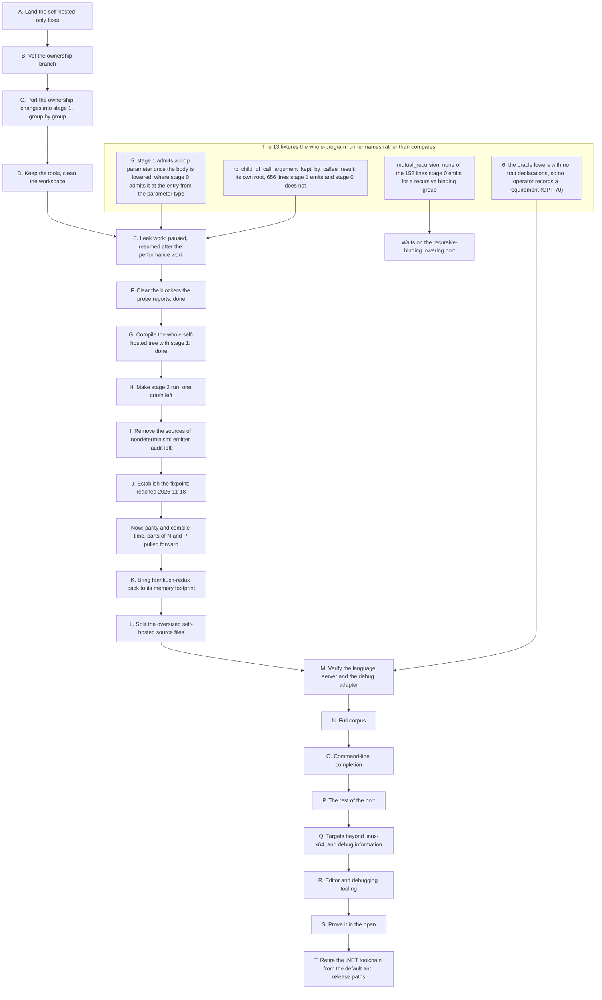

# Self-Hosting: Building the Ashes Compiler in Ashes

The plan for the self-hosted toolchain migration: where it stands, what to do next and in what
order, and the inventory of every item that remains. Completed work lives in the
[self-hosting log](SELF_HOSTING_LOG.md), which also holds the capability audit of what the
language, compiler and standard library had to provide before a compiler could be written in Ashes.

See [FUTURE_FEATURES.md](FUTURE_FEATURES.md) for how self-hosting fits the broader roadmap, and the
[self-hosted toolchain README](https://github.com/MattiasHognas/Ashes/blob/main/selfhost/README.md)
for package boundaries and commands.

## Known gaps deferred on the way to the fixpoint

Recorded while working through steps F to J (2026-11-14), reviewed on **2026-11-18** after the
fixpoint. None of these blocks the bootstrap. Each is picked up by the step "Start here" assigns it
to; keep this list updated when an item is promoted or resolved.

| Area | Known limitation and evidence | Deferred work / return condition |
| --- | --- | --- |
| Ordinary generic `Not` evidence | Ordinary custom-type and mixed Boolean/custom-type `Not` bindings lower at Core level through per-call dictionary evidence. The expression-only lowering entry points carry no replay and no standard trait module, so a constrained binding called there at a built-in type is rejected (`UnknownLoweringBinding` for the module's method), as is an alias call of a constrained binding in a program lowered without the module. [Cases and current limits](https://github.com/MattiasHognas/Ashes/blob/main/selfhost/tests/logical-not-inference/README.md). | Core lowering results do not establish native stage-1 runtime or lifetime acceptance of generic `Not` calls; that validation remains pending. |
| Custom capability context in constrained-call queries | Core capability declarations and operation schemes are not projected into the constrained-call inference environment. An argument that invokes a user capability may therefore fail re-inference even when ordinary Core lowering supports it. [Small retained probe](https://github.com/MattiasHognas/Ashes/blob/main/selfhost/tests/constrained-bindings/deferred/CapabilityArgument.ash); no bootstrap dependency has been demonstrated. | Project the declared operation/provider context and validate effect/evidence handling when required. This remains deferred and is not included in the constructor/alias/external/record-field query fixes. |
| Generic arithmetic and bitwise dictionaries | Ordinary generic operator dispatch for `Add`, `Subtract`, `Multiply`, `Divide`, `Modulo`, and bitwise traits is not implemented by the current constrained-binding path. That path admits only `Eq`, `Ord`, and `Not`; other constraints retain the existing primitive/deferred operator lowering and its type-mismatch or unsupported/missing-evidence diagnostics. Concrete primitive arithmetic support does not establish generic dictionary dispatch. | Add operator-to-dictionary lowering, physical evidence forwarding, and ownership checks for these traits when required. Preserve existing diagnostics; do not claim this broader parity from the Eq/Ord/Not bootstrap fix. |
| Derived trait execution (TRT-14 / TRT-15) | Declaration expansion and evidence planning do not establish complete physical dictionary/method lowering. The existing milestone records rejection of equality on a list of a derived record in `tests/reuse_specialization_declines_unreachable_helper.ash`; this case has not been revalidated in the current bootstrap round. | Remaining runtime evidence and method lowering beyond what the compiler build requires. Reproduce the recorded case before claiming it still fails or is fixed. |
| Stage-1 poison instrumentation | The self-hosted backend now emits a cached RC payload fill when the compiler reads `ASHES_RC_POISON=1`. Earlier stage-1-produced program checks were plain. | Verify the generated LLVM fill, run the backend ownership programs with the switch off and on during child codegen, and record the current-source results before claiming a poisoned stage-1 pass. |
| Stage-1 parity bugs found after the fixpoint (2026-11-18) | (1) Project planning resolves the entry module by name (`loadReachableModules` → `loadNamedModule` in `ProjectCompilationPlanning.ash`), so a project whose source roots hold another `Main.ash` fails with `ProjectCompilationAmbiguousModule("Main")`; stage 0 loads the entry by path (`selfhost/tests/inference-environment`, `inference-fields`, `recursive-trait-evidence`). (2) Lowering rejects `apply(given (x) -> print(x))(3)`, which stage 0 accepts. (3) One type mismatch is reported at the wrong line. (4) A parse error in the entry file prints structurally (`ShippedParseError(...)`). Reproducers under the `infer-edges` worktree's `work/q/` (`pr5.ash`, `u1.ash`). | Fix in stage 1 with a regression test each; item 2 of "Start here". |
| Type-checking gaps found after the fixpoint (2026-11-18) | (5) A user trait requirement used only under an unused inner `let` (`let _ = Named.label(x) in 1`) is dropped from the enclosing scheme. (6) Stage 0 accepts a trait method whose signature mentions no trait parameter, which section 21.2 of the language reference rejects. (7) Stage 0 accepts constructors and types of modules a file does not import, against the reference's import rule (the self-hosted suites relied on it and now import what they name). (8) The standalone inference reports an unknown field type as an arity mismatch on the record that holds the field. (9) Closed. [Language reference §4.3](../reference/language.md#_4-3-record-types) defines field access on record bindings. Both compilers treat `state.typeSupply.nextId` as a qualified name and reject the unknown module `state.typeSupply`. The regression `tests/field_read_through_record_field_rejected.ash` covers this diagnostic. Bind the intermediate record to a name to read its field. | Decided 2026-11-18 by the user: (6) stage 0 rejects such a method with a proper diagnostic, as the reference and stage 1 do; (7) stage 0 becomes strict, as the reference and stage 1 are, after a check of `lib/`, `examples/` and `tests/` for files that rely on the leniency; (5) the inference passes a requirement on a variable the inner `let` does not generalize on to the enclosing binding (standard HM), before step 8, because steps 7 and 8 read schemes from the table. Done 2026-11-18: (5) in the inference, for `let` and `let recursive` (stage 0 already passed such a requirement on and rejects a call at a type without an implementation with ASH036); (6) in stage 0 as ASH010 at the trait declaration, with stage 1's error worded the same; no trait in `lib/`, `examples/`, `tests/` or `selfhost/` declared such a method. (7) decided further: shipped `Ashes.*` modules follow the rule too, and trait names in `deriving`, `requires` and `implement` stay visible without an import; done in both stages as ASH048 (stage 1 was as lenient as stage 0 for an exported type or constructor, so its reference rewriter marks such a name); the tests that relied on it import what they name. |
| Test debt left after the suite pass (2026-11-18) | Ten `LinuxBackendCoverageTests` (memory-plateau and reuse tests) fail on `main` as well; they belong to the leak work. `selfhost/tests/heap-drop-worklist` compares against `heapCanDropValueGraph`, removed in 88aec017; the fix (freeze the old helpers in `Reference.ash.inc`, point the assertions at `classifyHeapOwnedChildrenDroppable`) is designed and not done. 30 of 95 `ir-program-parity` fixtures differ from stage 0. `namespace_old_module_fails` fails under stage 0 itself. Not ported to the inference: the "Expected shape: Some(T)." suffix and the "in if branches" / "in match arm" contexts. | Decide each parity fixture from the suite run's results; step 9 retires the fixtures. |
| Remaining step-E leaks and ownership gaps | The Round11 handoff retains the `32_3`, `32_28` / `32_29`, `40_9`, `32_ptr`, and `fn.tpl` investigations, other small reproducers, selector-alias reach, and the shared walker gap where `EnumerateChildren` does not descend `Call.Func`. These are historical open items, not a fresh census of the current compiler. | Resume E as item 5 of "Start here", with a clean committed-tree census and fresh reproductions. Promote any item that blocks the bootstrap or any newly introduced leak immediately; fix crashes before leaks, prefer Perceus RC, and require the stage-1 mirror where applicable. |

The removed Round11 handoff is preserved locally, with a SHA256 manifest, under the main
checkout's `.claude/step-f-archive/round2-20261112/artifacts/selfhost-dev/handoff-step-e/`.
It is intentionally not restored under tracked `artifacts/`. The historical list and measurements
remain available there; the current tracked pending-goal reproducer is linked above.

### Open work recorded at bootstrap36 (2026-11-14)

Written when stage 1 still failed early in its replay pass on its own sources. That stop was
resolved on the way to the fixpoint, so nothing here blocks the bootstrap any more. The other
entries have not been re-checked since and are triaged into the steps under "Start here" as they
come up. Reproducers named below live in the worktree that found them, under its ignored `work/`
directory; copy one into `tests/` when its fix lands.

Resolved since (kept for the record):

- **Replay-pass evidence failure.** `MissingCoreTraitEvidence("Eq", variable)` raised from
  `lowerConstrainedDictionaryMethods` through `lowerConstrainedCallWithName`, about 7,750 top-level
  item steps into the replay pass, in or near `ModuleReferenceRewriting.rewriteTypeName`. A
  single-file copy of that function compiles, so the failure needs the stitched project. Known
  candidates: a deferred constrained call does not lower its arguments in the discovery pass, so a
  goal nested in them is first seen on replay; and trait goal keys are a span plus trait and
  method, which two modules can share.

Lowering performance, not yet done:

- The replay pass lowers the whole program a second time.
- A recursive body with a call result that resolves late is lowered again; a local recursive
  function inside a top-level function can be lowered up to four times.
- Per tail self call, the owned-slot judgement is still quadratic in function size, and the
  per-predecessor part types and blockers are not memoized.
- Lifetime placement indexes its block list with `listAt` from the liveness, dominator and
  reachability code; `placeOwner` walks the instruction list several times per owner.
- Every plan of a top-level binding builds and frees a list entry per binding in scope.
- Type-graph classification is at least 18% of the discovery pass, structural droppers 8%, the
  ownership and tail-call analysis modules 6%.
- The substitution is an association list; `resolvedBindingSchemes` under
  `phantomResultVariables` resolves open bindings twice per function result.
- `matchingFunctionLines` in the IR text printer is superlinear; only `--emit-ir` uses it.

Lifetime, stage 0:

- The dictionary-passing path of a constrained call leaks one owned key per loop iteration
  (`step-f-stage0-dictionary-path-leak/work/repro/b3.ash`). Releasing the predecessor would free a
  key the generic callee's arena result still holds, so the fix needs a dictionary call's result
  to own its parts. Needs an ownership-contract decision.
- A value-less association variant leaks two cells per case
  (`step-f-stage0-dictionary-path-leak/work/repro/c1.ash`).
- The module stitcher compiled by stage 0 ends with about six live cells per definition.
- Heap free-list corruption when a list taken from an element of a borrowed association-list
  parameter is returned inside `Some` and also shared at insertion
  (`step-f-backedge-scan/work/fix2/driver` on `tests/as_pattern_element_returned_from_consumed_list.ash`).

Lifetime, stage 1:

- Three cells per case on the association programs `m14`, `m15`, `m17` and `b3`
  (`step-f-stage0-dictionary-path-leak/work/repro/`).
- `tests/loop_result_record_around_whole_parameter_releases_duplicate.ash` and
  `tests/loop_result_record_consed_parameter_part_releases_duplicate.ash` end with 71 live cells
  against stage 0's 1.
- The withdrawn-part-duplicate rule is applied at the loop-result site only; stage 0 applies it at
  the back-edge and scrutinee sites too.
- A transfer retain is still marked newly produced; only the two rules that released it twice
  were changed.

Correctness, stage 0:

- A dictionary application with a function-typed result is copied to the heap shallowly and
  keeps pointing at dictionaries in the applying frame's arena. A partial or escaping application
  of a constrained function crashes (`step-f-stage0-alias-evidence2/work/fx/v1.ash`), and an alias
  of one leaks two cells per call. Options recorded by the investigation: concrete-instance
  dictionaries as program-lifetime constants for the crash, and the alias wrapper returning its
  stage borrowed in the caller's window for the leak. Needs an ownership-contract decision.
- A reference with no matching active dictionary falls through to the raw function without a
  diagnostic.
- A tuple holding an alias of an unresolved constrained function is accepted and emits a
  dictionary-taking closure.

Correctness, stage 1:

- A constrained binding whose value is a partial application of another constrained function is
  rejected with missing evidence.
- The entry-frame concrete copy of a constrained loop is declined for an unknown reason.
- Concrete copies resolve other top-level functions by name, so a later rebinding of a helper
  name could be picked up.
- Two comparisons under one span share a trait goal key; for `Ord` and `Not` the last record wins.

Parity and tests:

- Stage 0's lowering changed in #1154 (a uniqueness fast path on a matched field, a dropped
  call-argument retain, and changes around reuse) without the stage-1 port. Six lowered-IR parity
  fixtures and `TakenOverRecordLoweringTests` stay red until it is ported or the fixtures are
  retired under the type-inference plan below.
- Fifteen C# unit tests fail on `main`, and the census test
  `NullaryPatternTestsDoNotKeepLookupResultsAlive` fails without any change.
- The full selfhost suites, the end-to-end suite and `scripts/verify.sh` have not been run on the
  Step F branch.


An item leaves this list only with a linked fix and relevant stage-1 regression/lifetime evidence,
or with a fresh reproduction proving the recorded defect no longer applies. Full suites and a
compiler census remain required at their agreed milestones; focused checks are not substitutes.

## Type inference before lowering

Decided on **2026-11-14**. Stage 1 lowers and infers types in the same walk, as stage 0 does.
Because lowering meets types it does not know yet, it runs a discovery pass and then replays the
whole program with proven types pinned, runs a speculative inference on every lambda `let` to ask
whether the binding is trait-constrained, lowers a recursive body again when a call's result type
resolves late, and defers operators and dictionaries it cannot decide at the site. These are the
dominant costs of stage 1 compiling itself and the source of most Step F blockers.

The direction is a dedicated inference pass that runs first and produces a typed program, with
lowering reduced to one pass that reads types. Stage 1 no longer has to emit the same IR as stage 0
for this work. The checks that matter are that programs compiled by stage 1 behave the same as when
compiled by stage 0 (output and exit live-cell counts), and that stage 2 and stage 3 are identical.

What is known about the starting point:

- `ProgramInference.ash` and `TypeInference.ash` cover every expression and pattern form. The
  compile command runs them only when `ASHES_SHADOW_INFERENCE` is set, and discards the result.
  They return binding schemes, one substitution and the trailing type; no type is kept per
  expression. An error names its package, module, declaration and innermost located expression.
- The standalone inference infers 959 of the 1,048 test programs that should compile and the
  compiler itself: 8,648 declarations in 147 modules in about 60 s with a 0.6 GiB peak. Capability
  rows and programs stage 1 cannot stitch account for most of the remaining test programs.
- Syntax nodes have no stable identity. Spans collide across stitched modules and synthesized nodes
  have none.
- Lowering decides about 30 things on whether a type is still open at a site, mirroring the order
  in which stage 0 discovers types. Final types alone do not reproduce those decisions.
- The two inferences disagree on operators: the standalone one gives `a + b` and `a == b` a trait
  constraint and generalizes; lowering holds the operand monomorphic, emits the integer form and
  seals it to `Int` when nothing resolves it.
- Of the roughly 350 type queries in lowering, about 260 classify ownership and heap layout and
  need a type for nearly every lowered value; about 55 choose an instruction or build trait
  evidence.

Order of work. Each step lands separately and is useful if the later ones are delayed.

1. **Skip the constrained-binding plan when the binding cannot be constrained.** A syntactic check
   answers "not constrained" when the value contains no operator that maps to a trait, no reference
   to a name whose scheme carries constraints, and no written `requires`. The generated code does
   not change.
2. **Make the standalone inference run on real programs.** Fix the standard-library type mismatch
   it reports, give its errors locations, replace the association-list substitution and the linear
   binding lookup, and run it from the compile command with its result discarded. The deliverable
   is that it infers every test program and the compiler itself, and how long that takes.
3. **Build the behavioural check.** Compile the test programs with stage 1 and with stage 0, run
   both, and compare output and exit live-cell counts. This replaces lowered-IR comparison with
   stage 0 as the acceptance check for the steps below.
4. **Make the standalone inference complete over the language.** Lowering does not read from it
   until this holds. It is complete when:
   - every test program that stage 0 compiles type-checks, and the standard library and the
     compiler itself type-check;
   - every test program stage 0 rejects for a type, trait or capability reason is rejected, with
     a located error;
   - the known gaps are closed: `async` and the `Ashes.Task` builtins, capability rows and the
     capability checks (closed rows, unhandled and ambiguous operations, `provide`), checking a
     concrete trait constraint against the available implementations, the `Ordering` constructors
     under their bare names, derived-trait fields, and the remaining single failures listed by the
     inference sweep;
   - the stitching limits that keep programs from reaching it are closed: the shipped
     `Ashes.Task` module, the `Ashes.Task.Parallel` self-import, `MapTree`, and selector imports of
     intrinsic members such as `Ashes.Text.fromInt`.
   Checks that belong to lowering stay there and are not part of this gate: resource and ownership
   diagnostics.
5. **Compare the two inferences.** With step 4 in place, report where the standalone result and
   lowering's own inference disagree per top-level binding. Operators and capability rows are the
   known differences. Each disagreement is settled against the language reference.

   Done for top-level schemes and binary operator sites over the 927 test programs both sides
   accept. Lowering records what it concluded only when asked (`lowerCoreProgramObservingTypes`);
   bindings are compared by stitched name and operator sites by span and trait. Measured:
   - Capability rows: lowering's schemes carry none (10,769 bindings differ only there). Lowering
     decides capability handling syntactically and from the declared operation schemes, never
     from a row.
   - Operators: of 17,971 sites, 17,750 agree. 148 are a generic body lowering lowers at several
     instances; 68 sites and 39 schemes are an operator the inference generalizes with its trait
     requirement where lowering holds it monomorphic and settles it to `Int`, as section 21.6 of
     the reference does not; 64 are operator nodes lowering synthesizes and the table has no node
     for.
   - Lowering is less precise in three places: `Ashes.Collection.Map.foldLeft` and
     `HashMap.foldLeft` lose the link between the folder's accumulator and the result, a handler
     arm's parameters and `resume` result stay untyped, and a few bindings stay monomorphic
     because a deferred operator holds their variable back.
   - `panic` wrappers are `Str -> a` in the inference and `Str -> Never` in lowering; both conform
     to the reference.
   - Fixed in the inference: `Ashes.Text.fromInt` and `toHex` arguments are no longer generalized
     over (stage 0 and the reference type them `Int -> Str`), and `Ashes.Trait` is inferred first,
     so programs with inline modules no longer keep settled requirements.
6. **Give syntax nodes an identity and record types against it.** Assign identities after
   stitching, including synthesized nodes, and have the inference pass fill a table: a type per
   expression, the resolved instance per operator, the instantiation and dictionaries per call,
   the scheme per binding. A body lowered at several types reads the table through its
   instantiation.

   This is in place. `NodeIdentity.ash` wraps every expression node of the stitched,
   deriving-expanded units in `ExprNode(id, node)`, numbered in pre-order; only the standalone
   inference receives the numbered tree. `ProgramInferenceResult.nodeTypes` is a `NodeTypeTable`
   of four maps keyed by node id: `types`, `operators` (trait and operand type),
   `instantiations` (arguments, requirements, dictionaries) and `bindings` (schemes at `let`,
   lambda and arm-body nodes). A generic body keeps its binding's quantified variables; a body
   lowered at a concrete type applies the instantiation's arguments to the stored type. Over the
   whole compiler every one of 398,599 nodes has exactly one recorded type.
7. **Lower from the table.** Lowering reads types instead of unifying. Remove the discovery and
   replay passes, pending and proven trait goals, deferred operators and dictionaries, the
   per-binding plan, and body re-lowering.

   State on **2026-11-24** (`selfhost/round11` at `5c8434ec`), when the compile command lowered from
   the table only with `ASHES_TYPED_LOWERING=1` (`lowerCoreNumberedProgram*`: the numbered,
   deriving-expanded program and the table). Measured with the
   typed-lowering driver (`selfhost/tests/typed-lowering-measurement`, which also takes a single file;
   `sweep.sh` runs it over the corpus):
   - Test corpus, 1,148 programs with the table: 0 replays, 0 pending trait goals, 0 structural
     equality goals, 0 deferred operators; the 6 `*_fails` diagnostics fixtures are rejected by the
     inference by design. The default lowering on the same corpus: 26 replays, 50 pending goals,
     6 equality goals, 123 deferred operators.
   - Whole compiler: one lowering traversal, no replay.
   - Flag-on behaviour check against stage 0: no row worse than the flag-off run (1,066 same and
     187 leak-only against 1,065 and 188), zero non-leak rows.
   - A stage 2 built by stage 1 with the flag on: 13:08 at 14.1 GiB, against 16:20 at 16.2 GiB on
     the default path; it matches stage 0 on every non-leak behaviour row. It is not byte-identical
     to the default-path stage 2, as expected.

   What lowering now reads from the table, each only with a node table:
   - Operator and trait-method operands, dictionaries and `Default` results through their recorded
     types, closed by the enclosing instantiation and by the variables the program's uses settle;
     a variable settles transitively, through the settled variables it is instantiated at.
   - A partly open equality (`xs == []`) answered by the recorded type or, in a constrained body,
     by that body's dictionary for the whole operand type.
   - A call's requirement reduced through the implementations as the inference reduces it
     (`Eq(List(a))` to `Eq(a)`) to match the recorded dictionaries; a requirement whose whole type
     the body carries answered by the body's own dictionary.
   - A requirement the inference records at a variable no use settles, which by the evidence rule
     the enclosing function supplies: bound to the type of the body's single dictionary of that
     trait. A bare reference to a constrained binding reads the instantiation at its own node.
   - Synthesized identities (`NodeIdentity.ash`): a node lowering creates after numbering carries a
     negative identity derived from its source node and a role (the prefix and resume references of
     the strict partial-stage scheduling so far), with no counter; readers map it back to the source
     node and bind only what matches the call's own requirements.
   - Arithmetic-generic bindings used at more than one type (`twice x = [x + x, x]` at Int and
     Float), top-level, recursive or a `let` below top level: planned as a constrained binding with
     the operator's dictionary, as stage 0 and reference 21.6 do, instead of a body sealed to the
     integer form. Top-level ones keep their per-concrete-call copies; nested ones pass the
     dictionary. An arithmetic operator whose one operand the body's evidence covers and whose
     other is a bare variable (a recursive self call's result) joins the two and dispatches through
     the evidence, as stage 0's `RecordMappedBinaryTrait` does; this rule is on the default path
     too, where it fixed a stage-0 parity bug (a recursive binding with a written `requires
     {Add(a)}`, `tests/written_arithmetic_requirement_on_recursive_binding.ash`).

   Removed: binding a lambda parameter to its recorded type before the body, when no expected type
   exists. It closed the parameters of generic library bodies used at one type and of closed user
   lambdas, which switched on entry-time decisions keyed on a parameter type known at entry
   (`normalizesAlwaysReturnedParameter`, the arena result boundary) that the default path and
   stage 0 do not take for those shapes, and those paths leaked in eleven programs. Its premise
   (linking a constrained body's operand to its dictionary) was wrong: a lambda with an expected
   type already binds its parameter first. Replacing those entry decisions with rules over the
   final type is step 8 work.

   **Switched, 2026-11-25.** Lowering from the table was
   made the default of `compile` and `run`
   (the only commands of the stage-1 CLI that lower) at `329ae3d2`, with `ASHES_TYPED_LOWERING=0`
   kept for one round as the comparison. That round (`0e72ed89`): behaviour with the default 1,065
   same, 188 leak-only, no non-leak row; stage 2 built by the typed stage 1 in 14:40 at 10.5 GiB
   resident peak (16:20 at 16.2 GiB on the old path); stage 3 in 13:08, byte-identical to stage 2;
   semantics 96/96. The preconditions that held at the switch:
   1. A flag-on bootstrap at `5c8434ec`: stage 2 (13:08, 14.1 GiB) and stage 3 (11:30) built with
      the flag, stage 3 byte-identical to stage 2.
   2. The flag-on behaviour check no worse than flag-off on any row, and the typed sweep at zero
      replays, goals and deferred operators.
   3. Readers that can run at a node lowering synthesized: an expression built by
      `lowerSynthesized` is lowered with no current node, so nothing is read for it. Otherwise:
      the operator readers (`recordedSiteOperator`, under `recordedOperandType`,
      `recordedSettledOperandType`, `pinRecordedOperands`) read only a record whose trait is the
      site's own (`recordedTraitMatches`; `0 - x` is recorded as `Negate`); the dictionary readers
      (`recordedDictionariesAt`, `recordedSettledDictionariesAt`, through `instantiationSourceNode`)
      bind a recorded type only to a requirement of the same trait and only when it unifies; the
      readers by an expression's own wrapper (`recordedClosedTypeAt`, `recordedSettledTypeAt`, the
      resume call, trait-method operands and results) read only that expression's record and bind
      it by unification, falling back to lowering's own inference otherwise; the call result reader
      (`recordedClosedNodeType`) retries without the expected type when lowering against it fails;
      the scheme readers check the binding name and value type (`recordedSchemeForValue`) or read
      the declaration at the value's own node.

   Then removed: the stitched-program lowering of the compile command, with `ASHES_TYPED_LOWERING`
   and `ASHES_SKIP_INFERENCE_CHECK` (`e0df21b6`); the measurement driver's legacy mode (`ae13c17e`);
   the replay under typed lowering, where a goal left is now refused at its site (`70e0151b`); and
   the compile command's last raw lowering, the wording of a program the inference rejects
   (`a0ecd410`), which now comes from the inference alone (below).

   **Exit condition, decided 2026-11-25: the shipped compiler reaches only the typed lowering, with
   no switch and no fallback.** The raw (un-numbered) lowering stays as a test-only path until
   step 9: the 258 lowered-IR parity fixtures against stage 0 (`selfhost/parity/semantics/lowered-ir`,
   driven by `LoweredIrFixtures`, `ir-program-parity`, `semantics-diagnostic-parity` and the backend
   raw fixtures) need it, because typed IR differs from stage 0's by design, and the program-level
   and expression-level selfhost tests are not migrated now. Its discovery and replay passes,
   pending and proven goals, deferred operators and per-binding plan are deleted with it in step 9.
   Under typed lowering the per-binding plan and the speculative operator form still run: the
   former decides which bindings are constrained bodies (with the table rules above), the latter is
   reached only where the table has no answer, which the corpus and the compiler no longer hit;
   both are step 8.

   The test-only status is structural for the entry points. The raw entry points live in their own
   module, `CoreLowering.Raw`, and the measured lowering in `CoreLowering.Measurement`; `CoreLowering`
   exports only the numbered entry points (`lowerCoreNumberedProgram*`,
   `lowerNumberedProgramWithRegionsAndReuse`, `lowerNumberedProgramWithSourceAndReuse`) and
   `withSourceRegions`. The compile command imports `CoreLowering` and neither of the other two, and
   the semantics package root (`Package.ash`) imports only `CoreLowering`, so the command line's
   module closure contains no raw entry point: calling one needs an import of `CoreLowering.Raw`,
   which no module under `selfhost/packages` has (only test projects import it). What
   stays by convention: the machinery the raw entry points reach is shared with the typed path in
   the same modules (`lowerProgramPasses` takes the discovery and replay branch when the state has
   no node table, and the deferred-operator, goal and plan code sits beside the typed readers in
   `CoreLowering.Program`, `.Operators`, `.Expressions` and `.RecordedTypes`), so it is linked into
   the compiler but unreachable from its entry points; splitting it out is the step 9 deletion.

   Rejected-program wording (`a0ecd410`). The inference now carries the site stage 0 words a bare
   unification error after: `+` over two operand types raises `AddOperandMismatch`, worded as stage
   0's operator diagnostic; a recursive binding's parameter annotations seed its type before the
   body (`seedRecursiveBinding`), so a self call is checked at the call; an occurs check at a call
   whose callee is still a variable is a call argument mismatch; and a call diagnostic names a
   renamed callee by its source name. `inferenceErrorWantsCallSiteWording` and the lowering
   fallback are gone. Checked with a stage-0-built driver that infers each of the 131
   `expect-compile-error` tests and prints the inference's text: 106 contain their expected
   message, 13 are not rejected by the inference (lowering's own checks), 11 fail at stitching, and
   one differs only because the driver does not substitute `__TCP_PORT__`. Against the command line
   before the change (which asked lowering for six of them), the printed line changes for one test:
   `polymorphism_rec_poly_rejected` is reported at the binding (`3:5 Occurs check failed (recursive
   type).`) where stage 0 reports the self call (`3:18 ... Context: in argument #1 of call to
   'f'.`), because an unannotated recursive lambda's parameter is still its own variable when the
   body's self call is checked; seeding it would change the inference of every recursive lambda,
   so it is left with step 8's measurement. The other five (`float_mixed_operands_is_error`,
   `recursive_self_call_annotated_parameter_mismatch`, `polymorphism_occurs_check_rejects_self_apply`,
   `annotated_binding_mismatch_names_written_type_first`,
   `recursive_awaiting_helper_rejects_wrong_declared_result`) print what stage 0 prints, and no
   message moved for the rest. Of the diagnostics parity backlog none changes: its open rows are
   stage 0's follow-on diagnostics (`float_mixed_operands_is_error` among them: stage 0 prints a
   bare mismatch line first and then the operator line, which stage 1 printed before and prints
   now), stage-0 defects and missing spans, none of which went through the lowering fallback.

   Re-lowering is not driven by calls to settled callees. It is driven by self and sibling calls of
   a recursive group whose result lowering keeps open on purpose, because stage 0 sees it open at
   that point, and by values whose copy waits on a type. Taking those results from the table
   changed ownership placement in 21 swept programs, so those decisions belong to step 8. The
   order-dependent rules met in this work, each deciding on whether a type is still open at the site:
   - `selfResultDeferred`: a self call whose callee is listed as deferring its result asks for an
     arena result and records no unresolved call result.
   - `siblingResultOpen`: a call to a group member whose arrow was open when the body began asks for
     an arena result, also when the body is lowered again.
   - `siblingResultPinned`: such a call whose result the group's first lowering settled uses that
     result at the site and keeps the arena request.
   - `deferredSelfResultNamedByConsumer`: a deferred self call whose consumer names a resolved type
     does not ask for an arena result.
   - `keepFirstSelfResultDeferral`: a body lowered again keeps the self calls its first lowering
     deferred.
   - `requestsArenaResult` and `containsUnresolvedLayout`: a call whose result layout is still open
     asks for an arena result and joins the body's unresolved call results.
   - `calleeResultUnsettled` (in `requestsArenaResultFromUnknownCallee`): a callee whose body has not
     been lowered yet is asked for an arena result.
   - `lowerFunctionBodyResolvingCalls`, `lowerRecursiveBodyResolvingCalls` and
     `anyCallResultResolved`: a body whose unresolved call results resolved is lowered again.
   - `bodyEncounteredRequirementClosedScope`: a body applying a mapped operator whose scope types it
     closed is lowered again against the closed scope.
   - `lowerInternalDeepCopy`: a copy of a value whose type is still a variable passes through and
     asks for the body to be lowered again.
   - `emitDeferredCoreAdd` and `emitDeferredCoreEquality`: `+`, `==` and `!=` over two open operands
     emit the integer form, recorded for rewriting once the type is final.
   - `unprovenTraitGoalKey`, `openDictionaryGoalKey`, `pinProvenTraitGoal` and
     `pinProvenEqualityGoal`: a trait goal or dictionary whose operand is open is deferred to the
     replay pass, which pins what the first pass proved.
   - `activeEvidenceCoversOperator` and `traitPlanLacksActiveEvidence`: an open operand dispatches
     through a generic body's own evidence only when that body carries it.
   - `normalizesAlwaysReturnedParameter` (entry argument normalization) and the arena result
     boundary of a function whose parameter reaches its result: taken only when the parameter's
     type is known at entry, which with the table it can be for every closed parameter; binding
     parameters from the table before the body switched them on in eleven programs that then
     leaked, so the rule over the final type needs its release with it.

   What the table gives lowering, re-checked against the code on **2026-11-23**:
   - Partly in place: the prefix and resume references of the strict partial-stage scheduling carry
     synthesized identities (above). Other nodes lowering synthesizes (evidence rewrites, `$partial`
     captures, constrained-value wrappers, specialized copies) still keep the identity of the
     nearest numbered node around them, so a read at such a site sees the enclosing node's record;
     they can take a synthesized identity with their own role.
   - Recorded, read in part: handler operation arm parameters and `resume` are bound at the arm
     body; lowering reads the type recorded for a `resume` call, not the arm parameters.
   - Recorded and read: top-level schemes by the root node of their value (`declarations`), read
     for operator-generic declarations; bindings at `let`, lambda and arm nodes, read for nested
     operator-generic lets.
   - Recorded, not read: record construction and update instantiations; how each operator's
     instance is reached (primitive, declared implementation, dictionary).
   - Schemes and unconstrained variables, decided on **2026-11-18** by the user. A binding's
     requirements are reduced through the implementations as stage 0 reduces them: one an
     implementation supplies leaves nothing (`Multiply(Int)`), one an implementation head matches
     leaves that implementation's requirements (`Eq(List(a))` becomes `Eq(a)`). A written requirement
     on known types or one a head matches is rejected as unjustified (`ASH010`), in the standalone
     inference and in stage 0, which used to fail on both with an internal ABI error. A variable
     nothing constrains stays open in the table and lowering treats it as any type, never as `Int`;
     a requirement still open in the trailing expression, where no binding quantifies its variable,
     is ambiguous (`ASH010`, reference 21.6), with no numeric default for operators. Stage 0 already
     rejected that shape; the standalone inference now does too, with stage 0's wording for both
     ambiguity forms. Lowering's own `Int` sealing of a deferred operator is unchanged where the
     inference does not reject first. Lowering still asks for unreduced requirements of its own
     schemes; under typed lowering a call reduces them the same way to match the recorded
     dictionaries.
   - `tests/trait_deriving.ash` is numbered and every derived expression has a recorded type
     (`checkDerivedTree`).
8. **Replace the order-dependent rules.** Rewrite the decisions keyed on a type being open at a
   site as rules over the final type, each with a lifetime regression.

   **Scope, decided by the user on 2026-11-25.** This pull request (closing after round 8) takes
   entries 1, 2, 3 and 5 below: `d0a78675` (1, an operator over open operands refused under typed
   lowering), `80dc9a77` (2, an open goal or dictionary refused at its site; no proof pins),
   `1f46e580` (3, evidence dispatch from the recorded operator instance) and `4176b44c` (5, a deep
   copy of an open-typed value made at its recorded type). Entries 4 and 6 to 11 follow the leak
   pull request: they change the same ownership decisions (arena-result requests, re-lowering,
   entry normalization) the leak fixes change, so they are taken up after it, in the order planned
   below: 8 and 9, then 6 and 7 with 10, then 11, and 4 after 11 (4 closes scope types at entry,
   which is the lambda-parameter read that switched rule 11 on). The shadow-count measurement stays
   in the driver (`ea730801`, `864d0ad3`; `--shadow-details`, `--ir-hash`) as the tool for that work.

   Shadow counts at `ea730801` for the deferred entries (agree / differ / unrecorded; on the corpus
   also the number of programs with a differing site). A site is counted in the lowering each pass
   keeps. The unrecorded column is large for 6, 8 and 11 and is not yet broken down (the reasons
   came with `864d0ad3`), so the differ counts are a lower bound, not exact:

   | Entry | Corpus, 1,149 programs | Whole compiler |
   | --- | --- | --- |
   | 4 | 0 / 8,644 / 0, 801 programs | 0 / 2,287 / 0 |
   | 6 | 8 / 461 / 2,469, 210 programs | 214 / 1,039 / 31 |
   | 7 | 0 / 71 / 3, 37 programs | 0 / 1,833 / 50 |
   | 8 | 27,418 / 546 / 4,865, 203 programs | 44,203 / 146 / 153 |
   | 9 | 36 / 231 / 0, 228 programs | 109 / 22 / 0 |
   | 10 | 0 / 493 / 0, 243 programs | 0 / 370 / 0 |
   | 11 | 31,738 / 6 / 9,370, 5 programs | 26,895 / 8 / 2,542 |

   The entries taken here measured: 1 and 2 zero sites on both; 3 254 / 0 / 83 on the corpus and
   58 / 0 / 8 on the compiler (no differing site: the recorded instance agrees wherever an
   operator is recorded; the unrecorded sites are trait-method calls, which the table records no
   operator for); 5 23 / 0 / 27 on the corpus and 244 / 14 / 0 on the compiler (the compiler's 14,
   below, are what `4176b44c` changes in the compiler's own IR).

   The corpus sweep with the driver at `35b883ee` (all four entries switched) gives the same
   `ir_hash` as the driver at `ea730801` for all 1,149 programs, with the same shadow totals: rules
   1, 2, 3 and 5 leave the corpus's lowered IR unchanged, and rule 5 moves only the compiler's 12
   sites below. (The hash first depended on where a sweep copied the sources, since the IR names
   the entry file; the driver now hashes with the entry path replaced by its base name.)

   Re-lowering cost. The typed lowering of the compiler is one pass of 224 s (inference 80.8 s)
   with 2,657 body re-lowerings, the sum of entries 4 and 10. The driver counts re-lowerings but
   has no timer inside lowering: reading the clock there puts the `TimeRead` capability on every
   lowering function's row, which the inference rejects. So the driver gained `--single-lowering`
   (this batch), which keeps the first lowering of every body that asks to be lowered again; its
   `first_ms` on the compiler against the ordinary run's is the time re-lowering costs, an upper
   bound on what a single lowering from final types (entries 4, 10 and 11 together) saves. The
   number comes from the next driver build; until then the share is unmeasured.

   Entry 5 in the compiler. The 14 differing sites (driver at `ea730801` with `--goal-details
   --shadow-details` on the CLI project; the site's file is right only with the module regions,
   which the driver now always passes under `--shadow-details`) are 12 deep copies passed through
   with their type open where the table records `Str`, and two copies made at a partly open type
   (`List(a)` in `ProjectSourceEnumeration`, `Json(a, b, c, d)` in `ProjectLockFile`) where the
   table records the closed one. `4176b44c` changes only the 12. Their spans point at small helpers
   with an unannotated parameter (`appendModuleSegment` in `ImportResolution` and `ImportHeader`,
   `appendNamePart` in `ModuleReferenceRewriting`, `copyOptionalText` in `ImportHeader`,
   `prependLockedDependency` and the lock-file string readers in `ProjectLockFile`,
   `uniquePaths` and the path filters in `ProjectSourceEnumeration`, the module loader in
   `ProjectCompilationPlanning`, one in `CoreLowering.Owners`; read from the spans, not from node
   identities), where the copy is lowered before
   the expression that settles the parameter (the other branch's `+`) or the helper stays generic
   and every use passes text. The kept lowering left those copies out, so the compiler handed the
   caller's string over instead of the independent copy the source asks for; binding at the copy
   makes the copy the source writes, at the type every use of the helper has, and costs one string
   copy per call. The two partly open copies keep their current form. The corpus test
   `deep_copy_in_generic_helper_settled_at_one_type` covers both shapes.


   Plan, written 2026-11-25 before any code. Each rule below names (i) what it decides, (ii) the
   rule over the final type that replaces it, (iii) whether stage 0 has the same dependence on
   lowering order, and so whether the replacement changes generated code and what parity is at
   risk, and (iv) the measurement that shows the replacement safe. The rules run under typed
   lowering only; the raw path keeps them until step 9 deletes it.

   The measurement for every rule is a shadow count before the switch: at the rule's site the
   measurement driver (`CoreLowering.Measurement`, `--goal-details`) computes the final-type
   decision from the table beside the current one and reports each site where they differ, with
   its node. Swept over the corpus (`sweep.sh`) and run on the whole compiler, zero differing
   sites means the replacement is IR-identical; otherwise the differing programs are the ones
   whose IR changes, and each is checked with a per-function diff of the lowered IR
   (`--emit-ir lowered`, flag off and on), the behaviour check with `ASHES_RC_LEAKCHECK=1`, and a
   lifetime regression in `tests/` that pins the new placement. Rules that cannot change generated
   code go first; the rules shared with stage 0 last, each in its own commit and probe.

   Unreachable under typed lowering (measured: zero on the 1,148-program corpus and the compiler,
   2026-11-24), so replacing them by a refusal is IR-identical by construction:
   1. `emitDeferredCoreAdd` and `emitDeferredCoreEquality`. (i) `+`, `==` and `!=` over two open
      operands emit the integer form, recorded for rewriting once the type is final. (ii) The
      operand type is the recorded one, closed by the instantiation and the settled variables;
      still open, the site is an error ("no recorded operand type"), never the integer form.
      (iii) Stage 0 has no speculative form: it unifies the operands and resolves the instance at
      the site (`RecordMappedBinaryTrait`), so no stage-0 behaviour is at risk. (iv) The
      `first_deferred_operators` counter is already zero; the shadow count is the same counter.
   2. `unprovenTraitGoalKey`, `openDictionaryGoalKey`, `pinProvenTraitGoal` and
      `pinProvenEqualityGoal`. (i) A trait goal or dictionary whose operand is open is deferred to
      the replay, which pins what the first pass proved. (ii) The dictionary is the recorded one;
      a goal left is refused at its site, which `refuseTypedGoals` (`70e0151b`) already does after
      the pass, moved to the site. (iii) Stage 0 has no replay; it resolves or rejects at the site.
      (iv) `pending_traits` and `equality_goals` are zero; the refusal is never reached.

   Expected IR-identical (to be shown by the shadow count):
   3. `activeEvidenceCoversOperator` and `traitPlanLacksActiveEvidence`. (i) An open operand
      dispatches through a generic body's own evidence only when that body carries it. (ii) The
      table records how each operator's instance is reached (primitive, declared implementation,
      dictionary), so the dispatch reads that record. (iii) Stage 0 decides the same way at the site
      from the evidence in scope (`TryLowerActiveTraitMethod`), on types its own inference has
      settled by then; differences would be sites where stage 0's open type and the recorded
      final type disagree, which the operand join (`activeArithmeticJoin`) already closed for the
      measured cases. (iv) Shadow count of sites where the recorded instance kind differs from the
      dispatch taken; expected zero.
   4. `bodyEncounteredRequirementClosedScope`. (i) A body applying a mapped operator whose scope
      types it closed is lowered again against the closed scope. (ii) The scope types are the
      recorded ones from the start, so the first lowering is the closed one and nothing is lowered
      again. (iii) Stage 1 only (stage 0 lowers once); the second lowering is meant to produce what
      a lowering with closed types produces, so the output should not change. (iv) Re-lowerings
      counted by cause in the driver; shadow comparison of the first lowering under recorded scope
      types against the re-lowered body, expected identical. Found while implementing (2026-11-25):
      the scope types closed are those of the body's own bindings, its parameters among them, so
      taking them from the table at entry is the lambda-parameter read step 7 removed because it
      switched on rule 11's entry normalization in eleven programs that then leaked. Rule 4 is
      therefore not IR-identical on its own and moves to after 11.
   5. `lowerInternalDeepCopy`. (i) A copy of a value whose type is still a variable passes through
      and asks for the body to be lowered again. (ii) The copy reads the value's recorded type and
      emits the copy for it directly. (iii) Stage 0 emits its deep copy on the type it has at the
      site (`InternalDeepCopy`); stage 1's re-lowering exists to reach the same final copy, so the
      output should not change. (iv) As 4.

   Change generated code by design (stage 1's version of stage 0's own order dependence, or
   following from it); each needs the per-program check and a lifetime regression:
   6. `selfResultDeferred`. (i) A self call whose callee is listed as deferring its result asks
      for an arena result and records no unresolved call result. (ii) The self call's result
      layout is the recorded result type of the binding; it asks for an arena result only when
      that final layout does (the rule of 8). (iii) Stage 0 sees the self call's result open because
      a recursive binding is monomorphic until generalized, and takes an arena result; replacing it
      changes IR where the final layout needs no arena (fewer copies, results handed over). Parity
      at risk: lowered-IR fixtures with recursive bindings (retired with step 9) and ownership.
      (iv) Shadow count of self calls whose arena request differs; per-program check.
   7. `siblingResultOpen`, `siblingResultPinned`, `deferredSelfResultNamedByConsumer` and
      `keepFirstSelfResultDeferral` (four rules, one change). (i) A call to a group member whose
      arrow was open when the body began asks for an arena result, also when lowered again; one
      the group's first lowering settled uses that result and keeps the request; a deferred self
      call whose consumer names a resolved type asks for none; a body lowered again keeps the self
      calls its first lowering deferred. (ii) One rule for all four: the call's result layout is the
      member's recorded result type, and the arena request follows that layout. (iii) As 6, for the
      group's sibling calls; stage 0 has the same dependence through its group lowering order.
      Taking these results from the table changed ownership placement in 21 swept programs
      (measured in step 7), so this is the largest IR change of the step. (iv) Shadow count per
      rule, then the 21 programs and whatever else the count names through the per-program check.
   8. `requestsArenaResult` and `containsUnresolvedLayout`. (i) A call whose result layout is still
      open asks for an arena result and joins the body's unresolved call results. (ii) The layout
      is the call's recorded result type closed by its instantiation; a result still open after
      that (a genuinely generic result) keeps the arena request. (iii) Stage 0 has the same rule
      (`RequestsArenaResult`, `ContainsUnresolvedLayoutType`) on its live types, so the
      replacement changes IR where stage 0's type was open at the call and the final one is
      closed. (iv) Shadow count of calls whose request differs; per-program check.
   9. `calleeResultUnsettled` (in `requestsArenaResultFromUnknownCallee`). (i) A callee whose body
      has not been lowered yet is asked for an arena result. (ii) The callee's result fact comes
      from a summary computed over the declarations and their recorded types before any body is
      lowered, not from whether its body was lowered first; whether the existing result-reach
      summaries can carry it, or a new pass is needed, is the first thing to settle. (iii) Stage 0
      has the same rule (`CalleeResultUnsettled`), keyed on body order, not types; replacing it
      changes IR for forward and recursive calls whose callee normalizes its result. (iv) Shadow
      count of calls whose request differs; per-program check; leak check on every changed
      program, since this rule guards an unreleased hand-over.
   10. `lowerFunctionBodyResolvingCalls`, `lowerRecursiveBodyResolvingCalls` and
       `anyCallResultResolved`. (i) A body whose unresolved call results resolved is lowered again.
       (ii) With 6 to 9 reading final types, no call result is unresolved at the end of a body, and
       the body is lowered once. (iii) Stage 1 only; the IR change is the sum of 6 to 9's, nothing
       of its own. (iv) The re-lowering counter reaches zero; done with 7.
   11. `normalizesAlwaysReturnedParameter` (entry argument normalization) and the arena result
       boundary of a function whose parameter reaches its result. (i) Taken only when the
       parameter's type is known at entry. (ii) Taken when the parameter's recorded type needs it,
       with the release of the normalized copy on every exit. (iii) Stage 0 has the same rule
       (`EmitRuntimeManagedTcoArgumentNormalization`) on the type at entry; binding parameters
       from the table before the body switched it on in eleven programs that then leaked (step 7),
       so the release has to come first. (iv) The eleven programs leak-free with the rule on, then
       the shadow count over the corpus; per-program check.

   Order: 1 and 2 (refused under typed lowering, `d0a78675`, `80dc9a77`), 3 (`1f46e580`), 5
   (`4176b44c`), then 8 and 9, 6 and 7 with 10, then 11, and 4 after 11. Measurement: `ea730801`,
   `864d0ad3` (shadow counts and the IR hash; see the driver README).
   The per-binding plan (`constrainedBindingPlan`) is not one of these rules; replacing it
   by the recorded schemes follows 3, because the plan decides which bodies carry the evidence 3
   reads.
9. **Retire the lowered-IR parity fixtures against stage 0.** Stage 0 remains the bootstrap
   compiler; stage 1 stops mirroring its internals.

   Raw-only code, deleted with the fixtures (the test-only path kept by the 2026-11-25 decision):
   - `CoreLowering.Raw` (all of it): `validateRawBindingEvidence`, `lowerValidatedCoreProgram`,
     `lowerCoreProgram`, `lowerValidatedCoreProgramWithSourceAndContext`,
     `lowerCoreProgramWithSourceAndContext`, `lowerProgramWithRegionsAndSchemes`,
     `lowerProgramWithRegionsAndReuse`, `lowerProgramWithSourceAndReuse`,
     `lowerValidatedCoreProgramWithSchemesAndReuse`, `lowerValidatedCoreProgramWithRegionsAndReuse`,
     `lowerCoreProgramWithRegionsAndReuse`, `lowerCoreProgramWithSourceAndReuse`,
     `lowerCoreProgramWithSource`, `lowerValidatedCoreProgramWithEnvironment`,
     `lowerCoreProgramWithEnvironment`, `lowerCoreExpression`, `lowerCoreExpressionWithLayouts`,
     `lowerCoreExpressionWithContext`, `lowerCoreExpressionWithFullContext`,
     `lowerCoreExpressionWithCompleteContext`, `lowerCoreExpressionLocated`,
     `lowerCoreRecursiveGroup`, `CoreObservedTypes`, `observedScheme`, `observedOperator`,
     `observedTypesOf`, `lowerCoreProgramObservingTypes`.
   - `CoreLowering.Measurement`: `measureRawCoreProgramLowering`, the `None` table of
     `measuredSeed` and `measureCoreProgramLoweringObserved`, and the raw branch of
     `measureStitchedLowering`.
   - `CoreLowering.RecordedTypes`: `rawOperatorDeclarationSchemes`,
     `withRawOperatorDeclarationSchemes`, `rawOperatorSchemesWithNestedLets`,
     `rawNestedOperatorGenericScheme`, the `None` branch of `recordedDeferredEvaluation`, and the
     registry's `rawDeclarationSchemes`.
   - `CoreLowering.Program`: the replay (`replayProgramWithProofs`, `replayLambdaOrAlias` and the
     replay dependency graph) and the no-table branch of `lowerScheduledProgramPasses`.
   - What only the raw path reaches once step 8 is done: discovery, pending and proven goals,
     deferred operators, the per-binding plan and body re-lowering; step 8 removes their typed
     uses, after which they are raw-only and go here.
   - Test users to delete or move with them: the four parity harnesses above and the selfhost
     semantics tests that import `CoreLowering.Raw` (about thirty files, listed by that import).
Steps 1 to 5 do not change generated code. Steps 7 and 8 do, in the ownership-sensitive paths, so
step 3 must exist before they start.

Decided on **2026-11-16**: the standalone inference is stage 1's type checker. `compile` and
`run`, file and project forms, infer the stitched program before lowering it; a program it rejects
fails with stage 0's code and message (`InferenceDiagnostics.ash` maps every error the inference
raises), and an accepted program is lowered from the types it recorded (since the 2026-11-25 switch;
before it, only with `ASHES_TYPED_LOWERING=1`). Until `a0ecd410` a bare unification error, which
carried no call, argument or operator site, was worded by lowering's own diagnostic; the inference
now carries the site and words it.
`ASHES_SKIP_INFERENCE_CHECK=1` skipped the check until it was removed with the stitched-program
lowering on 2026-11-25. This gives stage 1 the checks lowering lacks
(capability rows, providers, handlers, written requirements, type alias cycles) and costs about
57 s on the whole compiler and a few milliseconds on a test.

## Start here

**Where things stand (2026-11-18).** The self-hosted compiler bootstraps. Stage 0 (the C# compiler)
builds stage 1, stage 1 builds stage 2, and stage 2 builds a stage 3 that is byte-for-byte identical
to stage 2 (first on bootstrap52, again on bootstrap53: 45,765,488 bytes, stage 3 in 11:12 at a
19 GiB peak). That is step J of the work order. Steps F to J were worked through together on one
branch, merged as #1156; the table says what each still leaves open.

| Step | State | What it still leaves open |
| --- | --- | --- |
| A to D | Landed (#1114 to #1119, `scripts/selfhost-dev/`) | Nothing. |
| E. Leak work | Paused since 2026-11-09 | Resumed last, item 5 below. |
| F. Clear the probe's blockers | Done | Nothing; its record stays below as history. |
| G. Compile the whole tree with stage 1 | Done | Nothing. |
| H. Make stage 2 run | Stage 2 runs and matches stage 0 on every `tests/*.ash` program but one crash (`loop_predecessor_list_parts_kept_by_accumulator`, only with `ASHES_RC_LEAKCHECK=1`) | That crash; building the self-hosted suites with stage 1 instead of stage 0. |
| I. Remove nondeterminism | Stage 3 equals stage 2 on two separate rebuilds | The emitter audit BOOT-12 asks for. |
| J. Fixpoint | Reached 2026-11-18 | The one measurement J asks for afterwards: the four cross-language benchmarks with every escaping allocation on the reference-counted heap. |
| K to T | Not started, apart from what the order below pulls forward | |

Stage 1 against stage 0 on the 1,159 programs under `tests/` (`selfhost/tests/behaviour/check.sh`):
975 behave the same, 150 differ only in how many cells stay live at exit (leaks), and none crash,
print something else or are accepted or rejected differently. Stage 1 type-checks every program
with the standalone inference before lowering it and reports errors with stage 0's codes and
wording.

**The order of work now (decided 2026-11-16, mapped to the work order on 2026-11-18).** The goal
is for stage 1 to replace stage 0, which needs the bootstrap kept clean, parity with stage 0, and a
compiler fast enough to use. Work goes top to bottom; agents may work ahead on a later item when it
cannot change what an earlier item measures (for example typed lowering behind its flag).

1. **Close out H, I and J.** The last stage-2 crash, the self-hosted suites built with stage 1, the
   BOOT-12 emitter audit, and J's reference-counting measurement. Every round rebuilds stage 1,
   stage 2 and stage 3 and checks that stage 3 still equals stage 2.
2. **Keep stage 1 at parity with stage 0 (steps N and P).** Stage 1 behaves as stage 0 on every
   `tests/*.ash` program (accept or reject, diagnostics, output, exit code), measured against
   `selfhost/tests/behaviour/baseline.tsv`, and every self-hosted test suite builds and passes
   (`scripts/selfhost-dev/suites.sh`, `--focused` for the fixtures). Much of P is already in:
   `async` and `Ashes.Task`, static capability providers, network tasks, and the vendored bitcode
   for openlibm, PCRE2 and Mbed TLS. Leak counts are not part of this item.
3. **Compile time, part 1: types before lowering (P, performance).** Finish the standalone
   inference's edge cases, then steps 7 and 8 of "Type inference before lowering": lowering reads
   types from the table (on by default once the behavioural check is clean with it), then the
   order-dependent ownership rules become rules over the final type, which retires the discovery
   and replay passes and body re-lowering. This is where compile time drops.
4. **Compile time, part 2: multithreading (P, performance).** CG-17 parallel code generation and
   LNK-14 relocatable merge. LLVM is about half of a stage-2 build.
5. **Memory leaks (E, then K).** Live-count parity with stage 0 and the leaks stage 1 shows while
   building stage 2, then fannkuch-redux's footprint.

After that the work order continues with L (split oversized sources), M (language server and debug
adapter), O (command-line completion) and Q to T.

Work is verified in shared rounds: agents finish a batch, run only cheap checks (format, a
whole-compiler type check with the standalone inference), and one stage-1 build per round runs the
behavioural check for all of them, then stage 2, its behavioural check, and stage 3.

### Current round: round 10 (merged as #1160 on 2026-11-23; continuing on `selfhost/round11`)

**Weekly usage stop rule (user, revised 2026-11-21).** Stop at **98% used / 2% remaining**, replacing the earlier 97% threshold. The snapshot reached **98% at 11:59:02 UTC**; shutdown began at **13:00:32 Stockholm**. All jobs are stopped and all workers handed back. The reset recorded in that snapshot is 2026-11-27 23:42:42 UTC (28 November 00:42 Stockholm). Current-session snapshots are `token_count` events with `payload.rate_limits` in `/home/mattias/.codex/sessions/2026/11/21/rollout-2026-11-21T00-41-46-01a1fb56-67b0-7d63-a3c0-59dbf37e6755.jsonl`; select `window_minutes: 10080`. A new agent must check its own current snapshot, not this dated value. At the threshold, stop jobs/workers, update handoff/docs, commit/push all work, pause the goal and supply the continuation prompt. Do not confuse task token accounting with weekly usage.

**Resumed 2026-11-22 (Claude Code session; its weekly usage is not readable from inside the session, so the user calls the stop).** State after the first resumed batch:

- Fresh split native validation of the consolidated source `fd0fd8de` (stage 0 `r10-original-tmc-resolution/work/reference/s0/ashes`, results in `work/r11/`): semantics **96/96**, IR **32/95** differences byte-identical to `work/r10pre/split-semantics-seed/actual`; backend **242/243 normal and 242/243 poison**, the only failure being the known annotation-loop leak; `testNumberedGenericAddReturnsList` passes in both modes. Builds 9:32 / 9:30, peaks 20.3 GiB. This validates `fa0a1247` and `a898abc2` at the driver level.
- REST capability resolution: `fix/r11-rest-capabilities` `60928c55`, integrated as `e02d5e6c`. Stage-1 stitching renamed capabilities like private declarations; stage 0 hoists capabilities and providers program-wide by bare name (`ProjectSupport.cs` `TryHoistGlobalDeclaration`, `Lowering.Capabilities.cs`). Capabilities now keep their declared name. The same gap broke `tests/projects/capability_import` and `capability_provider_import` on bootstrap55. Checked only under stage 0 so far; the REST server/mock and the four capability project tests need the next stage 1. Worker notes and commands: `r11-rest-capabilities/work/PROGRESS.md`. Open spec question for the user: whether a capability name should need its module imported (stage 0 does not require it; the port matches stage 0). Not touched: trait versus capability of the same name unqualified (stage 1 picks the trait, stage 0 the capability); a type and capability of one name in one module.
- Recursive evidence growth: `fix/r11-evidence-growth` `c26e8977`, integrated as `04763055`. Projection paths grew through constructor and cons pattern fields on every pass (stage 0 never binds those, so it has no such growth). The merge now keeps the earliest stage per use as stage 0 does, and widens a path to any-member when it ends in a suffix the member already records. That widening is a new approximation that can only add or advance demands; watch the behaviour check for a newly rejected program. Matched diagnostic on the frozen input: `r11-evidence-growth-frozen/work/` (`54ba78bc` plus the commit). Worker notes: `r11-evidence-growth/work/PROGRESS.md`. Not touched: the solver re-infers every member on each pass.
- Evidence convergence confirmed on the frozen input: `inferExpressions` settles at pass 4 with 648 uses (was 310,375 and unfinished); whole-CLI inference about 78 s.
- Native validation of the integrated source `1b69d079` (`work/r11/round2/`): semantics 96/96, IR 32/95 unchanged, backend 242/243 normal and poison (annotation-loop leak only).
- Uninstrumented measurement on `1b69d079` (`work/r11/measure-build`, `measure-legacy`, `measure-typed`; driver build 5:37, 15.6 GiB): **legacy fails in the replay pass** with `MissingCoreTraitEvidence("Eq", SemVariable(506133))` after 11 pending trait goals and 17 deferred operators (inference 80 s, first pass 203 s, replay 98 s before the error). This blocks stage 2 on the flag-off path. **Typed passes**: 1 pending trait goal (`170315:170329:Eq:notEqual`, TypeInference.ash), 0 deferred operators, 26,098 recorded calls, 0 fallbacks, 300 recorded / 177 inferred source-copy calls; replay still runs (200 s + 198 s), 2,588 / 2,562 bodies lowered again.
- Workers out: `r11-replay-eq-evidence` / `fix/r11-replay-eq-evidence` (the legacy replay failure) and `r11-typed-step7` / `fix/r11-typed-step7` (the last typed goal, skipping the replay when nothing is pending; flag-on only). Both from `1b69d079`.
- Probe stage 1 `artifacts/selfhost-dev/s1-f-r11probe1-debug` from `cdd38158` (build 25:47, 19.4 GiB; `work/r11/probe1/`; a probe, not a bootstrap attempt). REST mock builds, runs and matches the stage-0 reference; three of four capability project tests pass. The REST server failed with ASH018 (provider arms checked against an empty row) and `capability_provider_import` with `Int vs Ordering`; both are addressed by `1105d2e4` → `0d58f7b6` (provider implementations checked against the operation's declared `needs` row) and `dc8dde80` → `76185a64` (a capability operation wins over a same-named trait method, stage 0's `TryGetCapabilityOperationReference` rule), integrated and not yet on a stage 1.
- Stage-1 behaviour check on the probe (`work/r11/probe1/behaviour-s1/`, 1,260 programs, 697 s): 1,031 same, 178 live-differs, 14 compile failures, 2 output differences, 2 crashes, 33 skipped. Non-leak failures: seven `capability_*` tests declaring `capability Ord` (regressed by `e02d5e6c`, the target of `76185a64`), and eleven that fail identically on bootstrap55: `recursive_peer_returns_callback_without_invoking_it`, `recursive_sibling_delays_evidence_in_a_returned_function`, `returned_callback_keeps_evidence_until_invoked` (ASH002 Int vs Bool), `annotated_partial_resolves_evidence_before_returning_function`, `ignored_callback_slot_keeps_evidence_latent` (`MissingCoreTraitEvidence("Seed", ...)`), three `generic_add_let_*` (ASH002 Int vs Float), `generic_add_non_tail_recursive_binding_used_at_int_and_float` (compile SIGSEGV), `loop_table_lookup_arm_outer_table_stays_arena` (run SIGSEGV), `annotated_binding_mismatch_names_written_type_first` (diagnostic wording). The driver suites did not show these; the CLI behaviour check is the gate.
- Legacy replay failure: instrumented run (`fix/r11-replay-eq-evidence-diag` `08af0a7b`, throwaway) located it at `names == []` in `StrictPartialStages.rewrite`: in a recursive group with a later `and` member, a pinned final member pass raised on a still-open equality that discovery defers and re-lowers. `32fd27e7` → `a976b3c1` records such a goal in pinned passes too (`openEqualityGoalKey`). Measured: the Eq failure is gone and the replay then stops at `CoreOperatorTypeMismatch("not", var, var)` (`r11-replay-eq-evidence/work/coord-measure/fix1-legacy.*`). The worker is auditing every operator and trait-goal emit path for the same pinned-pass hazard.
- Typed step 7 batch `fix/r11-typed-step7` through `23f4dded` (pushed, not integrated): measured, its goal `170315:170329:Eq:notEqual` is still pending and the replay still runs (`r11-typed-step7/work/coord-measure2/`); the recorded operand `List(v29901)` stays open. The worker was stopped mid-rework to keep two workers; resume it later.
- Decisions (user delegated on 2026-11-22: decide from the language reference and stage 0): capability names are program-wide and need no import, as in stage 0 and reference section 20; an arithmetic-generic binding used at several types takes an `Add` dictionary parameter as in stage 0 and reference 21.6, never a speculative `Int` body (covers the `generic_add_let_*` failures; not yet assigned).
- Workers out: `r11-replay-eq-evidence` (pinned-pass audit) and `r11-callback-evidence-cli` / `fix/r11-callback-evidence-cli` (the five callback-evidence failures). Unassigned: the `generic_add_let_*` class and its SIGSEGV, the `loop_table_lookup_arm_outer_table_stays_arena` crash, the diagnostic wording.
- Later the same day (all integrated on `selfhost/round10`; worker notes in each `r11-*/work/PROGRESS.md`):
  - Legacy replay: the hazard was general, not group-only. A body's first lowering in a pinned pass raised on an operator over a still-open operand that discovery defers and answers by lowering the body again (`names == []` in `StrictPartialStages.rewrite`, then `!exactParameters` in `concreteCopyTypeFromProof`). `59507a99` → `1b004c21` (`lowerBodyProvisionally` in `CoreLowering.LoopFrames.ash`) runs that provisional first lowering unpinned. **Legacy whole-CLI lowering now completes** (`r11-replay-diag3/work/diag/`: exit 0, first 195 s, replay 231 s, 11 goals answered). Eight e2e tests `*_settled_later_in_body_during_replay`. Instrumentation branch `fix/r11-replay-eq-evidence-diag` (`d042ad0c`) is throwaway; its driver runs a one-file project in seconds and prints the failing item and sites.
  - Capabilities: `d6825270` → `844f0d6c`. The inference bound capability operations under the key `Cap.op`, which shipped trait methods also use, so `capability Ord | compare` overwrote `Ord.compare`; they now use `$capability.<Cap>.<op>`. Not ported (no test): `TraitEvidenceRewriting.findTraitMethodInShapes` and `ModuleReferenceRewriting.rewriteQualifiedExpression` still pick a same-named trait first; an entry-module trait named like a capability.
  - Callback evidence (lowering, not inference): `59c9e338` (a deferred dictionary goal records the enclosing body's candidate dictionaries), `7a38c9c5` then `6d4d5ee3` (a kept-callback call binding is generalized only when the inference recorded its evaluation as pure and needing no requirement; arguments are hoisted again so a partial's prefix runs once at the binding), `7e488028` (a non-recursive top-level signature's type variables are applied to its lambda parameters; watch the behaviour check and stage 2 for this one). Stage-0 discrepancy written down, not copied: `saved = noisy(pick)` with an effect in `noisy` prints `bound|eval|eval|` under stage 0 (effect after the next binding, once per use); stage 1 declines to generalize it and rejects the program (`r11-callback-evidence-cli/work/r/q1.ash`). Open: stage 0 prints ASH010 for `escaping_recursive_function_requires_evidence` without a location, stage 1 with `:2:1`.
  - Operator-generic `let` below top level: `94db5c08` → `92905b9c` gives raw-source lowering the per-concrete-call copies typed lowering already made. All four `generic_add_*` rows are `same` on probe 3.
  - **Stage-0 miscompile fixed**: a branch returning an owner bound before the `if`/`match` moved it into the join, so a read after the join saw freed memory (this crashed stage 1 compiling `generic_add_non_tail_recursive_binding_used_at_int_and_float`). `e969051e` → `15ed3e1c` and `fea4a375` → `248bc3b6`: move only in tail position or for a match arm's own pattern binding, otherwise retain. Stage 1 already had the rule. Three new `*_read_after_join` tests and two `OwnershipTests` cases. Full stage-0 validation of `15ed3e1c` (`work/r11/reference1/`): build and format pass, C# 3,079 pass / 6 fail (the five known RSS plateaus plus `loop_returning_passthrough_result`, which `248bc3b6` repairs), LSP 88/88, e2e 1,340 pass / 0 fail / 83 skip. The stage 0 built there is `work/r11/reference1/s0/ashes`.
  - `loop_table_lookup_arm_outer_table_stays_arena`: `31a60741` → `116f2f3c` stops the use-after-free by skipping the back-edge release (it **leaks**; the correct fix is porting stage 0's arena successor join demotion with the arm's own reference; leak phase). Diagnostic position and order for an annotated binding mismatch: `59762c94` → `c77c1fa8`.
  - Typed step 7: `fix/r11-typed-step7` through `237778c9`, integrated through `f74e5d97`. Measured on the worker branch (`r11-typed-step7/work/coord-typed2-run`, `-legacy`): **typed: 0 pending goals, 0 deferred operators, replay skipped, one traversal, 6:20**; legacy 9:23 with the replay. Native IR parity and the flag-on behaviour check are still owed.
- Probe 3 (`artifacts/selfhost-dev/s1-f-r11probe3-debug` from `15ed3e1c`, built by the new stage 0 in 21:47 at 19.7 GiB; `work/r11/probe3/`): REST server and mock pass; behaviour 1,047 same, 183 live-differs, 7 compile failures, 2 output differences, 1 crash. All ten non-leak rows have fixes integrated after that build; none is yet confirmed.
- Decision revised: a binding's eager part is evaluated once at the binding (the agreed strict rule) even where stage 0 re-evaluates per use.
- Round 4 on `6b200f3d` (`work/r11/reference2/`, `work/r11/probe4/`; stage 0 `work/r11/reference2/s0/ashes`, stage 1 `artifacts/selfhost-dev/s1-f-r11probe4-debug`, built in 23:00 at 19.4 GiB): stage 0 build/format pass, C# 3,081 pass / 5 fail (only the known RSS plateaus), LSP 88/88, e2e 1,344 / 0 / 83. REST server and mock pass. Behaviour: 1,053 same, 190 live-differs, **one** non-leak row (`capability_provide_generic_wrapper`), no crash. `loop_exit_agreement_cell_*` (three tests) went from same to live-differs; unattributed, leak phase.
- **First stage 2 of this source** (`work/r11/probe4b/`, `artifacts/selfhost-dev/s2-f-r11probe4` with maps):
  - Under the usual 24 GiB cap it is OOM-killed at about 11 minutes (journal: kernel OOM killer; the wrapper reports 143). Under a 40 GiB cap it builds in 17:26 at a **39.3 GiB peak**. Sampled resident size: 8.7 GiB at 10:00 (inference and lowering), then 12 → 19 → 27 → 37 → 39 GiB in about 90 seconds, flat until exit; 120 M cells live at exit. gdb samples taken as the child of gdb (ptrace scope 1 forbids attaching; `work/r11/s2-burst2.sh`) put the burst **inside libLLVM** (module optimization and emission), after code generation in Ashes has built the module. Bootstrap52's stage 3 peaked at 12.5 GiB and bootstrap53's at 19 GiB. Blocking: find which functions or how much IR make LLVM need about 27 GiB (output is only 6% larger than bootstrap54's), and fix it; CG-17 partitions would also bound it.
  - **Stage 2 segfaults at startup** (any command). `crash-trace.sh --map` puts it in `StandardTraits.ordPredicateDefault`: a lone `let recursive` whose loop is `name :: tail -> f(name) :: self(tail)` double-released `tail` (stage 1 forced a retain and kept an owned slot for a self call; stage 0 has no summary for a self call inside its own body). Fine on bootstrap54, broken since bootstrap55. `e35bee1e` → `b49bc551` (`selfCallReadsNoSummary`), untested until the next stage 2.
- More stage-0 miscompiles of selfhost code, all fixed in C# with regressions and all predating today: a branch returning a component of a tuple bound before the `if` released the tuple early (`2b0ff294`); `first :: second :: more` rebuilt in a match arm stored `second` as a borrow (`e84ee98d`, stage-1 port `ff4d4a5a`; this corrupted stage 1's own `match_mixed_adts_fails` diagnostic). Stage 0 full suites must be rerun on these.
- Also integrated (through `b49bc551`, 14 commits on `6b200f3d`): capability-aware environment for lowering's own inference runs (`2f5f0fed`, the last behaviour row); diagnostic parity (`3653a837` … `1db53f07`: ASH010 position, operation signatures with `needs` rows now typed, inline-module error form, locations for lowering errors, pattern/arity and requirement-site positions); LNK-14 `ElfRelocatableMerge.ash` as an unwired module with backend-suite cases (`385adc4a`, `4bc168ed`; CG-17 must give cross-partition symbols hidden visibility, `LLVMSetVisibility` is not bound yet).
- Diagnostics parity backlog (`r11-diagnostic-parity/work/PROGRESS.md`, `work/sweep.sh`): 58 compile-error tests printed a different full diagnostic than stage 0 on probe 4; about 30 are expected to match after these commits. Open: `let _ = env == env` rejected by lowering (needs a driver trace of `emitPreparedCoreBinary`), stitch-level errors without spans (ASH013, ASH039), two wordings, a few positions. Decided: stage 1 does not copy stage 0's ASH010 for a local settled by an enclosing binding, nor its `<std:Ashes.Trait>:1:1` blame, and reports the first error only.
- Round 5 on `b93e730b` (`work/r11/reference3/`, `work/r11/probe5/`; stage 0 `work/r11/reference3/s0/ashes`, stage 1 `s1-f-r11probe5-debug` in 25:23 at 19.5 GiB, stage 2 `s2-f-r11probe5` in 17:47 at 39.8 GiB under a 40 GiB cap):
  - Stage 0: build/format pass, C# 3,083 pass / 5 fail (known RSS plateaus), LSP 88/88, e2e 1,349 / 0 / 83.
  - **Stage 1 behaviour: 1,059 same, 190 live-differs, zero non-leak rows.** REST server and mock pass.
  - Stage 2 starts and compiles small programs. Stage-2 behaviour (`probe5/behaviour-s2/`): 1,015 same, 158 live-differs, **76 compile crashes, all one cluster** (`__rcdrop_general_587`, `probe5/clusters-s2/`), nothing else. The self-compile dies in the same place after 1.7 s (`inferRecursiveEvidencePass` → `siblingSites`), so no stage 3. Trigger: any trait-constrained recursive binding. Cause: a loop returning a generic tuple finished its result after the exit drops released a parameter that is one of the parts; stage 0 hands the parts over first. `849b367a` → `1a872bdc` (`finishLoopResultAheadOfExit`), untested until the next stage 2.
  - Typed lowering behaviour, stage 1 with `ASHES_TYPED_LOWERING=1` (`probe5/behaviour-typed/`): 1,063 same, 184 live-differs, two non-leak rows: `let_result_viewing_released_string_is_copied` (wrong output) and `partly_open_list_inequality_through_generic_wrapper_used_at_one_type` (`MissingCoreTraitEvidence("Eq", List(var))`).
- **Stage-2 memory: cause identified.** `ASHES_DIAGNOSTIC_LLVM_STATS=<path>` (`c7091209` → `4db637fe`, opt-in; `ASHES_DIAGNOSTIC_IR_PREFIX` is too slow for the whole compiler) writes one line per LLVM function plus a phase clock. On the self-compile (`work/r11/llvmstats/new.*`): 40,883 functions, 55.5 M instructions, of which **`$env_normalize` closure environment normalizers are 42.6 M in 2,834 functions (77%)**, up to 242,556 instructions each; ordinary functions 11.0 M. Phases: build module 17.5 s, verify 7.7 s, optimize 211 s, emit 162 s. Resident size: about 12 GiB of Ashes heap, 19 GiB after building the module, 27 GiB after the verifier, 39 GiB in IPSCCP. Worker on `fix/r11-stage2-llvm-memory` is fixing the normalizers. A baseline on the `2ca820f2` source could not be made (the new compiler rejects the old library).
- PR plan (user, 2026-11-22): merge #1160 and delete the remote branch when the bootstrap closes again on one revision with the memory growth fixed; then one continuously updated PR through step 7 proper, step 8 and parallel code generation, merged when step 8 and parallel code generation are done; then a last PR for the leaks.
- **Round 6 on `070f5c27`: the bootstrap closes again** (`work/r11/probe6/`, `work/r11/probe6b/`; the machine was restarted mid-round, so stage 3 and the stage-2 behaviour check were rerun as `work/r11/round6b.sh`). Stage 1 `s1-f-r11probe6-debug` 21:38 at 20.0 GiB; behaviour 1,060 same / 190 live-differs / zero non-leak rows; REST passes. Stage 2 `s2-f-r11probe6` 17:38 at 39.9 GiB (40 GiB cap). Stage 3 `s3-f-r11probe6` 15:31 at 41.3 GiB resident plus swap (40 GiB cap, 32 GiB swap allowed). **`cmp` of stage 2 and stage 3 exits 0**, SHA-256 `d6e2b3baaf9a9786def09c3620bb98396f62635f7a7d7d3bca13663567780317` (46.6 MB). Stage-2 behaviour: 1,060 same / 190 live-differs / zero non-leak rows. Not acceptance yet: memory.
- Memory fix: every runtime-managed `CopyOutClosure` inlined a dispatch over every `$env_normalize` in the program (copy sites × normalizers; stage 0 uses one shared helper `__ashes_closure_env_normalize`, never ported). `c05303cb` → `0b8f3da0` ports the helper; estimate 55.5 M → about 13 M LLVM instructions and a 14-20 GiB peak, unmeasured. Open afterwards: the stage-1-built compiler needs more memory than the stage-0-built one for the same compile, and `compileStitchedToExecutable` keeps the stitched and unoptimized programs alive through emission.
- Typed mode: `c545208b` → `c5dd6acd` (the let-result view test now sees through `ExprNode`) and `794bd877` → `28eec11d` (a pinned pass takes the table answer for a partly open equality) target the two flag-on rows. Open for step 7: a generic wrapper's dictionary goal is answered only by the replay (lowering asks `Eq(List(a))`, the table records the reduced `Eq(a)`).
- **Round 7 on `d48b3c20`: acceptance for this pull request** (`work/r11/probe7/`, binaries `s1-f-r11probe7-debug`, `s2-f-r11probe7`, `s3-f-r11probe7`; stage 0 `work/r11/reference3/s0/ashes`, whose C# source equals the head's):
  - Stage 1 23:02 at 19.7 GiB; behaviour 1,061 same / 190 live-differs / zero non-leak rows; REST server and mock pass.
  - Stage 2 15:43 at **17.2 GiB** (was 39.9); stage 3 14:07 at **14.4 GiB** (was over 41 plus swap). `cmp` exits 0, SHA-256 `0303499ff8ffb82f821dad3fdf7f25ded96acfe11380a5b40290e3cb6c8c5b63`.
  - Stage-2 behaviour 1,061 same / 190 live-differs / zero non-leak rows.
  - LLVM module for the self-compile: 13.2 M instructions (was 55.5 M), 1.4 M blocks; the 2,837 normalizers now total 338 K instructions.
  - Native suites (stage-0-built drivers, `work/r11/round7-native/split-backend2`, `work/r11/round11-native/`): backend 245/246 normal and poison (the known annotation-loop leak); semantics **96/96** on `a398838a`, IR 32/95 byte-identical to the audited output. Getting there took four test-only commits: new unit cases written against the stitched compiler failed in the bare unit harness (`Ashes.Collection.*`, trait-dispatched `==` even on Int, `Unit`); `checkWrappedInequalitySettled` is out of the run list on this revision because it asserts a flag-on property that only the next batch provides. The coordinator's local `split-native-build.sh` copy (`work/r11/split-native-build.sh`) now copies every backend test module.
  - Typed mode (measurement): 1,062 same, 188 live-differs, one non-leak row (`partly_open_list_inequality_through_generic_wrapper_used_at_one_type`, the generic wrapper's dictionary goal).
- **Merged as #1160** on these results; the remote branch `selfhost/round10` is deleted. Work continues on `selfhost/round11` from main (worktree still `step-f-round3`), one draft pull request kept open until step 8 and parallel code generation are done; leaks follow in a last pull request, except the large stage-1-only leak shapes pulled forward at the user's request on 2026-11-23.
- Pushed batches waiting for the first round on the new branch, none built into a stage 1 yet (branch, head, content):
  - `fix/r11-diagnostic-parity` `7ee4dcef`: three diagnostic commits (28 compile-error tests still differ from stage 0 on probe 6; about 24 expected after).
  - `fix/r11-stage2-llvm-memory` `3d58b91b`: the CLI releases the stitched program, inference tables and IR before code generation and LLVM (three commits in `Compile.ash`).
  - `fix/r11-typed-step7` `881248bb`/`93069a4d`: reduced dictionary goals from the table, recorded lambda parameter types, the corpus sweep script, the corrected "what the table does not give" list, the switch plan (its `work/PROGRESS.md`).
  - `fix/r11-lnk14-merge` `7a8118ee`: CG-17 step A, sequential partitions behind `ASHES_LLVM_JOBS` (`auto` or a count), default path unchanged.
  - `fix/r12-leak-accumulators` `d2f8dea7` (four commits): named and generic-variant loop parameters placed on the reference-counted heap as stage 0 does (`reuse_letbound_match_accumulator` 2.4 M, `reuse_hashmap_set_bounded` 1.1 M live cells expected to 1; 174 compiler loops take a map parameter), routed reuse-specialization results, provisional placement by type. The last one is risky; validate under POISON first.
  - `fix/r12-leak-loop-producers` `c7604c41` (four commits): single retain of a live owner stored in a nested constructor, let-bound deferred call copy released at scope exit, a stage-0 leak of a let-bound cell over a pattern tail (C# verified), and the `loop_exit_agreement_cell_*` rows restored by narrowing `116f2f3c`'s skip. Diagnosed, not done: the arena successor join demotion port for `loop_table_lookup_arm_outer_table_stays_arena`; a callee building a record on the reference-counted heap inside an arena tuple (`rc_owned_binding_survives_curried_call_chain`).
- **`selfhost/round11`, draft PR #1161, state on 2026-11-24** (machine-local results under `work/r12/`; worker notes in each worktree's `work/PROGRESS.md`):
  - Integrated through `91b77bc5`: diagnostics (three commits), the CLI releasing the stitched program, inference tables and IR before code generation (`Compile.ash`), typed step 7 (reduced dictionary goals, recorded lambda parameters, the body's own evidence for a whole open type, the corpus sweep script), CG-17 step A (sequential partitions behind `ASHES_LLVM_JOBS`, default path unchanged), the backend suite using the package's `LLVMGetNamedGlobal` binding, and `e482ef70`: a cached routed reuse-specialization callee is bound at a fresh instantiation of its scheme. Without that last fix stage 1 (main's too) rejects the round-11 compiler source with a false `ASH002 Bool vs Int` at `Map.setStr`/`setInt` tail loops: the routed call unified the callee scheme's shared variables, and `ProgramPartitions.assignRanges` added the first `Int`-valued routed site. Regression `tests/routed_map_set_at_two_value_types.ash` (two call sites per value type are needed to trigger it). On main the same pollution could feed `flowCallFlagsOf` a wrong signature without a type error; unconfirmed.
  - Round 2 on `91b77bc5` (`work/r12/probe2/`, binaries `s1-f-r12probe2-debug`, `s2-f-r12probe2`, `s2-f-r12probe2-p16`): stage 1 28:23 at 18.5 GiB; stage-1 behaviour 1,064 same / 188 live-differs / zero non-leak; stage 2 16:56 at 16.2 GiB; stage-2 behaviour 1,063 / 189 / zero non-leak. Partitioned (`ASHES_LLVM_JOBS=auto`): stage 2 22:57 at 17.4 GiB, two builds byte-identical, behaviour 1,063 / 189 / zero non-leak. Native suites built and ran (tally them from `work/r12/round2-native/`).
  - **Retracted on 2026-11-25 (the cap was the cause, see the entry below): stage 3 does not build.** Stage 2 compiling the compiler is killed at the 24 GiB cap after six minutes (0.7 → 7.5 → 14.0 → 16.8 → 23.9 GiB at one-minute steps from minute 1), single module and partitioned alike. Main's stage 3 holds 8.1 GiB at minute 2 and then falls to 4.5 GiB before code generation. So code compiled by the round-11 stage 1 no longer frees what main's did during inference and lowering. Not yet attributed: either `e482ef70` changed flow facts for routed collection calls (fresh instantiations where polluted types used to be read), or new compiler source (the `Compile.ash` restructuring, lowering's `failureSite`, the typed readers) has a shape stage 1 leaks on.
  - Typed mode: corpus sweep with a driver from `fix/r12-typed-step7c` `7e93d254`: **1,147 programs, 0 replays, 0 pending goals, 0 equality goals, 13 deferred operators** (all `Add`/`Multiply` in arithmetic-generic bindings used at two types). Synthesized nodes now have identities (`synthesizedNodeIdentity source role` in `NodeIdentity.ash`). The arithmetic dictionary form is in progress (`c5f60f76` did not work; `dcaef16b` unmeasured). Flag-on behaviour on round 2: 1,054 same / 198 live-differs / zero non-leak; ten rows leak only with the flag on (suspect: the recorded lambda parameter read; comparison branch `probe/r12-no-lambda-read`).
  - Leak fixes, on `probe/r12-leaks` (`bef5667c`, all pushed, NOT integrated): placement of named and generic-variant loop parameters, routed specialization results, single retain of a live owner in a nested constructor, deferred call copy released at scope exit (decided when the copy-out resolves), join-arm retain with arena demotion, owning closures (slice 1), handle reads counted as uses, let-bound strings not materializable, back-edge successor copy, a stage-0 fix for a let-bound cell over a pattern tail. Probe E (`r12-leaks-probe/work/probee/`): 1,096 same, 165 live-differs, **one crash** (`loop_table_alias_of_local_table_outlives_back_edge`, from removing `116f2f3c`'s back-edge skip in `74214a42`; the plain let alias is not covered by the demotion). The coroutine placement gate (`36b7a614`) did not move `consumed_argument_through_await` (40,005). **Stage 0 needs about 24.6 GiB to build stage 1 from that source against 18.5 GiB for round 11**; which commit causes it is unknown (suspect: the new `ConsumerRequest` field of the closure slice).
  - Diagnosed, not fixed: state records through loops (`loop_exit_returns_record_parameter_field`, `recursive_group_threads_record_state`: stage 1 decides loop parameter placement after lowering the body, stage 0 before); the top-level `async` closure copy and frame dropper; the closure owner move under a live handler.
- **`selfhost/round11`, state on 2026-11-25** (results under `work/r12/probe3/`, `work/r12/stage3/`, `work/r12/swapcheck/`, `work/r12/twobytwo/`):
  - **Stage 3 was never regressed; the fixpoint holds on round 11, on both lowering paths.** A stage-2 compiler compiling the compiler needs about 39 GiB of resident plus swapped memory on main (12.6 GiB resident + 26.6 GiB swapped at the end; `/usr/bin/time` reports only the 14.3 GiB resident peak, and a resident-only sample looks like memory falling when it is being paged out). The round-11 stage-3 runs that "failed" had a 24 GiB cap and no swap. **Run stage 3 with `MemoryMax=40G MemorySwapMax=32G` and sample `VmRSS` and `VmSwap` together.** Two bisects (`r12-revert-typed`, `r12-bisect2`) found nothing because there was nothing to find. At `5c8434ec`: default path, stage 2 16:20 at 16.2 GiB, stage 3 15:04 (17.0 GiB resident, 48.3 GiB resident + swap), `cmp` identical; **typed path (`ASHES_TYPED_LOWERING=1` on every stage), stage 2 13:08 at 14.1 GiB, stage 3 11:30 (14.6 GiB resident, 36.9 GiB with swap), `cmp` identical** — the first flag-on bootstrap. The stage-2 footprint (three times stage 1's on the same input) is the leak arc's subject: it is what stage 1's generated code leaks while compiling.
  - Open observation: main's stage 2 compiling the round-11 source at `5c8434ec` under a 30 GiB no-swap cap climbed faster (27 GiB at minute 5) than either compiler on main's source (16 GiB); unexplained, not blocking.
  - Round 3 on `5c8434ec` (typed step-7 batch from `fix/r12-typed-step7c`): stage-1 behaviour flag off 1,065 same / 188 live-differs / zero non-leak; flag on 1,066 / 187 / zero non-leak (the ten flag-on-only leak rows are gone with the recorded lambda-parameter read); both stage-2 binaries zero non-leak rows; semantics 95 of 96 (the failure was the harness's legacy run lacking nested-let schemes; test fixed in `8294ffa8`, not rerun). Corpus sweep at `fbb30084`: 1,148 programs, 0 replays, 0 pending goals, 0 equality goals, 0 deferred operators.
  - Integrated after round 3, unbuilt until round 4 (`work/r12/probe4/`): `73330130` a shipped module's qualified reference to its own binding is no dependency in the project planner (any project using `Ashes.Task.Parallel` failed on stage 1 with `ModuleImportCycle`; test `tests/projects/shipped_module_naming_its_own_binding_by_full_path/`), and `6c2db48b` CG-17 step B as child processes (`ASHES_LLVM_PROCESSES=<K>`, default 6, with `ASHES_LLVM_JOBS`; see the CG-17 status block).
  - **Open runtime bug, not started:** `Ashes.Task.Parallel` workers are created without their own libc thread-local storage (`clone` without `CLONE_SETTLS`), so every worker shares glibc's per-thread malloc state with the caller; a worker that calls into libc corrupts the heap. Both stages' runtimes. This is why step B uses processes.
  - Leak branch `probe/r12-leaks` at `77536e21` (NOT integrated): probe F 1,098 same / 164 live-differs / no crash (alias crash fixed, `consumed_argument_through_await` 40,005 → 5); probe G 1,119 / 145 (async frame retain and dropper; async rows at stage 0's counts under poison); probe H 1,122 / 142 (`loop_record_field_cons_returned_at_exit` 22,015 → 1). Queued: `b923f1a0` for the `if`-arm half of `loop_exit_returns_record_parameter_field`. Stage 0 still needs 23.4–23.9 GiB to build stage 1 from this branch against 19.5 GiB without the closure slice `824bce00`; removing the `ConsumerRequest` field did not recover it; half-reverts `probe/r12-s0mem-a` (request half) and `probe/r12-s0mem-b` (emission half) are being built to attribute it.
- **State on 2026-11-25, morning** (`selfhost/round11` at `0e72ed89`; results under `work/r12/probe4/`, `work/r12/probe5/`):
  - **Typed lowering is the default and the bootstrap closes (round 5).** With `ASHES_TYPED_LOWERING` unset: stage-1 behaviour 1,065 same / 188 live-differs / zero non-leak; stage 2 14:40 at 10.5 GiB resident (old path 16:20 at 16.2 GiB); stage 3 13:08 (37.0 GiB with swap), byte-identical; stage-2 behaviour 1,065 / 188 / zero non-leak; semantics 96/96; backend 495/497 (one leak-count case, `testShippedTypeAnnotationLoopReportsTheSameLiveCellsAtOneRoundAndThree`, twice). `ASHES_TYPED_LOWERING=0` still selects the old path (1,064 / 189 / zero non-leak). The deletion of discovery, replay and the stitched-program lowering is in progress on `fix/r12-typed-cleanup`.
  - **CG-17 step B measured (rounds 4 and 5).** Child processes give byte-identical output at K = 1, 2, 6, 8, and the children scale (per-partition LLVM work 320 s at K=1, 62 s at K=6), but **`ElfRelocatableMerge` takes 414–427 s of serial Ashes code for 49 MB of objects**, so every partitioned build is slower than the single module (K=6: 1,010 s against 880 s single on the typed-default stage 1; scope peak 16.9 GiB). Partitions stay off by default until the merge is rewritten (`fix/r12-cg17-merge`); with a merge of seconds K=6 would be about 590 s. Timing lines: `ASHES_DIAGNOSTIC_LLVM_STATS` now reports plan, per-partition build/fork/reap/dispose, child phases and merge start/end.
  - The self-qualified shipped reference fix is confirmed on a real stage 1 (the project prints `3`; stage 1 has no `test` command, use `compile --project`).
  - **Leak branch: `probe/r12-leaks-b` at `c2706d11` (the remote `probe/r12-leaks` ends in a rejected commit; a force-push was not permitted).** Probe L on it: 1,131 same / 133 live-differs / no crash. Fixed since probe H: loop-exit field through `if` (22,007 → 1), concrete-copy callee facts (`2f795b0c` + `1b8b1535`; eight rows incl. 6,298 → 2,094 and 489 → 21), comparison calls borrowed (1,003 → 3), exit-arm pattern owner normalized once (28 → 1). **Rejected:** `18cba2c6` (every pattern-owner read not a reference-counted aggregate child): seven crashes, 90 new leak rows; `Ashes.Text.join`'s accumulator loops lost their parameter normalization. Narrowed replacement `e68ca4c9` (only the constructor spine declines) is in probe P. **Failed:** probe M (stage-0-rebuilding stack from `fix/r12-leak-generic-call` + `b10daf98`): the stage 1 it builds segfaults compiling 1,171 of 1,273 programs; kept as local branch `probe/r12-leaks-rejected-m-n-o`; being attributed (same source built by the old stage 0 in `r12-m-bisect/`).
  - Stage 0's build memory on the leak branch is NOT caused by the closure slice: with the whole slice reverted on the current head stage 0 still peaks at 23.0 GiB (22.3 GiB with workstation GC). The 19.5 GiB reference was from an older head; closed as not attributable to one commit.
  - Both-stage leaks found and parked or in progress: a list parameter whose element type stays a free type variable has no layout and is never released (design question, parked); a list returned by a closure parameter and stored in a record; a pattern head consed onto a recursive or curried self call; the retained tail of an arena result cell (`(key, value) :: tail`, 91,799 cells on one test in stage 0); a fresh argument to a view-returning builtin.
  - Lesson recorded twice this night: **a running queue script does not see `sed -i` edits** (the old inode stays open) — stop it by PID and relaunch; and **check a probe's `source.commit` before attributing its rows**.
- Earlier plan line, kept for the record: round 4 results (process partitions at K = 1, 2, 6, 8, identity and peaks); make typed lowering the default and then delete discovery and replay per the switch plan (step 7), then step 8; make partitions the default once measured; attribute the stage-0 memory cost on the leak branch and integrate it; the remaining state-record loop leak; the parallel runtime's thread-local storage.

The paragraphs below describe the state at the pause and remain as the record.

**Paused; round 10 is incomplete.** Stage 1 (`bootstrap55`) built successfully from `78325617`; stage 2 and two measurement runs were cancelled for quota, with exit 143. No stage-2/3 binary or byte comparison resulted. Fresh stage-1 checks exposed REST capability-resolution errors, and matched diagnostics exposed large recursive-evidence summary growth. These reopen acceptance despite the passing pre-round native checks. Integration is `selfhost/round10`. During user-requested consolidation, the two completed pending batches were integrated as `fa0a1247` and `a898abc2`; fresh native validation remains pending. No compiler jobs or agents remain active. [Fresh-agent continuation prompt](SELF_HOSTING_RESUME.md).

**One development branch; no development tags.** [Draft PR #1160](https://github.com/MattiasHognas/Ashes/pull/1160) uses `selfhost/round10`. Consolidation removed 85 remote branches, 97 local branches and eight obsolete worktrees after preserving their source and evidence. The only remote branches remaining are `main`, `release/*` and `selfhost/round10`; protected refs are unchanged. Retired branch and older worktree snapshots are preserved in the [verified source archive and relevance review](../../selfhost-archive/2026-11-21/README.md). Artifact worktrees remain at their original revisions with detached HEADs; historical branch names in tables and progress files are provenance, not branches to resume or merge. Four older worktrees retain useful leak/ownership investigations. Archive patches are not compiler acceptance or integration candidates as a batch. The PR remains a draft pending the outstanding compiler fixes and validation.

**Initial post-pause cleanup (before consolidation, 2026-11-21).** The first pass removed 6 redundant remote branches, 21 redundant local branches and 7 clean worktrees, initially preserving the 12 dirty older worktrees for review. The later consolidation above reviewed and archived those states, then retired eight. [Initial removal inventory](SELF_HOSTING_LOG.md#post-pause-repository-cleanup-2026-11-21). Machine-local audits: `work/coord/cleanup-20261121/` and `work/coord/consolidation-20261121/`. The compiler goal remains paused.

| Active work | Revision, evidence and next proof |
| --- | --- |
| Mixed concrete and abstract qualified trait calls | In unchanged measurement `reportSites`, the generic dictionary displaced concrete `Show` instances. C# `43b26d44` → `a964e98d` passes recursive and poison async closure controls. Stage-1 type-directed dispatch `f40b94cf` → `13dbe9b2` is integrated. |
| First-class method selected by its expected result | Annotated `Seed.first : Unit -> Int` returned 1 instead of 17 in a generic scope. C# `f25bb10b` → `d8ad60c6` passes `17/17/yes`; the stage-1 counterpart is in `13dbe9b2`. Strict ambiguous eager selection still rejects with ASH010. |
| Eager evidence regression | Full reference at `f25bb10b` exposed the unchanged local eager Seed fixture as ASH010. `bf922c7b` now unifies the consumed dictionary method's actual arrow with its requested signature; poison output is again `Int|true Bool|true`. Stage-1 replay identity and exact raw/numbered/native controls are integrated. |
| Recursive hover metadata | Reference LSP had one failing sweep: a recursive use exposed hidden dictionary parameters. `10f57493` → `eacb6cd9` and analyzer correction `4e0f844d` → `30905b28` record the source signature `List<a> -> Int requires {Area(a)}` by definition identity. Runtime ABI is unchanged. Final central LSP passed 88/88. |
| Current validation queue | Both normal/no-reuse drivers passed every non-leak backend case and 96/96 semantic groups on the earlier source; IR dumps match prior audited output. Stage 1 then built, but the real REST example/mock fail capability resolution. Recursive evidence indexing `d30df401` is now integrated as `fa0a1247`; it advances the diagnostic but does not resolve summary growth. Fix and validate these areas before a fresh bootstrap attempt. |
| Newly integrated typed-lowering batch | `36d8dbe1` is integrated as `a898abc2`; prior source inference passed **10,265 items / 188 modules**. Fresh central native checks remain. It reads eligible concrete source-copy call types from recorded inference instead of walking argument expressions and rebuilding the inference environment. The old fallback, copy emission and ownership remain; measured counters distinguish actual recorded/inferred use. There is no speedup or native-correctness claim for this new source. |

`work/r10pre/report-reference/` and `method-reference/` are older reference snapshots. Use the final evidence table below for current results and compiler paths; successful driver checks do not replace the remaining fresh CLI/bootstrap acceptance.

[Verbatim checkpoint history and commit mappings](SELF_HOSTING_LOG.md#round-10-shared-native-and-trait-selection-checkpoints-2026-11-21)

#### Orientation and responsibilities

1. Read this handoff, then the root `AGENTS.md` / `CLAUDE.md`.
2. Read “Start here” immediately above and “Type inference before lowering” in this plan, especially steps 7 and 8.
3. Consult the language reference (§13.1 imports, §21 traits, operators and requirements), diagnostic codes including ASH048, and test directives. [Language](../reference/language.md) · [Diagnostics](../reference/diagnostics.md) · [Tests](../guide/testing.md)
4. Read the behaviour runner, suite/probe instructions and package guide. On the development machine read `.claude/worktrees/step-f-round3/work/coord/rules.md` before running compilers. [Behaviour](../../../selfhost/tests/behaviour/README.md) · [Suites](../../../scripts/selfhost-dev/README.md) · [Packages](../../../selfhost/README.md)

The coordinator owns integration, builds, profiling, suites, sweeps and pushes. At most two workers use temporary separate `fix/*` branches and hand back substantial committed batches with exact load requests in `work/PROGRESS.md`. Keep worker and integration branches backed up after each commit, then retire worker branches after integration and preservation of needed evidence. Integrate between jobs that read the source. The user authorized GPT-6.2 Astra, autonomous iteration, validated milestone PR merges and obsolete-branch cleanup. Keep one shared development/PR branch and create no development tags. Round 10 has draft PR #1160 and no merged milestone PR.

All worktree names below are relative to `.claude/worktrees/`. Generated scripts, binaries and logs under `work/` are machine-local. Coordinator paths below are relative to `step-f-round3/` unless another worktree is named.

| Worktree / branch | Responsibility or evidence |
| --- | --- |
| `step-f-round3` / `selfhost/round10` | Coordinator validation, shared rounds and results. |
| `r10-native-evidence-next` / `fix/r10-native-evidence-next` | All three inference repairs integrated through `c2e1c50b`; original cases await fresh native validation. |
| `r10-external-next`, `r10-server-drain` / corresponding `fix/*` | External oracle and complete server-runtime batches integrated through `c47aa238`; backend native 4 validates their children. |
| `r10-measure-progress` / `fix/r10-measure-progress` | Stderr progress markers integrated as `956d4252`; rebuild the tool for the next measurement. |
| `r10-phantom-query` / `fix/r10-phantom-query` | BATCH READY `66b8d0d3`, integrated as `e948b6f2`: candidate-directed phantom-variable query in both compilers. Three focused poison programs had byte-identical lowered IR and expected output; compiler-source inference passed 10,131 items / 184 modules. No measured speedup claim. The HTTP trace and repair are archived in `r10-http-worker-count`. |
| `r10-handoff-consolidation` / `fix/r10-handoff-consolidation` | Completed and integrated as `da3848ad` / `02d8cd30`. |
| `r10-evidence-boundaries` / `fix/r10-evidence-boundaries` | BATCH READY through `bd915b62`, integrated. Stage-1 poison work is recorded in `r10-native-poison`. |
| `r10-callback-evidence`, `r10-ir-ownership-audit` / corresponding `fix/*` | Completed callback and ownership batches, integrated through `0db26650` and `30935ec4`. Their progress files identify witnesses, source checks and outstanding native checks. |
| `r10-type-coverage`, `r10-test-oracles`, `r10-remaining-correctness` | Coverage inventory, C# oracle evidence and bootstrap36 historical reproducers. |
| `r10-fixture-candidates` | Coordinator scripts and preserved fixture/stack evidence under `work/`; `parallel-codegen` / `fix/parallel-codegen` is separately paused. |

#### Current evidence and next validation

**Paused at the user's 98% weekly usage threshold. No compiler jobs or agents remain active.** The results below predate source consolidation commits `fa0a1247` and `a898abc2`. Bootstrap source was `78325617`; native validation source `39e79d7f` differed from that only in documentation. The new integrated source needs fresh checks. [Continuation prompt and restart procedure](SELF_HOSTING_RESUME.md). [Verbatim preceding checkpoints](SELF_HOSTING_LOG.md#round-10-bootstrap55-and-quota-pause-checkpoints-2026-11-21).

| Check | Final evidence at pause |
| --- | --- |
| Stage-0 reference | `r10-original-tmc-resolution/work/reference/` at `82052af0`: build/format pass, C# 3,073 pass / 9 fail / 2 skip; four missing-library failures pass the corrected 6/6 FFI-class rerun, leaving five known RSS leaks. LSP 88/88; e2e 1,325 pass / 0 fail / 81 skip. Integrated `src/` is identical to that revision. Fresh CLI: `work/reference/s0/ashes` there, with complete runtime dependencies. |
| Native input | `work/r10pre/seed-native-input/`: explicit inference `ok`, 12,747 items / 283 modules; lists contain 242 backend cases, 96 semantics groups and 95 IR fixtures. |
| Backend normal/no-reuse | `split-backend-seed` and `split-backend-seed-no-reuse` each pass **241/242 normal and 241/242 poison**. Only the known annotation-loop leak fails. Each batch's `annotation-check/results.tsv` confirms exit 0, correct 12/36 stdout and live 14/40 in both modes. All ten trait, original TMC, async and ownership controls pass. Build times 8:49.29 / 8:46.99; peaks 19,103,672 / 19,334,944 KiB. |
| Semantics and IR | `split-semantics-seed` and `split-semantics-seed-no-reuse` each pass **96/96** groups. The **32/95** IR differences are byte-identical between both builds and to audited `named-native5/actual`; saved comparison exits are 0. Build times 9:06.26 / 9:53.93; peaks 20,202,524 / 20,377,448 KiB. |
| Historical host | `original-backedge3`: three original prechecks and original lowering pass, 1,597 IR lines. Build 5:32.98, peak 14,197,820 KiB. Only the missing direct type import was added; removing it restores archived Main byte-for-byte. All 87 earlier diagnostics disappeared. |
| Round-10 stage 1 | **PASS**, `artifacts/selfhost-dev/s1-f-bootstrap55-debug`, source `78325617`. Build **27:26.14**, peak **19,202,944 KiB**, debug/O2/leakcheck. SHA-256 `7e7181c45741e6b74e37032ef709856b32831588bc0f10bb8255e324c6aaf993`. Evidence: `work/r10pre/round10-bootstrap55/`. |
| Round-10 stage 2 | **Quota cancellation**, exit 143, no stage-2 binary. Stage 3, byte comparison, fresh full behavior and full round suites/counters have not run. Cancellation is not a compiler failure. |
| Fresh stage-1 original CLI | `work/r10pre/bootstrap55-cli-s1/`: alias and selector compile/run and print 42. **REST and mock reject**: Main.ash:6:1, ASH019 unknown capability `Store`; ApiMock.ash:94:5, ASH020 handler arm `Store.load` not a declared operation. Both fail immediately, not by memory cap. Stage-0 REST oracle passed all 12 assertions. |

Paths are relative to integration unless another worktree is named. The pre-round known-bug gate passed, but fresh CLI findings **reopen correctness acceptance**. Round 10 is incomplete.

**Next implementation: two independent tasks.**

1. Fix stage-1 REST capability resolution using the unchanged real example and mock, language import/capability rules and stage-0 implementation. Do not rewrite the examples. No worker was assigned before the quota stop.
2. Finish recursive evidence cost/convergence work. The exact baseline diagnostic reaches unit 19 (`TypeInference`), group `__ashes_private_value_AshesCompiler_Semantics_TypeInference_inferExpressions`, pass 2 with **33 summaries / 3,138 direct parameter and capture uses**, then times out at 600 seconds before another sparse marker. Indexing advances to pass 4 with **310,375 uses**, then was cancelled for quota. Lookup is faster, but summary growth remains unresolved; there is no proof of an infinite loop or completed speedup. Compare C# merge rules, including earliest-stage handling, without dropping required evidence or capping production iterations. Preserve the agreed strict eager-evidence policy.

**Consolidated batches and retained diagnostic evidence:**

- **`d30df401` → `fa0a1247`, integrated:** balanced-tree exact membership replaces accumulating-list scans, preserving order, five identity fields, demand stages and widening. Formatting/static checks pass. Matched diagnostic compilation and partial progress above are established; current-source native semantics, full uninstrumented counters and heap impact remain unverified. `r10-recursive-evidence-cost/work/PROGRESS.md` has matched-input and finer member-level diagnostic commands.
- **`36d8dbe1` → `a898abc2`, integrated:** recorded concrete source-copy call types and actual shortcut/fallback counters. CLI inference passed 10,265 items / 188 modules; native/lifetime/performance checks remain. See `r10-typed-lowering-next/work/PROGRESS.md`.
- **Diagnostic-only, do not integrate:** `fix/r10-inference-progress-diag` at `4c1d782a`; exact-baseline copy `fix/r10-inference-progress-frozen` at `fb7857e0`; baseline plus indexing `fix/r10-evidence-index-frozen` at `54ba78bc`. Use the real `d30df401` batch after validation, not its diagnostic copy.
- **Archive only:** shutdown found 23 previously uncommitted generated fixture candidates in the detached `r10-fixture-candidates` worktree. They were preserved, not accepted, as `0c7d7923` on `fix/r10-fixture-candidates-archive` and pushed. Do not merge them or replace the validated fixture oracles with them. The older `fix/r10-typed-consumer-audit` branch was backed up at shutdown, then retired during the authorized cleanup: its head `617eb374` is already an ancestor of integration.

**Measurement artifacts and terminal states:**

- `r10-measurement-baseline` stays at `db54fdb9`. Its `work/legacy/` and `work/typed/` use the debug/O0/poison driver in integration `work/r10pre/split-measurement/`; both reached 3,600 seconds, exit 124, no TSV rows.
- Its `work/optimized-measurement/measure` uses identical source and stage-0 hashes, O2 without debug/poison/leakcheck. Build **5:35.53**, peak **15,264,412 KiB**. `work/optimized-legacy/` was cancelled for quota (inner exit 143), still in inference without counters.
- `r10-inference-progress-frozen/work/diagnostic-build/`: build **5:42.60**, peak **14,516,420 KiB**, cap 16 GiB. `work/diagnostic-run/`: real 600-second timeout, exit 124, last marker pass 2 / 3,138 uses. Compiler `fb7857e0`, input `db54fdb9`.
- `r10-evidence-index-frozen/work/diagnostic-build/`: build **5:44.73**, peak **15,052,560 KiB**, cap 16 GiB. `work/diagnostic-run/`: quota cancellation, exit 143, last marker pass 4 / 310,375 uses. Compiler `54ba78bc`, input `db54fdb9`.
- Stop records: integration `work/r10pre/usage-pause-20261121/`. All three cancelled leaf processes and wrappers were verified gone; all workers had handed back. Preserve terminal outputs and use fresh result directories.

**Coordinator scripts:** machine-local `r10-fixture-candidates/work/`. `shared-native-prepare.sh` renders/source-checks only; use `split-native-build.sh` / `split-native-run.sh` for actual native checks. The oversized combined harness OOMed twice at 24 GiB; do not retry it. Preserve every original case. `annotation-leak-check.sh`, `original-cli-checks.sh`, and `original-backedge-check-imports.sh` preserve their witnesses. Original CLI compile cap defaults to 8 GiB; the fresh checks used `ASHES_CLI_CHECK_MEMORY=4G` and recorded that cap. Measurement wrappers are `measurement-optimized-build.sh`, `measurement-run.sh`, `measurement-diagnostic-build.sh`, `measurement-diagnostic-run.sh`; diagnostic wrappers accept `ASHES_DIAGNOSTIC_CHECKOUT` and build revision `ASHES_DIAGNOSTIC_REVISION`. Frozen-baseline counters are not current-source acceptance.

`round10-bootstrap.sh` requires a clean matching source head and refuses existing phase results/binaries. Preserve bootstrap55's source `78325617`, valid stage 1 and cancelled stage2. Consolidated source changes and fixes for the new blockers require validation and a fresh bootstrap attempt/output name. Do not create development Git tags, mark the old gate current or overwrite failed/cancelled evidence. Stage 3 needs swap in parent and child scopes. The full objective remains clean byte-identical S2/S3, stage parity, typed lowering 7/8, parallel LLVM/linking, then all leaks; blocking leaks are immediate.

#### Gate and remaining bugs

Fix every known non-leak bug before the shared round, including crashes, hangs, wrong stdout, rejected valid programs and incorrect diagnostics. Fix a leak immediately if it blocks progress. The five measured C# RSS failures and historical leak-only behaviour rows are temporary exclusions. After multithreading, fix all remaining compiler and generated-program leaks. Original bug numbers below correspond to the earlier reproduction notes. [Round-10 history](SELF_HOSTING_LOG.md#round-10-preflight-history)

The new annotation-loop backend failure is also confirmed leak-only: both children exit 0 and print the correct 12/36, while live cells rise from 14 to 40 over two additional rounds (13 per round). Preserve it for the post-parallel leak phase. The active non-leak checks include all three repaired semantic groups, Socket close/cancel, worker fork/reaping/cap behavior, graceful drain completion/deadline and the original HTTP 120-request control.

| Bug | Implemented or observed | Proof still needed |
| --- | --- | --- |
| 0. TMC accumulator and qualified callee | Grown-seen accumulator repair and final-tail transfer integrated in both compilers. Stage-0 qualified-callee and dedup checks passed. | Fresh stage-1 checks of the original programs and stage-2 lifetime regression. |
| 1. Stage-0 IR fixtures | Reviewed `loop_result_some_holding_the_loop_parameter` and `tco_generic_curried_helper_result_passed_to_self_call` plus their related IR/explain oracles. All 207 reviewed stage-0 fixture tests passed. | Recheck full suites on the current head. Stage-1 IR differences belong to bug 9. |
| 2–3. Open Not and competing Eq goals | Executable recursive-expression boundary and per-lowering evidence identity fixes integrated. Original Eq witness uses two `given xs -> xs == []` functions at distinct element types. | Run logical-not/discovery, lifetime and same-span comparison cases in the current native suites. |
| 4. Owned matched fields | Ported shared/unique ownership when destructuring an owned call result such as `Some(span)`. | Exercise both unique and shared paths and the stage-2 double-release witness. |
| 5–7. Diagnostics, parser recovery, imports | Integrated expected constructor shape, if/match contexts, requirement precedence, EOF/newline recovery, alias visibility, trait-name exemptions, qualifier resolution and Unicode provenance corrections. | Compare current stage-1 positions, words and ordering with stage 0. Check shipped selector-only `MapTree`, and `File.Inner` as ASH048's declaring module. The selector printed 42 on bootstrap54. |
| 8. REST example | The real `examples/restful_api` compiled with fresh stage 0 after the module-alias fix. | Current stage-1 example build and offline mock run. |
| 9. Lowered-IR parity and ownership | Four relevant integrated repairs cover captured-self normalization, TMC close-before-result-publication, scalar pattern fields excluded from RC retains, and lexical identity of transferred binders. See the ownership evidence below. | Fresh named IR/semantics plus no-reuse run. Classify remaining differences individually and execute the actual programs. |
| 10. Bootstrap36 carryover | Escaping dictionary environment capture/copier/dropper repairs integrated; original stage-0 poison case passed 1,000 rounds. Small association-list check passed stage 0 and bootstrap54. | Current stage 1 on partial application, lexical helper (`first`), same-span Not/Ord, and typed generic entry-frame capture (`generic_add_binding_reading_top_level_value_used_at_int_and_float.ash` should print `12 4.5`). The original backedge-scan driver also needs checking. See `r10-remaining-correctness/work/PROGRESS.md` and “Open work recorded at bootstrap36” above. |
| 11. C# wrong-output and structural oracles | Both unchanged builders compute 9 per round. Corrected their stdout assertions and eight structural assertions, preserving production and documented differential-path ownership/reuse checks. Last full C# run left only five measured RSS failures. | Reaudit actual failures on each new full run. |
| 12–14. Constrained partials and evidence | Generalized partials, captured lexical dictionaries, recursive-group ABI, higher-order forwarding, selected fields and callback return/invoke summaries are integrated in both compilers. Expanded poison native inference-policy suite passes. | Check invocation/delayed-return lowering, normal/raw executable boundaries, independent effects and mixed concrete uses in fresh broad native suites and backend behavior. |
| 15. Inference table coverage | Source inventory enumerates 19 semantic type constructors, 48 expression constructors and 14 patterns. Handler binders/guard scope, unsigned and signed integer complement, shadowed-let scheme lookup, deriving and layout translation have targeted tests. | Run `RecordedInferenceCoverageTests`, including the exact stitched `tests/trait_deriving.ash`. Check synthetic lowering-only nodes separately from numbered source and derived expressions. Full inference coverage, table-driven lowering and zero replay remain unverified. |
| 16. Native driver stage-0 evidence | Composite dependency deferral and exact dictionary identity repaired the original ASH010. The exact native7 retry exposed missing sibling-method capture; packed-dictionary projection is now repaired, with equality, inequality and suspension probes passing. | The unchanged 220-group input passed every non-leak group in native 8 and the full reference completed at `cbbbc830`. Execute the expanded raw/numbered and coroutine controls on the paired source. |
| 17. Mixed concrete/generic trait calls | Shared native 2 stopped in unchanged measurement code. Focused C# controls pass on the worker branch. | Validate both compiler repairs on the preserved input and expanded native groups. |
| 18. Result-directed first-class method | The first-class Seed method returned 1 in place of 17 when the enclosing generic dictionary won. C# focused poison control passes. | Verify concrete and generic selection in fresh stage 1, including first-class, captured and custom-method calls. |

**Strict evaluation decision.** Evidence needed while evaluating a binding must already be concrete or supplied by the enclosing function. Annotate an ambiguous binding. A later top-level use cannot select its earlier effect's instance. Requirements used only by a returned function remain generalized. An enclosing polymorphic `check x` may use its inferred Seed/Eq dictionaries. Each canonical scheme requirement's demand stage is recorded at `nodeEvidenceStagesAt(rhsRoot)(nodeTypes)`. A returned callback retains its latent requirements; a peer that invokes it during binding can require immediate evidence. The independent prefix test must print `entered|bound|v=42 v=true`, with the supplied prefix evaluated once before the marker. [Language reference](../reference/language.md)

**Ownership evidence.** Offline analysis of the old 35 IR differences found active flag 1 at all 122 transfer guards across 29 fixtures and 51 flag slots. That establishes the taken guard path on those specific dumps. In the two generic-collection fixtures the direct loop keeps its arena chain across the backedge, and the helper loop acquires the normalized successor before releasing the previous root. The extra borrow of the string head is a temp copy; the extra zero store in `step` has no reader. Preserve the exact IR fixtures. Fresh mixed arena/RC paths and executable behavior still need validation.

For `tail_call_scalar_shadowing_another_arms_list_tail.ash`, stage 0 emits two real retains and prints 7. Old stage-1 IR also retained the unrelated integer 7, and bootstrap54's generated executable exited 139. The worker's whole-compiler source preflight after `30935ec4` passed (10,090 items, 184 modules). Check the integrated lexical-binding repair with `runCallWindowLoweringTests` and a current stage-1 backend. Also run the following original IR-fixture sources as programs. The integrated stage-1 backend now supports the compile-time poison switch. Run its generated children in both modes and verify poison is present in the instrumented child. The suite executable’s own poison setting alone cannot establish that. The named IR-only harness cannot establish backend behavior.

| Fixture | Expected stdout |
| --- | --- |
| `generic_collection_loop_reuses_matched_accumulator` | 1 |
| `collection_threaded_through_helper_releases_by_slot` | 1 |
| `non_tail_self_call_list_result` | 1 |
| `spine_cell_head_bound_by_let_releases_its_binding` | 5 |
| `aggregate_borrowing_owner_kept_by_callee` | 1 |
| `producer_conses_nested_variant_head` | 4 |
| `record_head_list_producer` | 2 |

#### Shared round after the gate clears

1. Validate stage 0 from the frozen head with solution build, format verification, full C# and LSP suites and `ashes test tests`. Compare failures with the saved baseline by actual cause.
2. Build stage 1 with `--debug -O2` and `ASHES_RC_LEAKCHECK=1`. Build stage 2 with its link map. Run the behavioural check of **both** against stage 0, recording acceptance, diagnostic, stdout and exit code. Build stage 3 from stage 2 without errors and compare the stage-2 and stage-3 binaries byte for byte. Follow the coordinator's stage-3 swap allowance. The local template is `work/step-f/round9.sh`.
3. Repeat stage-1 behaviour with `ASHES_TYPED_LOWERING=1`. With the flag off, compare lowered IR against the previous stage 1. The available round-9 binaries are `artifacts/selfhost-dev/s1-f-bootstrap54-debug` and `s2-f-bootstrap54` (with maps). Earlier results are under `work/behaviour/b54-s1/` and `b54-s2/`.
4. With the flag on, record whole-compiler counters for pending trait goals, structural equality goals, replay passes and bodies lowered again. Require zero pending goals and no replay. Use the re-lowering count to verify replacement of discovery and repeated lowering.
5. Run `scripts/selfhost-dev/suites.sh` and its `--focused` variants plus outstanding checks in each batch handoff. Record the source, binaries, counters, behaviour summaries and byte comparison before calling the round complete.

After the round, resolve flag-on differences, enable typed lowering by default (step 7), then replace the step-8 order-dependent ownership rules one at a time. Resume CG-17 parallel LLVM/codegen and LNK-14 linking after that. Parked type-query, linker and leak measurements remain in the work order and historical checkpoint. [Preflight history](SELF_HOSTING_LOG.md#round-10-preflight-history)

## Work order

Every step names the checklist identifiers that gate it. A to D have landed, E is paused, and F to J
were reached on 2026-11-18 (the fixpoint). What each of them still leaves open, and the order of the
work now, is in "Start here"; that order pulls parts of N and P forward, ahead of K to M. The
stretches:
- A to E land the memory work and restore stage parity.
- F to J make the compiler compile itself, to a fixpoint.
- K to M settle what the first two stretches left behind: a benchmark's memory, the size of the
  self-hosted sources, and the editor tooling.
- N to R make it a compiler anyone would use.
- S and T replace the default toolchain.

Steps A to E exist because the memory work of 2026-09-20 sat on a branch, `stage0-rc-general-results`,
that could not be merged as it was. It changed how stage 0 lowers programs without the matching change
to stage 1, and the shared parity fixtures said so.



**Landed so far.** A in #1114. B and C together in #1115 (arena reuse declines a reference-counted
token), #1116 (a reference-counted list literal cell never points at an arena cell), #1117 (closures
carry whether their function hands over an owned result) and #1119 (the ownership contract itself, with
stage 1 brought to parity on every shared program). D is the tools in
[`scripts/selfhost-dev/`](https://github.com/MattiasHognas/Ashes/blob/main/scripts/selfhost-dev/README.md). With them on `main`, stage 1
compiles the self-hosted code generator module in 32 s at 2.6 GB peak, against 35 s at 8.9 GB before.
E is under way, its first round in #1122. The descriptions of A to D below are kept as the record of
what was done and why. The branch `stage0-rc-general-results` they refer to no longer exists:
everything on it that changes what a program does has landed, and it was deleted rather than kept as
an archive. The one commit left out, a shortcut that skips the representation test for a value an
instruction just placed in the arena, changes generated code size and nothing else (measured: no
effect on memory), and is a separate small change with its own stage-1 mirror if it is wanted.

Two things the vetting in B added to the gate, because the gate as it stood was green through both.
The ownership branch made k-nucleotide use 37.9 GB instead of 214 MB while every suite passed, so the
`challenges/` programs are run against `main` before ownership work lands. And whole-program parity
and the self-hosted semantics suite compare IR text: stage 1 miscompiled `Ashes.Text.join` with both
green, and only the self-hosted `cli` and `backend` suites, which run code stage 1 generated, saw it.

**What was found.** Four things, all measured.

- *Stage 1 repeated its own work exponentially.* `lowerFunctionBodyResolvingCalls` lowers a lambda
  body and, when a call result resolved or a requirement closed the scope, lowers it again, and it
  did so at every nesting level. One function of 18 curried parameters cost stage 1 37 seconds and
  2.7 GB; stage 0 compiles the same program in 0.4 seconds. Lowering the closures nested in a body
  once while that body is lowered again brings it to 0.08 seconds and 122 MB. The single-module
  probe run to completion went from 782 seconds and 31.2 GB to 32 seconds and 2.7 GB. It was found by
  listing the leaked lowering states in a heap snapshot: 2,631 of them were 17 distinct states, one
  leaked 2,048 times. Identical leaked objects in power-of-two multiplicities mean repeated work, not
  a missing release.
- *Stage 0 leaks under its new ownership contract, and four of those leaks are fixed.* A record
  update that stored a fresh call result; loop bindings matched out of a `match (a, b) with` tuple,
  and an arena tuple whose retained child the result's normalization orphaned; list accumulators
  whose self-calls disagree in shape; and variant-typed loop parameters, which could never be placed
  and therefore blocked every sibling that might hold them. Together they took the probe from
  10,638 MB to 6,367 MB at two minutes and removed 90% of the leaked lowering states. Each has a
  plateau test that fails when its own toggle is set. Stage 1 still leaks after them.
- *The ownership contract was never mirrored into stage 1.* `CoreLowering.ash` has no owned slots at
  all; the last ownership work ported was the representation test. That is why 18 lowered-IR and 20
  explain fixtures under `selfhost/parity/semantics/` fail against stage 0 on that branch while stage
  1 still matches them: the fixtures are the alarm for exactly this, and they are not stale.
  Regenerating them would only move the failure to the stage-1 side.
- *The stage-2 build now stops on stage-1 defects, in this order.* A `show(key)` inside
  `IrCodegen.Support.lookupIndexedIn`, which is called with both `Str` and `Int` keys while stage 1's
  deferred trait goal can pin only one type; then `ASH002 Type mismatch: u64 vs u64` in a call to
  `IrCodegen.FloatText.floatTextConst`; then, past lowering, the list-marshalling slice of CG-11. The
  first predates this work: the unmodified stage 1 lowers the same function correctly once it has a
  single concrete call site.

**The rule from here on.** A change to how stage 0 lowers ownership ships with its stage-1 mirror
and regenerated fixtures in the same pull request. The branch above broke that rule, and the port in
step C is the cost of it. The note after the list that leaves other self-hosted mirrors filed and
untouched still holds for fixes the compiler's own sources never depend on; the ownership contract
is not one of those, because a stage 2 built by an unported stage 1 contains none of it.

**What "leak-free" means**, so the work has an end: compiling one more function with stage 1 adds no
reference-counted cell that is still live when the process exits, and resident memory plateaus over
a long compile. Both are measurable today, in seconds, with the tools kept in step D.

A. **Land the self-hosted-only fixes on their own.** Two commits touch only `CoreLowering.ash`: the
   repeated-lowering fix and the type annotations on `lowerFunctionBodyResolvingCalls`' callbacks
   (an unannotated callback's result type is unresolved where the call is lowered, so the contract's
   typed ownership step skips it and the owned value it returns is never released). Cut a branch from
   `main`, cherry-pick those two, gate them against `main`'s stage 0, and open the pull request. The
   annotation may measure as neutral there, since its gain depends on the contract; the
   repeated-lowering fix does not depend on anything. Add a regression test that compiles a function
   of about 16 curried parameters within a time bound, because a regression here brings the 40 GB
   wall back without any visible error.
B. **Vet the ownership branch before porting any of it.** Three checks, about a day. Run the
   `challenges/` benchmarks on `main` and on the branch, one at a time, and compare time and memory:
   the branch places more values on the reference-counted heap, and anything that regresses is fixed
   or dropped rather than mirrored. Sort the seven failing tests that are not parity fixtures into
   tests that expect the old IR shape and real regressions
   (`persistent_map_reuse_memory_should_plateau` looks like the second kind). Bisect the fixture
   failures to the commits that cause them, which both sizes the port and gives the groups to port
   in.
C. **Port the ownership changes into stage 1, group by group.** For each group from step B: cut a
   branch from `main`, cherry-pick the stage-0 commits of that group, write the stage-1 mirror,
   regenerate the fixtures (`ASHES_UPDATE_PARITY_FIXTURES=1`), and open one pull request. Both parity
   tests are green at the end of every group, so the alarm stays meaningful throughout. Take the
   groups one after another, each branch cut after the previous one merged, rather than stacking open
   pull requests: later contract commits build on earlier ones, and each gate should run against
   what `main` will actually contain. `stage0-rc-general-results` is never merged; it stays as the
   archive to pick from and the reference for what the ported result must reproduce, and is deleted
   once everything from it has landed. Every one of these is an ownership change, so the six
   self-hosted suites are the gate that counts: a change on that branch once passed the whole
   end-to-end suite, plain and under `ASHES_RC_POISON=1`, while miscompiling the derived `Ord` body,
   and only the self-hosted semantics suite saw it.
D. **Keep the tools, then clean up.** Move the scripts the remaining work depends on into the
   repository (the whole-tree stage-2 build with its memory samples, the curried-parameter scaling
   check, the exit-census and leaked-state tools, the reference-count watchpoint scripts), since they
   are what makes each step above a minutes-long loop rather than a day. Then delete the scratch
   directories, the old stage-1 binaries and heap dumps, and the stray outputs in the worktree.
E. **Finish the leak work under the mirror rule** (remaining work paused until after F), in a fresh
   worktree and branch. The zero-leak goal and mirror rule remain unchanged. See F for the baseline,
   safety requirements and post-F decision before resuming. The method that
   found every fix above: compile a tiny input with stage 1, take a census of what is still live at
   exit, add one construct and diff the census, then put a hardware watchpoint on one leaked cell's
   reference count and read which retain has no matching release. Pricing constructs this way says
   where to look first: a `match` in a recursive loop leaks the most per function. Two patches are
   shelved with their measurements, neither with a gain beyond noise or a standalone regression test:
   releasing a fresh argument handed to a callee whose result reach is unknown when the result's type
   cannot contain it, and deferring ownership of a closure result whose type is still unresolved.
   Done is the definition above.

   The first round of E went after the largest class in a heap snapshot of the module probe, about
   430,000 leaked list heads of which 385,000 were lexer tokens, and reduced the lexer to reproducers
   of a few dozen lines. Its loop threads two list accumulators, conses onto one of them only when a
   callee's pair carries a value, and returns both in a tuple. Four things went wrong in that shape,
   and one of them is a miscompile rather than a leak: a callee's pair of records is placed on the
   reference-counted heap and released at the loop's back edge, while an arena list the loop keeps
   still points at one of its records, so `main` segfaults on a fifty-line program. What the fixes
   rest on is the loop protocol, which is worth stating because both of the wrong fixes tried first
   broke it. A parameter on the reference-counted heap has its successor copied at the back edge, with
   references of its own, before the iteration's owners are released; so a cell built for it borrows
   its children, and a retain stored in an arena cell is never released. A parameter left in the arena
   gets no copy, so a cell that escapes into it must retain what it stores. And a conditional
   accumulator may be placed on the reference-counted heap only when no consed head reads a loop
   parameter: a sibling parameter's predecessor is released at the same back edge. That last hazard
   is guarded, not fixed. Widening the placement to every accumulator of heap elements miscompiled
   two loops of stage 1 itself (`computeSccs` and `importWordsGo`, which cons a sibling parameter)
   with the end-to-end suite green, plain and poisoned; the self-hosted suites and the stage-1 dump
   tool saw it, which is the point of the gate above.

   Stage 1 had no counterpart of the placement these fixes extend (a list accumulator whose
   self-calls disagree in shape), one of the contract pieces step C left unported, so the
   reproducers landed as shared lowered-IR fixtures that stage 0 owned alone. The port followed:
   stage 1 now classifies an accumulator chosen by a branch, places it beside a sibling that cannot
   hold it, normalizes the arms of an `if` as it did a `match`'s (in source order, a fresh cell kept
   rather than retained), keeps a loop's successors without an arena reset when no reset is
   possible, and retains the children of a let-bound successor of an arena parameter. The four
   programs match stage 0 byte for byte and are listed in whole-program parity. The port found a
   leak of stage 1's own making on the way: the owner a `match` keeps its adopted scrutinee in had
   no binding to take a type name from, so a loop never released a pair a callee returned to it.
   The path for types only the normalization helper expresses (a recursive variant) followed in a
   second port. Stage 1 now synthesizes that helper and the type's own dropper, a function
   returning such a value hands it over owned and says so in its closure's header, a caller keeps
   the result in an owned slot it releases at its end or at a loop's back edge, behind a result it
   made independent first (an optional scalar or a table of pairs included), a loop accumulating
   such values lives on the reference-counted heap, and a caller that cannot name its callee reads
   the header to know which it got. Three programs over a recursive variant match stage 0 byte for
   byte and joined the shared fixtures. Two defects of stage 1's own surfaced on the way and were
   fixed at once: a second arm of a `match` ending in a tail call released the first arm's adopted
   scrutinee as well as its own, and a nullary constructor pattern was taken for a variable binding
   the whole scrutinee, which left that arm releasing nothing. A third port brought the reach
   analysis's exposure account (an unproven result still proves it never holds a parameter whole
   when every value the unproven construct saw is enumerated, so a fresh argument is released in
   the ordinary way rather than handed over), the release of a normalized parameter behind a result
   that only borrows from it, the closure environment normalizer on the general deep copy (a
   captured record holding a list of records gets one), a callee's later curried positions known
   normalized through the returned-closure chain, and the to-space copy of an argument bound to a
   callee's quantified parameter, which stage 1 lacked at call sites altogether. What is still
   unported from this arc is the frame that collects the retains an arena aggregate takes as a
   call's argument and releases them behind the call's result, with the refined back-edge test that
   decides slot by slot whether a successor can hold an owned value; both sit behind the placement
   of a loop parameter at the loop's entry, which stage 1 still decides at finalization. After this round
   the probe's leaked list heads in the first 2 GB of heap fall from 1,020,000 holding 472 MB to
   476,000 holding 177 MB, and its peak from 2,582 MB to 2,507 MB: about 15,000 large roots holding
   800 MB are now the largest class, and the next thing to identify.
   The second round priced stage 1 per compiled function with an exit census over two generated
   inputs: about 625 KB stays live for every function compiled, and the largest class came from the
   self-hosted IR optimizer. Hand-written reproducers of it kept diverging from the real code, so
   the optimizer itself is now run in a probe project (`optloop.sh`): N rounds over one lowered
   program in a fraction of a second, leaking about 1 MB per round, with every leaked cell
   traceable to a source line. It found a second miscompile on `main`, again by way of a leak: the
   back edge's copy of a dying arena successor released the source's children as references, and
   when the successor was a name bound out of a tuple rather than a literal, that release ran on an
   arena cons cell, read the integer before it as a count, and put arena memory on the free list
   when that integer was 1. Two leaks went with it: a callee returning its rebuilt record beside a
   second result never released its owned parameter, and a fresh argument handed to a callee whose
   result type has no place for it was never released (the patch shelved in the first round fits
   it exactly, and the probe is what it lacked: a measurement). One fix was dropped after
   measuring: exempting any record threaded through a loop from sibling blocking frees the
   optimizer's per-instruction pairs, and costs stage 1's own lowering 190 MB, because the state it
   threads is large and rebuilt every iteration. The probe still leaks 0.9 MB per round from other
   sites, which is where the next round starts.
   The third round first misread the largest class in the module probe's snapshot, about 18,000
   roots keeping 800 MB, as the live syntax tree of the program being compiled; the measurement
   described after this round shows it is neither. What holds from that round is that an exit
   census cannot tell live from leaked, since a function's syntax tree and IR are legitimately live
   when the process exits, and that a probe whose input does not change between rounds
   (`optloop.sh`) measures a leak where a per-function exit figure does not. The fix of the round is at the function's end: a function releases the values it owns only
   once its result is independent of them, and two kinds of result could never be made so. A list
   whose heads have no fixed copy (a table of string pairs) was not normalizable, which in the
   optimizer left the three largest per-round roots behind; and a variant whose fields are all
   inline, an optional integer, is neither a contract type nor has a generic one a fixed copy-out,
   so the 28 functions in the self-hosted sources that return one left whatever they owned, mostly
   an `Expr`. Fifty more functions leave their owned values behind because their result type is
   generic; those need annotations in the source, not a compiler change. What dominates the module
   probe after this is old versions of the lowering state's persistent maps, kept by arena records
   that hold reference-counted roots: the record-update design question, whose first designed fix
   was unsound, and the subject of the next round.
   Then the question was asked directly, how much of what stage 1 holds is leaked, and it has a
   measured answer (`reachat.sh`): interrupt stage 1, write a core, and mark conservatively from the
   stack, static data and every arena mapping into the reference-counted heap. On the code generator
   module probe, 9% of the reference-counted heap is reachable and **91% is reachable from nothing**,
   at 12 seconds (1.09 of 1.19 GB) and near the peak at 28 seconds (1.90 of 2.09 GB) alike, with
   sampled cells checked by hand against the whole core. Live data is about 190 MB under a 2.5 GB
   peak. That overturns the third round's first reading: the large 56-byte root class is neither the
   syntax tree nor live. Those records carry a function's name because they are `PatternWalk`, the
   state the pattern-binding ownership analysis threads through its mutually recursive walkers:
   forty dead versions per compiled function in a small input, and the class that claims about half
   of all the garbage in the probe. Each version is a record update built in the arena, copied onto
   the reference-counted heap at a call boundary, and never released: the state-threading copy tax
   and the leak are one mechanism. Arena memory, by contrast, holds almost none of the heap, so
   "arena records keep reference-counted roots alive" is not where the memory is.
   The `PatternWalk` shape was then reduced to a program of forty lines (a record state threaded
   through a mutually recursive walk, one walker returning its parameter whole in one arm) that
   leaked 1.2 KB per round, and its exit census (`progcensus2.sh`) named four defects in stage 0
   that were one leak. A record result from a callee whose result ownership is settled only at run
   time (a sibling in the group, a closure parameter) was taken for an arena value and retained
   again by the join it flowed into; such a result now reads the callee's returns bit like a result
   with a fixed copy-out does, kept as it is when reference-counted and copied into an owned graph
   otherwise. A fresh argument was given up to a callee whose result may return it whole even when
   that callee does not adopt it; it is now handed over under the adoption bit and released after
   the call unless the callee adopted it or returned it as the result, a pointer comparison. The
   proof that a result always reaches a parameter recursed into callees with a depth bound and no
   cycle, so a mutually recursive walker never owned its state; it is now a greatest fixpoint over
   every registered function, the dual of the may-reach summary. And a function owning its entry
   parameter refused to release it behind a join that returned the parameter bare, though the join
   had retained it. Stage 1 mirrors the four rules, and end-to-end tests pin the reproducers.
   The run-time read had to be narrowed twice before it was sound. It covers single-constructor
   records only, and only a callee the contract already commits to an owned return
   (`CalleeReturnsGeneralRcOwned`): a callee that returns a reference-counted value it does not own,
   the borrowed head of a list it goes on to drop, was taken over and released, and the second call
   through that path popped a corrupted free list — the self-hosted frontend suite crashed on
   `tokenize("\"abc")`, reduced to `reproducers/borrowed_list_head_returned_through_helper.ash`.
   Narrowed that far the rule leaves `recursive_group_threads_record_state` at 700 MB per million
   rounds against 1220 MB on `main`, and the other reproducers unchanged: the two that still leak
   are exactly the shape the owned-return guard excludes, so the callee side of the contract is the
   next round. That reproducer also segfaults under `ASHES_RC_POISON=1` when compiled by `main`,
   a separate and older defect. Found on the way: stage 1 has taken seven
   times longer on the probe since the third port (230 seconds against 32), an uncached walk of the
   heap layout at every admissibility question, to be cached next.
   The self-hosted optimizer's pass shape (`reproducers/optimizer_pass_state_and_rewritten_instruction.ash`,
   1380 MB at 100,000 rounds) was taken for an unreleased tuple: the callee's result pair was
   thought to keep its instruction shared, so the list's drop kept every child. The lowered and
   final IR both release the pair, and a variant that uses neither half of it leaks the same, so
   the census was read again: containers are freed and their children are not, and the children
   come from two unrelated leaks, each now a program of a dozen lines. A record parameter kept by
   an outer curried stage (`make (loc) (k)`) was copied onto the reference-counted heap at entry
   and the copy moved into an arena closure environment that nothing releases; it regressed in
   #622, found by bisecting the reproducer over published compilers. The outer stage no longer
   normalizes: the parameter reaches the result only as a capture of the next stage's closure,
   whose environment normalizer copies or retains it once the closure escapes. This is also the
   root cause of OPT-85's lowering-state probe (`stateleak`, 32 MB at 4,000 rounds on `main`, now
   8 MB), which was attacked from the other side, by giving the adopting environment a dropper,
   and that miscompiled five of the six self-hosted suites; this side passes all six. The other leak is older than August: a tuple consed onto a list inside a
   tuple result inherited the enclosing tuple's request for a reference-counted representation,
   while the list cell holding it stayed in the arena, so the arena reset reclaimed the cell and
   left the tuple. An arena list's element no longer takes that request. Both rules are mirrored
   in stage 1, and the optimizer reproducer, `loop_state_and_rewrite_pair` (1228 MB) and
   `record_state_list_field_grown_by_callee_pair` (312 MB) now stay at 8 MB with unchanged output.
   A loop accumulator with an arm that resets it to nil (`direct_successor_with_reset_arm`, 1752 MB)
   was never an accumulator edge, so the list stayed in the arena holding retained elements; nil is
   one now, and a nested join normalized in place no longer counts as borrowing the loop parameter,
   which had the outer join retain it a second time. Stage 1 needed only the first rule.
   None of this moved the module probe (2767 MB on `main`, 2750 MB after, 91% of the heap still
   leaked), and the census said why. Roots claiming 390 of the leaked megabytes are token lists, and
   the real parser, run in a probe (`parseloop.sh`), leaves 166 MB behind after one parse of a
   3,700-line file and 83 MB for each parse after, against 0.5 MB for lexing alone. The parser threads
   its state as a tuple of the token list, the diagnostics, the source bytes and a flag. That tuple
   lives in the arena (the byte view and a list whose representation is unknown at the tuple keep it
   there), while the token lists put into it are fresh reference-counted results
   (`List.append`, per declaration and per nested `let`). A call that hands a fresh list to a function
   returning it inside such a tuple transfers ownership to a callee that owns nothing, and every
   later state rebuild drops the arena tuple's reference to the old head cell. Reduced:
   `list_parameter_returned_inside_tuple.ash`. Three local rules were tried and reverted, each
   measured on the real parser: normalizing list parameters, an all-inline variant as a tuple
   sibling, and copying a transferred fresh list into the arena (which fixes both reproducers, and
   makes the parser worse, because its arena lists are copied back onto the reference-counted heap
   downstream). The same shape is behind the lexer's leaked token kinds, the recursive group's
   sibling result and the closure-parameter result: an owned reference-counted value stored in an
   arena aggregate nothing releases. That is the ownership contract's open question (which values
   a result owns, and who releases what an arena aggregate holds), and the next round is its design,
   not another local rule.

   **The design for that round.** The invariant to establish is the dual of the representation
   test's: *an arena value never holds the only reference to a reference-counted value.* Arena
   memory holding a borrowed reference is fine, since its owner outlives it; holding the only one is
   a leak by construction, because nothing releases what an arena cell points at. The only reference
   ends up there in three ways, each with a reproducer:

   ```mermaid
   flowchart LR
       A["A fresh call result stored<br/>into an arena aggregate"] --> L["Only reference<br/>held by arena"]
       B["A fresh argument transferred<br/>to a callee that does not adopt it,<br/>whose result keeps it"] --> L
       C["An owned result of a type the<br/>contract does not govern, threaded<br/>through a group sibling or a closure"] --> L
   ```

   A is `record_with_call_result_field_beside_optional_in_tuple` and the lexer's token kinds; B is
   `list_parameter_returned_inside_tuple` and the parser's state; C is
   `group_sibling_result_passed_to_recursive_call` and `record_result_through_closure_parameter`.
   Two ways out were measured and rejected. Demoting the value into the arena (a deep copy, the
   original released) closes both B reproducers and makes the parser five times worse, because an
   arena list flowing on into reference-counted code is copied back at every such point. Promoting
   the aggregate onto the reference-counted heap works wherever it applies (the two-parameter B
   shape, the optional-scalar A shape), and fails only where the promotion is refused: a sibling the
   normalizer cannot take (a byte view), a list whose representation is unknown at the aggregate, or
   a read of a parameter the aggregate does not own.

   So the direction is promotion, made total, in three stages, each landed on its own with the
   reproducers, the parse probe, the six suites, the poisoned end-to-end run, the `challenges/`
   programs and the module probe as its gate:

   1. **A callee that keeps a parameter whole owns it.** Entry normalization covers every
      runtime-manageable parameter type, lists included, so such a callee adopts a fresh argument
      and copies a borrowed one; a read of the adopted parameter is an owned element of the
      aggregate storing it; and "transfer to a callee whose result keeps it" disappears, since every
      such callee now adopts. This closes B.
   2. **An aggregate holding an owned element is promoted, whatever its siblings.** Borrowed
      reference-counted siblings are retained, arena siblings copied onto the reference-counted
      heap, and a byte view is retained or copied like a string. This closes A and the parser's
      four-field state.
   3. **Such a result is owned by the caller.** The contract's owned-result commitment extends to
      every aggregate its callee promoted, so the caller keeps it in an owned slot or reads the
      closure's owned-return bit. This closes C.

   The cost to watch is the same at every stage: a value that used to live and die in the arena now
   pays a reference count, and an arena value handed to an adopting callee is copied once. The
   `challenges/` programs and stage 1's compile time are what decide whether a stage lands.

   Stages 1 and 2 exist behind `GRC_OWN_KEPT` and `GRC_PROMOTE_SIBLINGS`, off by default. They close
   all three B-shaped reproducers, poisoned runs included. Stage 1 needed one thing the design did
   not name: a closure built before its function's entry normalization was decided carried a stale
   adoption bit, so callers never handed a fresh argument over; closures are now marked once the
   program is lowered, as the owned-result bit already was. Handing an argument over under the flag
   instead of transferring it, the other obvious piece, crashed the real parser (a callee that keeps
   the parameter on some paths does not normalize it) and is not part of it. On the real parser both
   stages do what they say, `parserStateWithTokens` now adopts its token list and returns a
   reference-counted state, and the leak stays the same size, in a different shape: the token lists
   reach it in the arena, so its entry normalization copies them whole, and no caller releases the
   state that owns the copy. That is stage 3, and it comes with the copy cost made concrete: unless
   the lexer's list and the lists the parser builds are reference-counted to begin with, every
   adoption is a full copy.

   Meanwhile the census, now able to name a root by what its first two words hold
   (`REACH_SHAPE`), found most of the probe's leak in stage 1's own source patterns and in two
   compiler rules, and removing them took the module probe from 2767 MB to 920 MB at the same
   compile time:

   | Change | Probe peak |
   |---|---|
   | `main` | 2767 MB |
   | The parser concatenates its token lists with a typed helper instead of the generic `List.append` | 2491 MB |
   | The pattern-binding walk threads its binders as a list instead of a record through a recursive group | 1499 MB |
   | Module stitching searches the completed modules instead of concatenating them | 1449 MB |
   | The admissibility walks keep types on their path instead of rendered names | 1271 MB |
   | A reference-counted nullary constructor is one immortal cell per tag (both backends) | 1169 MB |
   | Heap-layout children are built onto their tail instead of from pairs and a concatenation | 1038 MB |
   | Shadowing a name that names no function leaves the reach scope as it is | 952 MB |
   | A loop releases the value an earlier iteration left in an owned slot | 920 MB |

   The last is a lowering rule, mirrored in stage 1: a loop threading a value through a helper's
   owned result (`map |> keepFirst(k)(v) |> loop`) hands the result to its parameter, and the next
   iteration's call overwrote the slot that held it, so every earlier version leaked. The slot's old
   occupant now moves to a slot of its own before the store, and a back edge releases it once no
   successor can still name it: each is inline, a read of an owned slot, a parameter normalized onto
   the reference-counted heap, or of a type that cannot hold it. A parameter handed on unchanged
   counts only by its type, since it may be that very value. A related shape is reproduced and
   not fixed: an arena record update of a loop parameter retains the reference-counted fields it
   keeps, for the back edge to take over when the update is the successor, and when a helper takes
   the update instead those retains are never released
   (`nested_group_replaced_by_helper_in_record_loop.ash`). The probe's largest remaining single
   class, about 12,000 leaked lowering-state records (76 MB), is not that one: folding the one such
   update the census pointed at into a single helper changed neither the probe nor the leaked-state
   count of a four-function program, so where those records come from is still open.

   **Class C, closed for records.** Stage 1 threads most of its state through single-constructor
   records a recursive group passes between siblings (`ParserState`, `ResultReachState`, `Token`),
   and those records were not contract types: the normalizer could copy them inline, so they never
   got an owned slot, a dropper or an owned-result bit, and every sibling result was the C shape.
   Such a record (one constructor, a heap child, not recursive) is now a contract type, copied by its
   normalization helper and released by a per-type dropper (`__rcdrop_record_N`); the rules are in
   [architecture.md](../internals/architecture.md#borrowed-parameters-owned-results). Admitting all
   134 of them at once first made the probe worse (1741 MB against 902 MB), for two reasons found on
   the real parser run in a loop. A group sibling's result type is unresolved where the call is
   emitted, so the call asked for an arena result: the callee deep-copied its `(X, ParserState)`
   pair, token list included, and the caller copied it back, once per call. The request is now
   withdrawn once the result turns out to be a contract type. And a `let` whose body is a normalized
   join lost that fact on the reload after its window, so the function retained its result a second
   time and every consumed pair leaked. Making the records contract types also multiplied the
   back-edge drops in stage 1's large folds (every owned slot at every arm's back edge, 38,900 IR
   instructions for `foldLoop`); a back edge now skips the slots of a sibling arm of a join it is
   inside, which one iteration never both runs, and the stage-0 compile of stage 1 is back to 66 s.
   Stage 1 mirrors all of it, and the whole-program parity suite passes. The mirror's first version
   handed the drop synthesis its contract question as a closure stored in the lowering state, which
   took every state record out of the contract (a record holding a closure is not admissible) and
   sent the probe to 3.4 GB; the answers are now a table of type names filled once when the program's
   lowering starts. The module probe peaks at 658 MB in 74.7 s, against 902 MB in 77.5 s on `main`.

   One `challenges/` program pays for it: `n-body` runs 4 to 5% slower (2.46 s against 2.57 s, best of
   three), with the same output and memory. Its `System` holds five `Body` cells, so it is a contract
   record now: `advance` copies its fresh result onto the reference-counted heap through the
   normalization helper, where the loop used to copy the arena successor inline at its back edge, and
   the loop retains that result for its parameter and releases the call's owned slot, where one move
   would do. Two follow-ups would win it back: build a fresh contract record result on the
   reference-counted heap in place, and let a back edge take over an owned slot its successor reads
   instead of retaining the value and releasing the slot.

   **The leak after #1139, named and ranked.** A reachability census of the probe at 60 seconds found
   306.5 MB of the reference-counted heap (63%) leaked for certain. Each root class was named by the
   record type its field count and first words fit, then by a watchpoint on one cell in a small input:

   | Root class | Claim | What it is |
   |---|---|---|
   | 200 bytes (11,641) | 71 MB | `CoreLoweringState`: one per top-level item (the item loop keeps its state in the arena beside an unplaceable pending list) and one to three per compiled function, each holding that function's instructions |
   | 32 bytes, pointer first | 54 MB | mostly the `(SemVariable, TypeVariableSupply)` pairs of `freshTypeVariable`, dropped by an unannotated quantifier loop |
   | 32 bytes, integer first | 52 MB | a long tail of small cells and strings, no single source |
   | 136 bytes (23,874) | 26 MB | `HeapLayoutFacts`: the facts table was rebuilt for every type declaration, quadratic in time and in what it left behind |
   | 64 bytes | 21 MB | persistent-map nodes of loops that thread a map while walking a list: each earlier map was overwritten in its slot, not released |
   | 24 bytes | 15 MB | fresh `TokenKind` cells compared with a derived `!=` and never released |
   | 48 bytes | 15 MB | the parser's header tuples, retained for a borrowed alias and never released |

   Fixed so far, each with a reproducer that leaks on `main` and a test: the facts table built once,
   the quantifier loop annotated, an inline-element list no longer demoted beside a sibling that
   cannot hold it (the per-argument states of the tail self-call loop), an earlier iteration's value
   released when the other successors only walk the loop's entry values (mirrored in stage 1), a
   fresh comparison operand released after the call (mirrored), no borrowed-owner retain for an arena
   binding copied into an aggregate, and capture pruning and the constant folder's joins annotated.
   The probe went from 658 MB and 75 seconds to 526 MB and about 55 seconds, and the census from 63%
   leaked to 55%. On the way the census found #1139 freeing a record literal successor's fresh field
   twice, and stage 1's linker placing an AVX-512 constant section at 32-byte rather than 64-byte
   alignment, which made stage 1's output of a loop with a seven-value closure fault on this host;
   both are fixed.

   One stage-0 fix was withdrawn. A loop whose successor updates its own record retains the
   unchanged fields and the field reads nested in the updated ones into arena cells, and the back
   edge's copy borrows them, one reference left per iteration (stage 1 borrows these fields and does
   not leak). Releasing them as a record literal's are exposed an older defect of that literal
   release: it frees every child a fresh literal holds, including one the construction only
   borrowed, such as a binding matched out of a sibling parameter kept in the arena, and the leak had
   been hiding that. A release must follow the retain it balances, not the literal's shape; until
   then the literal release is a latent use-after-free on `main`.

   **The round of October 2026.** Landed as one pull request off `selfhost/step-e-leaks`, every rule
   in stage 0 with its stage-1 mirror, a `leak.*` census template that leaks with the rule's
   `GRC_NO_*` switch set, an e2e test and a C# plateau test. Measured on the same input, the module
   probe at 60 seconds, against the stage 1 of `main` after #1139:

   | | `main` | this round |
   |---|---|---|
   | Reference-counted heap leaked for certain | 307 MB (64%, 8.0 million cells) | 151 MB (43%, 4.0 million cells) |
   | Probe peak | 709 MB | 534 MB |
   | Time to the trait-evidence stop | 78.5 s | 69.6 s |

   What it closed, by group:
   - **The class-11 ABI change.** A generic function returning a tuple that holds contract values
     hands those parts to a caller that asks, through bit 2 of the hidden ownership word. A callee
     reports at run time which parts it handed over (a mask written to a word the caller passes), so
     a caller of a closure it cannot name, and a generic forwarder such as `apply f k = f(k)(k)`, ask
     too. The arena-result request is read as bit 1 alone.
   - **Owned values left at a function's return.** A function releases owned values its result
     cannot reach, by value flow and by the heap types its result can hold; a tuple result holding a
     part of an owned value takes it over; a recursive function's own binding no longer hides its
     result's phantom variables. Stage 1's own sites went from 26 (40 values) to 9 (12).
   - **Loops and accumulators.** Exit cells passed to a call (which leaked the lexer's whole token
     list once per file, 47 MB of the probe), fresh starts beside cons edges, cons chains whose heads
     read a loop parameter, emptied and refilled worklists, walked-or-refilled paths, bounded heap
     elements rebuilt by a call, a loop parameter the body never reads, a variant node holding a
     walked head, release before a branch that last reads an owner, a consumed list's root released
     after the successors, and a constrained call's argument handed to its successor.
   - **Closures.** A closure call that only borrows its argument takes no duplicate (stage 0 looked
     the call up by reference after re-creating it, so it never matched; stage 1 had no record); a
     lambda applied where it is written hands its result over owned; a call through a captured self
     reads the callee's returns bit; a cons onto a fresh counted call result is counted.
   - **Builtins in stage 1.** Builtin results, error messages, syscall strings, `Bytes.subView` and
     `File.mmap` views are built in the arena as stage 0 builds them; `Byte.allocate` and the byte
     updates are lowered as stage 0 lowers them; a fresh buffer read by a builtin is released, and a
     loop places a `Bytes` parameter on the counted heap.
   - **Literals and tuples.** A list literal whose arena cell sits over a counted cell is counted; a
     copied successor's head tuple borrows its parts.
   - **Crashes found on the way:** a nested `let recursive` helper whose label became known exposed
     two release-order bugs, one reachable from a 15-line program; stage 1's IR optimizer crashed
     restoring a sibling list from an accumulator's pairs; stage 1's backend test assumed LLVM 22's
     assembly layout and the suite loaded the system LLVM, not the bundled one.
   - **The source workarounds are gone:** `Text.join`, the `upsertStr` map insert, `pruneCaptureList`
     and `stepLiveness` are back in their original form, which shows the compiler rules cover them.

   Signed off for this round: `regex-redux` peaks 9% higher (1436 to 1566 MB), `k-nucleotide` runs
   6% slower and `fannkuch-redux` 4% slower, with identical output everywhere. Speed is not the
   question while the leaks are.

   Still open in E: generic named results (`Result`, `Maybe`, `List`) of contract values, which get
   the same run-time hand-over as tuples; stage 1's remaining census classes (below); the back-edge
   arena compaction stage 1 lacks; and the exit census over N and N+1 generated functions with the
   memory plateau that show E is done. Winning back `n-body`'s 4 to 5% and reclaiming the persistent
   map's region are no longer part of E and follow it as tasks of their own.

   The goal of E is that every known leak is fixed, in both stages. No known class or open lead is
   parked as too small or as waiting for a real program to show it; E is done only when each of these
   is fixed, with a census template, or shown not to be a leak:
   - every class of the ranked exit residual and the census classes below;
   - the curried tuple's string-parameter join;
   - the open ends sorted into E on 25 October: generic `setAssociation`, coverage expansion with
     dynamic imports, `FloatText`, and generic named results;
   - `regex-redux`'s 130 MB of extra peak memory;
   - the `perform` site adopting a handler arm's `List(Int)` result;
   - the non-generic return arm;
   - stage 1's generic-map loop leak and stage 0's generic map growing per call in a loop;
   - stage 1's two capture-group gaps: the escaping string tuple element and element specialization
     for generic list builders.

   **The census classes, named.** A debug build of stage 1 run on the probe to its exit, a census
   that prints each leaked root two levels deep (strings decoded, claims summed), and a hardware
   watch on one root's count through the whole run name the source behind each class. The probe's
   input has to be a frozen copy of the packages: editing `selfhost/` moves every address.
   - *Lists of `(name, ownership)` pairs, 15 MB:* the ownership-inference tables. A loop returning
     `Some(entry)` of a binding matched out of its parameter, and a helper rebuilding that `Some`,
     kept the retained entry in an arena cell. Fixed: such a cell is built on the counted heap
     (leaked at 60 s 151.6 to 144.8 MB, probe peak 537 to 528 MB; about 10 MB of the class is left,
     from another site).
   - *Records holding a `CoreLoweringState`, 21 MB:* `FreshTemp`-like records passed into a generic
     forwarder (`lowerLoadedPattern ... lowerPattern loaded`). The forwarder's result is a closure
     call of unresolved type, so the owned record is in the result's reach and is never released.
     Needs an ownership-word answer for generic forwarders, as tuples got: a design task.
   - *String-literal table versions, 11 MB:* every version of `stringLiterals` ends with one
     reference that no cell holds (its holder was released without its fields, or held it from an
     arena copy; not confirmed). Not reduced.
   - *`SemNamed` types, 12 MB, and one-word `TokenKind` cells, 7 MB:* the renumbered constructor
     definitions of `prepareDropperTypes`, and the lexer's token kinds, each left with one reference
     after its holders went (the holders not identified yet). Not reduced.
   - *Qualified identifiers, 2.5 MB:* a consumed list argument is released spine-only when an arena
     tuple result may hold its heads, so every head the tuple does not hold leaks.
     `OwnResultBeforeArgumentRelease` skips tuple results and handed-over arguments.
   - *Exit residual, 1,775 cells per added function (after the pipeline-step fix):* 85 cell classes,
     the top three 43% and the top ten 82%. In rank order: a pair cell pointing at a 48-byte cell
     (336, not named), a cell holding a 208-byte lowering state (287), cells reachable only through a
     cycle (132), integer list cells (120), a record keyed by the input's name (114, possibly not a
     leak), the one-field cells of the qualified-identifier item above (109), then four classes of 78
     to 103 cells, none named. The other 75 classes add about 320 cells together.

   **Round 8, 1 November (#1145).** Ten rules, each in both stages or a stage-1 port of a stage-0 rule. The
   leak census runs 528 cases on stage 0 and stage 1 with none leaking, the first time the plain run
   is empty: `capability.result-operation` is fixed by porting stage 0's perform-site result plan and
   bracketing the inline `return` arm. The exit residual is 1,268, 1,297 and 1,335 cells per added
   function at N=10, 40 and 80, down from 1,770, 1,801 and 1,843, still flat. The 48-byte pair class
   was `IrCfgBlock` worklists of block indices left in the arena, and the 208-byte lowering state was
   one `LoweredCorePattern` per tuple pattern field, a forwarded record result read only through bit
   61; both are fixed. Also fixed: a closure call of unknown callee asks for an arena variant result,
   a top-level helper's rebuilt closure keeps its adoption bit, stage 1 keeps a reuse
   specialization's results in place and types a self call's arguments by the loop's declared
   parameters (a crash), a `match` directly on `perform` owns its result under a live handler, and a
   normalized match join whose arms own their references is newly produced.

   **Round 9, 2 November.** Seven rules over five fixes. A tuple scrutinee's list tail walked beside a
   heap parameter is released, and an accumulator of mixed-size scalar constructors stays in the arena.
   A cons onto the function's own recursive result takes that result over: the exit census's top
   class, lists of `Some(TcoOtherShape)` from stage 1's TCO shape walk, went from 285 to 65 cells per
   function. A record update nested in a loop's literal successor is released field by field, against
   the retains its construction took (stage 0 only; stage 1 did not leak). A reuse-specialized call's
   counted result is owned by its caller, including a cons built over the matched parameter's own
   cell, and a specialization that hands its result over counted takes the ordinary call path instead
   of leaving its fresh elements in to-space. The census runs 543 cases with none leaking, plain and
   poisoned, and the exit residual is 1,240, 1,269 and 1,307 cells per added function.

   **Round 10, 3 November.** Every leak known at its start, implemented by four parallel workers and
   checked in one combined pass. The round first fixed a regression it introduced: an escaping
   closure that takes its captured `let` owner over (a use-after-free fix) doubled the exit residual,
   because a closure applied where it is made (`make(n)("a")`) was never released; it is now lowered
   as the `let` it stands for, and an `if` between such closures moves the owner on both branches.
   Then, by exit class: escaping arena cells hand a fresh head or tail retain to an owned slot, a loop
   parameter chosen beside a call consuming it is a choice accumulator, a reference-counted cell owns
   a list tail bound out of a pattern (which also fixed a crash present on `main`), a scope copy-out
   releases a returned pattern binding's retain, a fresh argument handed to a closure of unresolved
   result is released, an arena argument tuple's pattern-owner duplicates are released after the
   call, and the pattern-owner duplicate sets are kept per function: they were keyed by temp numbers
   that restart in each function, so one function's release silently cancelled another's. Stage 1
   gained the live-handler placement context and its general-RC gates. The exit residual is 821, 880
   and 958 cells per added function. Known and carried to round 11: the arena-cell fresh string head
   rule, withdrawn because it corrupted stage 1's heap; stage-1 counterparts for mutual groups'
   result normalization, a loop head binder tuple on a back edge, and a loop exit head under a nested
   pattern.
F. **Clear the blockers the probe reports.** **Done** (on the way to the fixpoint, 2026-11-18; the
   record below is history). It was the next active step under the 2026-11-09
   sequencing decision. Before starting fixes, record a fresh census from a clean, committed tree
   containing the landed round-11 work. Record the source commit, stage-1 binary, census inputs,
   NET/GROWTH, per-class deltas and peak memory. Historical round-11 counts are not this baseline.

   Fresh baseline (2026-11-09, source `a51ede27`, after merged #1153): stage 1 built in 557.61 s,
   peaking at 16,564,336 KiB, and passed all six smoke guards. The unchanged round-11 loops10/11
   census measured **NET +20 / GROWTH +33** (6,032 -> 6,052 live cells). Binary SHA-256:
   `41bb083063cfa5ec15bc6fc3a5620a40aa9c98ca805e29123b0087d149a04156`.
   Largest positive classes: `32_ptr` +5; `40_9`, `32_3`, `32_29`, `32_28` +2 each.
   All 20 backend module probes were attempted: 15 stopped on missing `Show` evidence, four on
   unsupported FFI buffer marshalling, and `ElfLinker` compiled and ran. `FloatText` reached the
   buffer stop without the historical `u64` mismatch. The semantics sweep is incomplete:
   `AggregateOwnership` passed; `CallOwnership` exhausted memory. A reduced-budget trace showed
   rapid 4 MiB anonymous mappings, but neither repeated work nor a missing release is established.
   These are baseline findings, not evidence that F or E is complete.

   The first F slices split backend lookup keys and added FFI buffer marshalling (`17cb09da`).
   A phase trace then located the `CallOwnership` memory stop in trivial ownership-copy elision's
   temporary-use counter: rebuilding the association-list prefix allocated quadratically.
   Prepending the latest count and using the existing integer-key lookup (`89691259`) preserves
   first-match lookup semantics. At 1,000/2,000/4,000 probe pairs, peak RSS fell from
   174,348/665,992/2,634,084 KiB to 10,080/10,072/10,076 KiB. A fresh stage 1 built from
   `e0b13051` compiled the real `CallOwnership` module in 173.24 s at 1,652,220 KiB and the emitted
   program ran. No release was added. Its clean-tree census remains **NET +20 / GROWTH +33**, with
   all class deltas unchanged; the full self-hosted semantics suite also passes.

   The completed module surveys found 21/21 backend modules compiling and running after the
   native-FFI/linker slices, and 69/89 semantics modules passing before the next source fixes.
   Both semantics modules that exceeded the 4 GiB screening cap reached the same mixed-key
   diagnostic at 20 GiB, peaking near 6.5 GiB. `StateMachineTransform` and `IrCompileTimeEval`
   now separate string labels from integer slots/temporaries. The backend also implements the
   signed numeric conversions used by compile-time evaluation and `Rune.fromInt` used by formatting.

   Replacing the lexer's three fixed regex checks with predicates generated from bundled PCRE2
   moved the frontend survey from 9/12 passing to 13/13, including the generated module. Both
   compiler stages agree with PCRE2 for all 1,114,112 code-point entries, and the full frontend
   suite passes normally. The focused lexer suite passes with poisoning. The complete poisoned
   frontend suite has a separately reproduced baseline crash in `ModuleSource.ash:125`, reached
   by `ModuleSourceTests.checkAmbiguousProjectSource`; the old regex lexer and a reproducer that
   imports only `ModuleSourceTests` fail there too. Do not report that full poisoned suite as green.
   The full semantics suite passes, and all 30/95 whole-program IR parity diagnostics match a
   frozen `a51ede27` build byte for byte. A fresh stage-1 build, census and compiler probes are
   still required before declaring F complete.

   During F, crashes, use-after-free and over-releases remain blockers. Fix leaks only when they
   block F within the existing memory budgets; leave the other leak classes tracked under E.
   Ownership fixes still require the stage-0/stage-1 mirror (or a measured exemption), regression
   coverage and the existing gates. Keep the memory scopes, heavy-job limit and free-memory floor;
   do not raise budgets to bypass a leak or accept an unproven release.

   After F, repeat the same census on a clean, committed tree with the same inputs and round counts.
   Compare NET/GROWTH and per-class deltas against the baseline, recording commits and peak memory.
   Use the broader working probes to investigate leaks that the old workloads could not reach.
   Then explicitly reassess whether to finish E or proceed to G; a small per-function leak count
   does not establish that whole-tree self-compilation fits in memory. E remains unfinished until
   its leak-free acceptance criteria pass.

   From here to J the goal is a fixpoint, not feature
   parity with stage 0. Stage 2 and stage 3 are both produced by the self-hosted compiler, so the
   fixpoint is blind to any disagreement between stage 0 and stage 1: matching stage 0 instruction
   for instruction is a debugging aid, not a requirement.

   Start from the three stops the stage-2 build is known to reach, listed under "What was found"
   above. For the first, prefer splitting `lookupIndexed` into a `Str`-keyed and an `Int`-keyed
   version over waiting for trait dictionary passing; it keeps the diagnostic and unblocks the sweep.

   Then run the bootstrap probe over every module of a package before fixing the next failure it
   names. What remains is then a list ordered by how often a shape recurs, rather than a queue
   discovered one failure at a time. The semantics package was last swept on 2026-09-17 and is due
   again. What remained there was SEM-22, confined to its own module, and a memory cap that was mostly
   repeated lowering. Gates: BOOT-2.

   The leak census run under stage 1 (2026-09-28) found five more gaps it cannot close alone; the fifth, a shipped type named without an import, is rejected by both stages since 2026-11-18 (ASH048).
   Each has a reproducer under `scripts/selfhost-dev/reproducers/`:

   - A static `provide` is never wired into whole-program lowering (CAP-7, typed by CAP-9), so a
     provided operation compiles and then exits "Unhandled capability operation":
     `provided_capability_called_in_function.ash`. It covers all 15 no-count census cases left.
   - A generic capability's operation result is not unified with its arm's `resume` argument, so
     a handle valued by its body keeps a type variable that `print` rejects:
     `handle_result_of_generic_capability_printed.ash`.
   - A type selector import of a shipped module (`import Ashes.Collection.Map.MapTree`) fails to
     stitch with `ShippedModuleMissing`: `shipped_type_selector_import.ash`.
   - An unknown type name in an annotation surfaces as an ASH002 mismatch at a call, not as
     stage 0's unknown-type diagnostic (whose span points at `<std:Ashes.Trait>:1:1`):
     `unknown_type_name_in_annotation.ash`.

   The same run's parse errors on a parenthesized `let` whose value is a nested `let ... in`, the
   unbound handler-arm capture (`capabilityClosureResultNNNN`) and the `u8 vs u8` mismatch are fixed.
G. **Compile the whole self-hosted tree with stage 1.** With step A landed this is a loop of about
   two and a half minutes, a stage-1 build and a run, rather than a run that dies of memory: read the
   first diagnostic, find where it was raised, fix it, repeat. The three known stops are the ones
   step F starts from. Prefer a small change to the self-hosted sources over a new stage-1 feature
   wherever both would work, since a source change reaches every stage at once. Expect more stops
   behind the known ones, and keep them as a list. Gates: BOOT-2, OPT-85.

   **Done** (2026-11-16): stage 1 compiles the whole self-hosted tree.
H. **Make stage 2 run.** A stage-2 binary that faults on its own sources is a different class of
   defect from a stage-1 miscompile. Stage 1 is what compiled it, and the reduction technique that
   works for one does not transfer to the other.

   Do not trust the binary because it linked. Compile the small programs with it and compare against
   stage 0. Then build the six self-hosted suites with stage 1 instead of stage 0 and run them, which
   exercises stage 1's code generator far harder than anything has so far.

   Then measure stage 2 building stage 3. If it does not fit in memory, count what it allocates before
   assuming a missing release: identical objects in power-of-two multiplicities are repeated work.
   Gates: BOOT-2.

   **State 2026-11-18:** stage 2 runs and matches stage 0 on every `tests/*.ash` program but one
   crash (`loop_predecessor_list_parts_kept_by_accumulator`, only with `ASHES_RC_LEAKCHECK=1`), and
   stage 2 builds stage 3. Left: that crash, and the self-hosted suites built with stage 1.
I. **Remove the sources of nondeterminism.** Hash-ordered iteration, address-derived values,
   traversal-seeded counters, timestamps and absolute paths baked into artifacts. Each produces a
   difference that looks like a miscompile and is not, so audit the emitters before comparing
   anything. Gates: BOOT-12.

   **State 2026-11-18:** stage 3 equals stage 2 byte for byte on two separate rebuilds, so the
   emitters are deterministic on this input. Left: the emitter audit itself (BOOT-12).
J. **Establish the fixpoint.** Stage 2 compiles the same sources to a stage 3 byte-identical to
   stage 2. Gates: BOOT-3.

   **Reached 2026-11-18** (bootstrap52, again on bootstrap53: 45,765,488 bytes). Left: the
   measurement below.

   After the fixpoint, one measurement: what the four cross-language benchmarks would cost if every
   allocation that can escape its scope went to the reference-counted heap rather than the arena. It
   is stage 0 only, behind a local switch, and nothing of it is committed; the times and peak memory,
   off and on, decide whether the later [single ownership pass](SINGLE_OWNERSHIP_PASS.md) makes
   reference counting the default or keeps the arena as the default, and may change how K is best
   done.
K. **Bring fannkuch-redux back to its memory footprint.** The benchmark peaks at about 3.3 GB on
   `main` where its README records 8 MB. It did so before the ownership contract landed, so the
   cause is older than step C.

   It is a plain program with a fixed input, which makes it bisectable in minutes: publish the
   compiler at a commit (`publishcli.sh`, or `publishref.sh` for a commit that is not checked out) and
   compare with `challenge_ab.sh`. Find the commit, reduce the program to the loop that grows, and fix
   the placement. If the footprint cannot be restored without giving up a guarantee the contract
   needs, record why and what it would take instead.
L. **Split the oversized self-hosted source files.** `CoreLowering.ash` is about 24,900 lines, more
   than five times the next largest file (`TypeInference.ash` at 4,400, `Parser.ash` at 3,700,
   `IrOptimizer.ash` at 3,000).

   Split it into `Lowering.<Concern>.ash` modules, the way the backend's code generator is already
   split into `IrCodegen.<Concern>.ash`. Name each module after the stage-0 `Lowering.<Concern>.cs`
   partial it mirrors wherever one exists, so the mirror rule's "where does this go in stage 1" has
   one obvious answer. Scoping is sequential and module imports are acyclic, so the cut follows the
   dependency order the file already has: the state record and its accessors first, then the
   emitters, then the concerns that use them.

   This is a move and nothing else. Every shared fixture and the whole-program parity suite stay
   byte-identical, and stage 1's compile time and peak memory do not regress. It comes after the leak
   work rather than during it, because a file this size that is also open on a long-lived branch
   turns every move into a merge conflict. Once the pattern is settled, apply it to any other
   self-hosted file of several thousand lines.
M. **Verify the language server and the debug adapter against the current codebase.** The memory
   work changed the lowering that `Ashes.Lsp` consumes and the code `Ashes.Dap` debugs, and the
   split moved most of the self-hosted lowering between files. Their own test suites exercise
   neither end to end: `Ashes.Lsp.Tests` drives the server's handlers, not an editor session, and
   the adapter has no suite that steps through a program built by the current compiler.

   Open the repository's own sources, the split modules included, and the examples in the VS Code
   extension, and check diagnostics, hover, completion and formatting for errors in the server's log.
   Then debug a program built with `--debug` through the adapter under gdb and under lldb
   (breakpoints, step, locals, a let binding's own position), and check the adapter's log the same
   way. Anything found is fixed before step N, with a test at the layer that would have caught it.
N. **Full corpus.** Compile and run the compiler, standard library, examples and the whole test
   corpus with the self-hosted compiler. Gates: BOOT-4, the TestRunner items (TR-1..TR-9).
O. **Command-line completion.** Option parity for `compile` and `run`, the reporting flags, and the
   remaining commands. Gates: CLI-1..CLI-12.
P. **The rest of the port.** Trait and capability physical lowering, the async and task arc,
   optimizer and performance parity, sockets and the vendored bitcode payloads. These are ordered
   among themselves by the checklist's own dependencies, not by urgency to the bootstrap.
Q. **Targets beyond linux-x64, and debug information.** Object-parsing generalization first, then
   the remaining three targets. Gates: the linker items (LNK-*) and the code-generation items.
R. **Editor and debugging tooling.** Language server, debug adapter, the fuzzing runner. These
   follow the compiler and gate nothing before it.
S. **Prove it in the open.** Bootstrap, parity, packaging and release jobs in both local and hosted
   continuous integration, and the performance acceptance gate. Gates: BOOT-7, BOOT-8, BOOT-9.
T. **Retire the .NET toolchain from the default and release paths**, keeping its sources buildable
   and tested as the permanent stage-0 and behavioral reference. Only then consider any source-tree
   reorganization, as its own mechanical change. Gates: BOOT-10, BOOT-11.

Deliberately **not** on the path to the fixpoint (F to J), however real, and so filed and left alone:
- the self-hosted mirrors of stage-0 lowering fixes the compiler's own sources never depend on
  (OPT-82, OPT-84);
- stage-0 defects those sources never reach (OPT-83 and the JSON view path);
- exact-IR parity work for its own sake.

The ownership contract is the exception, and is on the path as step C above. It decides whether each
later stage leaks, a stage 2 built by an unported stage 1 contains none of it, and leaving it
unmirrored is what turned the shared parity fixtures red.

## How to work on this

- Start behavior changes with a pure-Ashes failing test under `selfhost/tests/<package>/`; keep unit tests
  within the owning package and add cross-package tests only at real public boundaries.
- Keep test suites flat: compose small named checks through pipelines instead of sequencing them with
  deeply nested `let ... in` pyramids.
- Treat .NET stage-0 comments as audit input while porting. Preserve non-obvious observable behavior,
  ordering, ownership, diagnostics, and phase boundaries in a module header or a local standalone
  comment; do not copy XML documentation, C# API narration, or host-specific implementation details.
- Keep each milestone on a fresh `feature/...` branch and worktree. Copy `runtimes/` from the main
  checkout into a new worktree before backend-dependent validation; runtime payloads are intentionally
  not regenerated by the self-hosted work.
- Do not delete the existing .NET or Node.js implementations as part of or after the port. Keep the
  .NET implementation buildable and tested as the permanent stage-0 and behavioral reference; changing
  which implementation is shipped or launched by default is a separate decision.
- For the current frontend, formatter, and semantics tests, compile the corresponding
  `selfhost/tests/*/ashes.json` project and execute the emitted host binary. Run semantics tests both
  normally and with `--debug-disable-reuse` so ownership/reuse differences cannot hide a defect.
- Before publishing a milestone, format every changed `.ash` file, build `Ashes.slnx`, run the compiler
  and LSP unit suites, and verify C# formatting. Record exact commands and counts in the PR. Add focused
  bootstrap parity fixtures as soon as a self-hosted phase can serialize the same public result as C#.
- Update this migration table and the implementation status in `selfhost/README.md` in the same PR when
  a milestone changes either one. Do not mark an area complete merely because its data model exists.
- When an item is finished, move its entry to the [self-hosting log](SELF_HOSTING_LOG.md) rather
  than ticking it here. Nothing appears in both: an entry is either work or a record. A partly
  finished item is split, its completed half in the log and its open tail here. Identifiers are
  never reused, so check the log before numbering the next item in a series.
- Keep every checklist item short and precise: its ID, its scope, a one-clause "Done:" boundary and
  a one-clause "Open:" tail where partially complete, and at most one load-bearing gotcha or
  regression-test pointer. Per-PR narratives, verification transcripts, and investigation histories
  belong in the PR description and git history, never appended to this document.

## Migration state (reference)

A per-area snapshot of what is ported and what is not. Read it when you need context for an area;
the work order above is what to act on.

The new implementation lives entirely under `selfhost/`. It is pure Ashes: Python, shell, C#, and
Node.js helpers are not part of its implementation or test path. The existing .NET toolchain remains
in the repository permanently as a buildable, tested stage-0 and behavioral reference after the
self-hosted compiler becomes the default. The Node.js VS Code extension also remains in the repository,
and so does the .NET registry server (`src/Ashes.Registry`): it is a deployed service, not part of the
toolchain a user runs, so only its client commands are ported. Neither implementation may be removed or
changed merely to make the self-hosted port easier.

| Area | Ported surface | State |
|---|---|---|
| Frontend | Tokens, UTF-8 source spans, lexer, typed syntax model, leading import-header separation, inline-module lifting and validation, expressions, patterns, types, and whole-program parsing for all current declaration forms | Implemented and covered by pure-Ashes tests; token streams and frontend diagnostics also have shared stage-0/self-hosted parity fixtures |
| Formatter | Canonical formatting for complete programs, declarations, expressions, patterns, and types, including precedence and idempotence coverage | Implemented and covered by pure-Ashes tests |
| Semantics foundations | Stable symbols/scopes, semantic types, substitution, unordered open-row unification, constrained schemes, and source type resolution | Implemented and covered by pure-Ashes tests |
| Expression/program inference | Core and structural expressions, operators, records, guarded matches, Result pipelines, `let?`, annotations, constructors, recursive groups, aliases, zero-cost types, sequential top-level inference, and package-aware inference of dependency-ordered stitched modules | Implemented for the listed surface |
| Capabilities | Declaration and operation schemes, effect propagation, handlers and `resume`, provider registration, exact concrete provider satisfaction, abstract requirement preservation, and provider/handler ambiguity rejection; dynamic-handler lowering and backend dispatch | Inference and the dynamic-handler subset are implemented; static `provide` lowering and remaining handler ownership/region work are open (IR-8, OPT-43, OPT-52) |
| Traits | Operator constraints; trait declaration/method registration; forward supertrait validation; cycle rejection; qualified method schemes; default-body type checking; ordinary implementation registration with rigid heads, requirements, optional defaults, and type-checked supplied methods; deterministic duplicate/structural-overlap rejection; package orphan ownership for traits and nominal head types; decreasing conditional requirements; selected-default dependency validation; canonical constraints with transitive supertrait elimination; written binding-requirement boundary validation; recursive concrete instance evidence resolution; canonical failure traces; deterministic hidden-dictionary ABI shape planning; ABI-ordered call-site evidence argument planning; constrained-function application/partial-capture planning; active evidence forwarding with deterministic supertrait paths; active trait-method slot planning; concrete dictionary-construction input planning with supplied/default method selection; dependency-aware selected-method construction order; evidence transport destinations for direct functions, closures, aggregates, and async frames; constrained-value rewriting with hidden parameters, dictionary destructuring, and unambiguous method binding; constrained-reference rewriting with exact or inherited active evidence; concrete dictionary-value rewriting with selected method bindings and nested supertrait values; the shipped standard trait ABI plus primitive/structural implementation heads bound to rewritten `Ashes.Trait` source bodies; and deterministic, declaration-aware `deriving` expansion for ordinary and zero-cost nominal types | Declaration, ordinary implementation, coherence, termination, default-cycle, constraint-canonicalization, written `requires` validation, evidence-plan resolution, structured resolution failures, dictionary ABI layouts, call-site evidence arguments, constrained-function application plans, recursive/sibling evidence-forwarding plans, active method-access plans, concrete construction inputs, selected-method build order, value-transport plans, constrained-value/reference rewriting, concrete dictionary-value rewriting, standard implementation evidence/source binding, syntax-level deriving expansion, and semantic deriving eligibility validation implemented; physical IR lowering remains |
| IR, optimizer, ownership, backend, linker | Complete IR model/text form, core and builtin lowering, scoped arenas, RC/Perceus insertion, reuse and placement paths, supported tail-modulo-constructor and reverse-list/bytes transforms; a linux-x64 LLVM backend and pure-Ashes ELF linker producing real executables | In progress; zero-cost classification, trait-evidence/static-provider/async lowering, remaining ownership and region-lifetime gaps, fusion correctness, optimization levels, and the other three targets remain; individual checklist items distinguish supported paths from open tails |
| CLI, LSP, DAP, TestRunner, fuzzing runner, registry commands | `fmt`, `init`, `compile`, `run`, `add`, `remove`, `restore`, `tree`, and `why` have implemented surfaces; compile/report options are partial (see CLI-1..CLI-12) | In progress; remaining commands, TestRunner, fuzzing runner, LSP, and DAP remain separate checklist work |
| Bootstrap | Stage 0 builds an executable stage-1 CLI, and stage 1 compiles, links and runs ordinary programs. Stage 1 also carries compiler modules of its own through lowering, the optimizer and code generation to a working executable: 33 of the semantics package's 86 modules as of 2026-09-17, with memory, not defects, gating the rest — 51 exceed a 24 GB budget and one module is held by a defect | Stage-1 artifact available and working on ordinary programs; self-compilation of the whole tree, and the stage-2 against stage-3 fixpoint, not established |

The current packages intentionally form the same strict dependency graph as the existing toolchain:
`frontend` has no compiler dependency, `formatter` depends only on `frontend`, and `semantics` depends
only on `frontend`. Do not move backend behavior into those packages. Future packages must follow the
dependency table in the
[self-hosted README](https://github.com/MattiasHognas/Ashes/blob/main/selfhost/README.md#package-dependency-graph)
and
must reference only the packages they actually consume.

