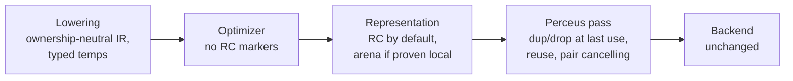

# Single Ownership Pass

Status: proposed milestone, after the self-hosting fixpoint (step J) and ideally after the .NET
toolchain is retired (step T). Not started.

Baseline: static reading of `selfhost/step-e-leaks` at `e5d782d9`, 2026-10-28. No measurements were
taken for this proposal.

## Problem

Every ownership decision is made inside lowering, while the IR is emitted, and both compilers are
built the same way. Lowering picks the arena or the reference-counted heap for each allocation (48 IR
instructions carry `RuntimeManaged`), emits the copy-outs where an arena value must outlive its scope
(49 sites of `CopyOutArena`, `CopyOutList`, `CopyOutClosure` and `CopyOutTcoListCell`), and emits
`RcDup` and `RcDrop` itself. `PerceusLifetimePlacement` only moves the drops lowering already chose to
their last use. Because types are often still open at the emission point, lowering also defers
decisions behind placeholders (`TcoResetPending`, `CallResultCopyOutPending`) and lowers a recursive
group twice to pin a sibling's result type.

The result is about 170 `GRC_NO_*` rules, roughly 94 of which fire on a recognised code shape. A shape
no rule covers can still leak. Most of these rules are not retain or release decisions: they are copy
decisions at the boundary between the arena, which is the default, and the reference-counted heap,
which a value reaches only when lowering proves it escapes. The run-time ownership mask (bits 2, 60,
61 and 62 of the hidden ownership word) exists for the same reason: an arena result cannot be owned
by the caller.

## Target

1. Lowering emits allocations, moves and calls with no representation choice, no copy-out and no
   `RcDup` or `RcDrop`. Each temp records its resolved type; today only local slots do, for debug
   information.
2. The optimizer runs on that IR without stepping around ownership markers.
3. A representation pass places a value in a scoped arena only when an escape analysis proves it dies
   inside the scope. Everything else is reference-counted from birth, so nothing is copied out.
4. One Perceus pass over the control-flow graph inserts a dup at each extra use and a drop at the last
   use, including back edges and exits, then reuses dropped cells and cancels dup/drop pairs. It is the
   only place that emits `RcDup` and `RcDrop`.
5. The backend executes the same instructions as today.

Region-managed values that are regions by design stay: scoped arenas for proven-local values, task
and capability regions, the persistent collection region, OS-backed views and stacks. A one-shot
handler's pending post and the parallel TLS arena become escape barriers for the representation pass.

## Order of work

1. **Measure first.** After J, a stage-0-only spike prices reference counting by default on
   spectral-norm, binary-trees, n-body and fannkuch-redux, time and peak memory, switch off and on.
   Nothing of it is committed. Today the arena is why spectral-norm and binary-trees beat OCaml (see
   [The trade this model makes](../internals/architecture.md#the-trade-this-model-makes)).
2. **Typed temps**, behaviour-neutral.
3. **One dup/drop pass.** Lowering keeps its representation choice and copy-outs but stops emitting
   `RcDup` and `RcDrop`. This removes the retain, release and join rules.
4. **Representation pass**, only if the measurement allows. This removes the copy rules, the deferred
   placeholders and the run-time ownership mask.
5. **Reuse into the pass**, then the memory-model sections of architecture.md and ir.md. Each step
   updates those sections first for the part it changes.

Doing this after the fixpoint gives a leak-free baseline, so a regression of the new pass is visible
at once, and stage 1 compiling stage 2 as the correctness check. Doing it after step T means it is
written once, in the self-hosted compiler, instead of in both compilers in lockstep.

## Effects and risks

- **Run-time speed.** Reference counting by default charges per cell where an arena reset is free
  today. The measurement decides; if it costs too much, step 4 is dropped and the arena stays the
  default with a smaller boundary rule set.
- **One bug, every program.** A wrong liveness answer is a use-after-free in every compiled program,
  not a leak in one shape. `ASHES_RC_POISON=1`, `ASHES_RC_VERIFY=1`, the leak counter and the
  self-hosted suites gate every change to the pass.
- **Size.** About 23,800 lines of stage-0 ownership partials of lowering and 14,250 lines of stage-1
  ownership modules are rewritten or deleted, plus ownership code spread through `Lowering.cs` and
  `CoreLowering.ash`.
- **Tests and tooling.** The lowered-IR parity fixtures and the leak-census known set restart; 36 of
  152 C# test files reference the RC IR directly; the `--explain` reports move to read the new passes.
  The state-machine split of an async function must follow the new passes, as it follows placement
  today. The LSP reads only resource ownership and is unaffected.
- **Open questions.** Whether escape analysis keeps the per-iteration arena reset for loop-local
  values; whether borrowed-by-default parameters fit reuse, which wants owned inputs; closure
  environments (bit 61 of the closure word).
