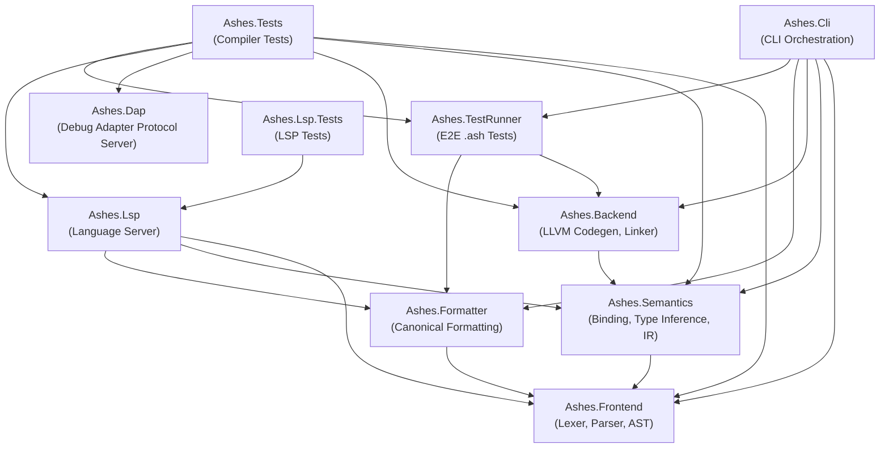
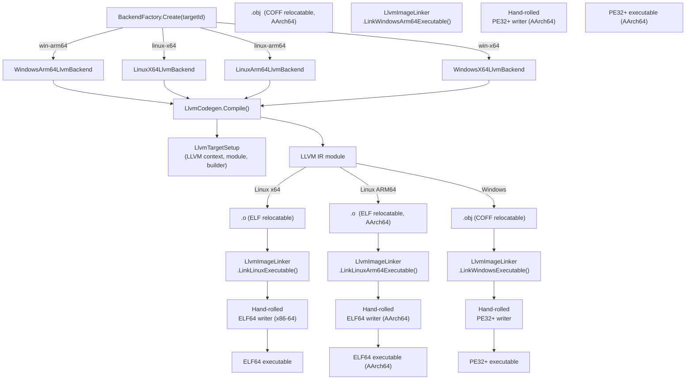
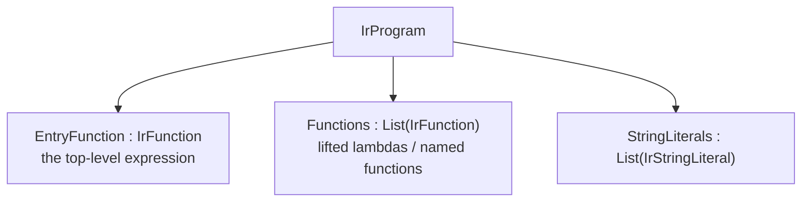
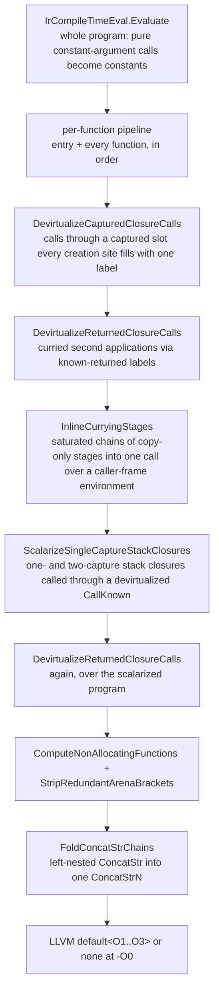

# Compiler Architecture

This document describes the internal architecture of the Ashes compiler,
covering the compilation pipeline, project structure, backend design,
intermediate representation, memory model, and linking strategy.

---

## Compilation Pipeline

Source code flows through four major phases before producing a native
executable:

```mermaid
flowchart LR
    A[".ash source"] --> B["Lexer"]
    B --> C["Token stream"]
    C --> D["Parser"]
    D --> E["AST"]
    E --> F["Binder / Resolver\n+ Type Inference"]
    F --> G["Typed AST"]
    G --> H["Lowering"]
    H --> I["IR"]
    I --> J["LLVM Codegen"]
    J --> K["LLVM IR"]
    K --> L["Object code\n(.o / .obj)"]
    L --> M["Linker"]
    M --> N["Native executable\n(ELF / PE)"]
```



| Phase | Project | Key class | Output |
|-------|---------|-----------|--------|
| Tokenization | Ashes.Frontend | `Lexer` | Token stream |
| Parsing | Ashes.Frontend | `Parser` | `Ast` nodes |
| Binding, inference & lowering | Ashes.Semantics | `Lowering` | `IrProgram` |
| Code generation | Ashes.Backend | `LlvmCodegen` | LLVM IR → object file |
| Linking | Ashes.Backend | `LlvmImageLinker` | Native executable bytes |

Each pipeline project's public surface is documented directly from its `///` XML doc comments in
the [Frontend](api/frontend.md), [Semantics](api/semantics.md), [Backend](api/backend.md), and
[Formatter](api/formatter.md) API references.

---

## Project Dependency Graph

The repository is split into ten .NET projects with strict dependency
rules:



**Key rules:**

- **Frontend** has zero internal dependencies.
- **Semantics** depends only on Frontend.
- **Backend** depends only on Semantics (transitively Frontend).
- **Formatter** depends only on Frontend — it never touches Semantics or Backend.
- **Lsp** must **not** depend on Backend.
- **Dap** currently has zero internal compiler dependencies and remains a standalone tooling process.
- **Cli** is the only orchestration project that wires all phases together.

---

## Tooling Servers

Ashes exposes two editor-facing servers alongside the compiler and CLI:

| Project | Protocol | Responsibility |
|---------|----------|----------------|
| Ashes.Lsp | Language Server Protocol | Syntax highlighting, diagnostics, completions, hovers, formatting |
| Ashes.Dap | Debug Adapter Protocol | Launching debug sessions, translating IDE debug requests to native debugger commands, surfacing runtime state |

`Ashes.Lsp` is a consumer of compiler phases: it requests parsing,
binding, and formatting services from the compiler projects and converts
the results into LSP responses.

`Ashes.Dap` is intentionally outside the compiler pipeline. It does not
parse or type-check `.ash` code; instead it brokers DAP traffic between
the IDE and a native debugger backend such as GDB or LLDB, operating on
already-compiled binaries and their debug information.

---

## Package manager

Ashes has **no separate compilation and no binary artifacts**: `ProjectSupport.BuildCompilationPlan`
resolves imports across directories and stitches every module into one source string that is
type-inferred, monomorphized, and lowered as a unit. Three consequences shape the whole package model:

Before stitching, each source module's optional explicit export interface is validated and converted
to one shared value/type/constructor/submodule surface. The stitcher uses that surface for whole-module
imports, selectors, aliases, and constructor qualification; the LSP reads the same source interface
for completion and definition lookup. Hidden declarations remain in the stitched unit for internal
calls, while their compiler names are private to prevent the global combined source from exposing them.

- **A package is a source tree** — nothing to build or version by ABI. The global cache is
  content-addressed *source*; "installing" a cached package makes its roots visible to resolution rather
  than compiling it (so a cached `ashes add` is instant).
- **One version per package per build** — two versions would stitch into the same namespace and collide,
  so a version conflict is an error, not duplicate-and-isolate. This removes npm-style diamond
  duplication by construction.
- **The compiler is never the solver** — resolution happens in the CLI at `restore` time and produces a
  deterministic set of source roots that the compiler, LSP, and test runner all consume through
  `LoadProject`. `ResolveImport` never learns about registries, versions, or archives.

Dependencies are declared in `ashes.json` (see the projects guide) and imported under a namespace (the
`namespace` field, else the PascalCase of the package name). A **path** dependency resolves live from
disk; a **registry** dependency resolves through the registry into the lock and cache. Both are
transitive — a dependency's own dependencies are pulled, diamond-deduplicated, and a cycle is `ASH035` —
and the namespace discipline (`ASH028` / `ASH029`) is enforced across the whole resolved set.

**Resolution** is the Cargo model: SemVer constraints, the highest version satisfying all constraints
across the transitive graph, unified to one version per package, pinned in the selected project's lock
file. A first resolve pins the newest compatible version; later publishes do not change the build until
an explicit update. An empty intersection is a typed conflict (`ASH032`). The single-version world makes
this simpler than npm/Cargo (no multi-version isolation to attempt); unlike Go's MVS it selects
newest-compatible rather than lowest.

**Lock file** — a generated, committed file holding the resolved graph so every front end consumes an
identical root set. Its base name follows the selected manifest: `ashes.json` uses `ashes.lock`, while
`ashes-test.json` uses `ashes-test.lock`. `restore` writes it; `build` / `run` / `test` read it
(auto-restoring a missing or stale lock); `restore --frozen` fails if resolution would change it, and
`--offline` trusts it and only verifies the cache. Each entry records the package's namespace, version,
source (`registry+<url>` or `git+<url>`), and `ash1:` hash.

**Cache** — content-addressed source under `$XDG_CACHE_HOME/ashes` (`cache/pkg/<ns>/<version>/<hash>/…`),
shared across projects, deduplicated, and safe under concurrent CI. The compiler and the CLI compute cache
paths the same way (`ProjectSupport.CachePathFor`), so the compiler reads exactly what `restore` wrote;
cached content is verified against the lock's hash (`ASH034`) before use.

### The `ash1:` content hash

The integrity value is a hash of the **source tree**, not of any archive, so it is identical however the
source was fetched. Over the set of packaged files:

1. Each file is a `(path, bytes)` pair, `path` package-root-relative with `/` separators (no leading
   `./`, no backslashes).
2. Emit the line `"<sha256-hex-of-bytes>  <path>\n"` (two spaces, LF) per file.
3. Sort the lines by `path` (ordinal).
4. Concatenate, SHA-256 the result, hex-encode it lowercase, and prefix `ash1:`.

Directory entries, symlinks, and file modes are excluded — only paths and contents contribute. The
registry recomputes this at publish and rejects a mismatch against the client's declared value; the client
re-verifies every download and cache read. The CLI (`SourceHasher`) and server (`ContentHash`) implement
it independently, locked to agreement by a pinned test vector.

The command surface (`add` / `remove` / `restore` / `tree` / `why`, and the registry verbs) is in the CLI
reference; the manifest shape and namespace discipline are in the projects guide.

---

## Package registry

`Ashes.Registry` is the reference package registry: a standalone ASP.NET Core (.NET 10) minimal-API server
that stores and serves Ashes packages. It lives in the compiler solution for build/test/format but deploys
on its own lifecycle, and is a strict downstream consumer of `Ashes.Frontend`/`Ashes.Semantics` for
publish-time validation — no compiler phase depends on it. Packages are **source**: a published version's
blob is the gzip source tarball, content-addressed by the `ash1:` hash of its uncompressed file tree, so
identical trees deduplicate and a download verifies by re-hashing regardless of transport.

**HTTP API (`/api/v1`).** Read endpoints are unauthenticated and cacheable; writes take a bearer token.

| Method | Path | Purpose |
|--------|------|---------|
| GET | `/healthz`, `/api/v1/index` | Liveness; registry info + effective limits |
| GET | `/api/v1/packages`, `/api/v1/search?q=` | Browse (paginated); search (FTS5-ranked) |
| GET | `/api/v1/packages/{ns}`, `/api/v1/packages/{ns}/{version}` | Package metadata + versions; one version |
| GET | `/api/v1/packages/{ns}/{version}/source` | Download the source tarball (`application/gzip`) |
| GET | `/api/v1/packages/{ns}/{version}/readme` | Extract the root README as Markdown, or `204` when absent |
| POST | `/api/v1/tokens` | Mint an API token |
| PUT | `/api/v1/packages/{ns}/{version}` | Publish (multipart: `metadata` JSON + `source` tarball) |
| POST | `/api/v1/packages/{ns}/{version}/yank`, `/unyank` | Yank / reverse a yank (owner-only) |
| GET/POST/DELETE | `/api/v1/packages/{ns}/owners` | List / add / remove co-owners (owner-only) |

Errors use a uniform envelope `{ "error": { "code", "message" } }` with stable codes: `not_found`,
`unauthorized`, `namespace_owned_by_another`, `version_exists`, `version_yanked`, `limit_exceeded`,
`namespace_lint`, `invalid_version`, `hash_mismatch`. The generated OpenAPI document and its Scalar
reference are mapped in the Development environment only.

**Web UI.** `Ashes.Registry/Web` is a Vue 3 / TypeScript single-page application built by Vite. The
registry project runs its locked `pnpm` build automatically, publishes the generated assets under
`wwwroot`, and serves them from the same ASP.NET Core host. Non-API paths fall back to the SPA entry
point, so package URLs are directly shareable while `/api/v1`, `/healthz`, and development-only API
documentation remain ordinary server routes. The SPA consumes only the public API rather than reaching
into EF storage. It provides package search/browse, version selection, README rendering, capability and
dependency inspection, source downloads, and the copyable `ashes add <namespace>` command. Published
Markdown is sanitized in the client before insertion; embedded images and active HTML are removed.

**Publish pipeline.** `PUT` runs an ordered pipeline that writes nothing until every stage passes:
authenticate → unpack the tarball under the per-file/total/count and decompressed-ceiling limits and the
source-only content allowlist → authorize the namespace (the first publish claims it, later versions
require ownership) → validate SemVer and immutability (a differing hash for an existing version is
`version_exists`; an identical re-publish is an idempotent no-op) → namespace lint → compute the `ash1:`
hash server-side and verify it against the client's declared value → extract the public capability rows →
store the blob, then the package (owner claim), then the version.

**Capability audit.** The namespace lint and capability extraction reuse the compiler front end behind
`IManifestValidator` / `ICapabilityExtractor`. The default extractor parses and lowers the uploaded source
— stitching multi-module packages through the project loader when an `ashes.json` is present — and reads
the inferred `needs {...}` rows off the exported bindings via `Lowering.PublicApiCapabilities()`, so the
audit reflects real inference rather than a heuristic scan. It is best-effort: a compiler failure yields
no capabilities instead of blocking the publish.

**Storage** sits behind narrow interfaces (`IBlobStore`, `IMetadataStore`, `ISearchIndex`, `IAccountStore`)
so the reference filesystem/SQLite implementation can be swapped for object storage / PostgreSQL at scale:

- Content-addressed **blobs** on the filesystem (`data/blobs/<kk>/<hash>`), written atomically and deduplicated.
- **Metadata, accounts, and tokens** in SQLite via EF Core migrations. The database is configured by
  `ConnectionStrings:Registry` (defaulting under the `--data` directory) and swaps to PostgreSQL by provider.
- **Search** is a SQLite FTS5 index over namespace/description/keywords, kept in sync by triggers; queries
  select candidates by prefix-token match and rank name-first (exact > prefix > description, downloads tie-break).

Token secrets are random 256-bit values, shown once and stored only as SHA-256 hashes. `POST
/api/v1/tokens` open self-registration is a self-host convenience gated by `Registry:AllowOpenRegistration`
(default on); a public instance turns it off and provisions tokens out of band. The client verbs
(`login`, `publish`, `yank`, `search`, `info`) are covered in the CLI reference.

---

## Backend Architecture

The backend converts IR into a native executable through LLVM:



All backends implement `IBackend` and delegate to the same
`LlvmCodegen.Compile()` entry point, which branches internally based on
the target ID.

### Parallel code generation

A large program is split into several LLVM modules that are optimized and turned into
object code on separate threads, merged into one relocatable object, and linked as usual. The
partition count depends only
on the program's size (one partition per 1024 lifted functions, at most 16), so the image is
reproducible across machines; `ASHES_LLVM_JOBS` overrides it, `1` keeps a single module, and
debug builds always use a single module. Each partition is its own LLVM context and module: it
declares every lifted function but defines only the contiguous, instruction-count-balanced range
it owns, only partition 0 defines the entry function, and the runtime helper functions are
defined in every module so they still inline. The globals partition 0 defines (the arena cursors,
the capability handler slots, the string literals its functions use) are exported from it and
replaced by external declarations in the other partitions, so every object shares one set of
runtime state; a literal only a later partition uses stays that partition's own, and the
libc-named helpers every module defines (`memcpy`, `memset`, `memcmp`, `bcmp`, `strlen`) are weak
definitions outside partition 0. The vendored bitcode payloads are linked into partition 0
alone. The partitions' objects are then merged into one ELF relocatable object the way `ld -r`
does (`ElfRelocatableObjects`): sections of the same name are concatenated at their alignment
(`.text`, the `.rodata*` constant pools, `.bss`, and the arm64 `.tbss` arena cursors alike),
every symbol is rebased into the merged section it lands in, section symbols collapse to one per
merged section with the relocation addends adjusted, an undefined global in one object resolves
to the definition another provides, and relocations keep their types, so the merge is the same
for both architectures. The merged object then goes through the target's ordinary single-object
linker. The Windows targets merge the same way into one COFF relocatable object
(`CoffRelocatableObjects`) for the single-object PE linker: sections with the same name and
flags are concatenated at their alignment, a COMDAT several objects carry (the weak helper
definitions and LLVM's `__xmm@`/`__real@` constant sections) is kept once, a relocation against
an input section symbol is redirected to a static marker symbol at that section's offset so the
relocated bytes and the relocation types stay untouched, an external symbol several objects
define outside a COMDAT keeps the first definition external and demotes the later copies to
static, and a section past 0xFFFF relocations uses the `IMAGE_SCN_LNK_NRELOC_OVFL` form.
`ASHES_DUMP_OBJECTS=<dir>` writes the partition objects and the merged object into that
directory.

### External dependencies

| Dependency | Source | Purpose |
|------------|--------|---------|
| libLLVM (native) | Downloaded via `scripts/download-llvm-native.*` | LLVM C API (`libLLVM.so` / `libLLVM.dll`) |
| Mbed TLS (bitcode) | Vendored under `runtimes/` (refreshed via `scripts/download-mbedtls.sh`) | TLS runtime for `Ashes.Net.Http` / `Ashes.Net.Tls` (`libmbedtls.bc`), linked into programs that use it |
| openlibm (bitcode) | Vendored under `runtimes/` (refreshed via `scripts/download-openlibm.sh`) | Transcendental math for `Ashes.Number.Math` Layer 2 (`libopenlibm.bc`), linked into programs that use it |
| PCRE2 (bitcode) | Vendored under `runtimes/` (refreshed via `scripts/download-pcre2.sh`) | Regular-expression engine for `Ashes.Text.Regex` (`libpcre2.bc`, 8-bit + Unicode, JIT off), linked into programs that use it |

The compiler talks to LLVM through a thin P/Invoke interop layer
(`Ashes.Backend/Llvm/Interop/LlvmApi.cs`) — no managed wrapper packages
are used.

#### Updating native runtime libraries

The native payloads live in `runtimes/{linux-x64,linux-arm64,win-x64,win-arm64}/`
and are provisioned for build/publish with the following scripts:

| Dependency | Linux / WSL | Windows (run from WSL) |
|------------|-------------|------------------------|
| libLLVM | `./scripts/download-llvm-native.sh [MAJOR]` (default 22) | `./scripts/download-llvm-native.sh --all [LLVM_VERSION]` |
| Mbed TLS | `./scripts/download-mbedtls.sh` (host arch) or `./scripts/download-mbedtls.sh --all` | `./scripts/download-mbedtls.sh --all` (all targets build on one host with clang) |
| openlibm | `./scripts/download-openlibm.sh` (host arch) or `./scripts/download-openlibm.sh --all` | `./scripts/download-openlibm.sh --all` (all targets build on one host with clang) |
| PCRE2 | `./scripts/download-pcre2.sh` (host arch) or `./scripts/download-pcre2.sh --all` | `./scripts/download-pcre2.sh --all` (all targets build on one host with clang) |

`Ashes.Backend.csproj` validates that the expected LLVM library and
Mbed TLS payload exist for the active RID. LLVM is copied into the
build output root, while `libmbedtls.bc` and `mbedtls.version` are
copied under `runtimes/<rid>/`; `Directory.Build.targets` reapplies the
RID-specific copies during `dotnet publish`.

The Mbed TLS `libmbedtls.bc` payloads are committed to the repository.
Re-run `scripts/download-mbedtls.sh` only when updating `MbedTlsVersion`
or refreshing the vendored bitcode. See *Async & TLS runtime model* below.

The openlibm `libopenlibm.bc` payloads are likewise committed. Re-run
`scripts/download-openlibm.sh` only when updating `OpenlibmVersion` in
`Directory.Build.props` or refreshing the vendored bitcode. Because bitcode is
produced by the clang frontend, every target's payload builds on one host with
clang alone (no cross toolchain). See *Math runtime model* below.

The PCRE2 `libpcre2.bc` payloads (backing `Ashes.Text.Regex`) are committed and provisioned the same
way. Re-run `scripts/download-pcre2.sh` only when updating `Pcre2Version` in
`Directory.Build.props`. The script compiles the 8-bit PCRE2 library (Unicode on, JIT off) from
source to per-target bitcode, then `internalize` + `globaldce` strips everything unreachable from
the exposed API down to a minimal external surface: `malloc`/`free` (routed to an emitted bump
region) and `memcpy`/`memset`/`memcmp`/`strlen` (backend builtins), plus `memchr` (a libc import on
Linux). The Windows payload is compiled with the `windows-gnu` triple — PCRE2's exposed functions
pass more than four arguments, so it needs the Microsoft x64 calling convention — using vendored
declaration-only stub headers plus a small `memchr`/`strchr`/ctype shim, so no MinGW sysroot is
required. A compiled pattern (`pcre2_code*`) lives in the bump region, which the arena never
relocates, so a `Regex` value is a stable handle; per-match scratch is reclaimed by a region cursor
save/restore around each match. The payload is linked into a program only when it uses `Ashes.Text.Regex`
(gated on the regex IR intrinsics), after the program's own optimization passes.

To bump the LLVM version, pass the new version to the download script —
no source changes are needed because the LLVM C API is stable across
releases. For Mbed TLS, update `MbedTlsVersion` in
`Directory.Build.props` and re-run `scripts/download-mbedtls.sh` to
provision matching payloads.

### Async & TLS runtime model

Networking (TCP/HTTP) and TLS are **async-only**: the `Ashes.Net.Http` / `Ashes.Net.Tcp`
/ `Ashes.Net.Tls` APIs return `Task(E, A)` and are consumed via `await` /
`Ashes.Task.run` (the `Task` type is the enforcement — misuse is an ordinary type
error). Under the hood these lower to **non-blocking leaf tasks** driven by the
coroutine/state-machine machinery (`StateMachineTransform.cs` + the LLVM task
runner): each leaf task carries wait metadata and steps incrementally, returning
*pending* on would-block and resuming on readiness — via `epoll` on Linux and
`WSAPoll` on Windows. Networking crosses a per-module runtime ABI (`ashes_tcp_*`,
`ashes_http_*`, `ashes_step_*_task` symbols) rather than calling backend helpers at
each instruction site.

#### The run-queue scheduler

Every async program, on every target, runs on a **flat run-queue scheduler**
(`ashes_scheduler_run`): tasks link into an intrusive FIFO through a `ReadyNext`
header slot, and the loop pops a task, steps it once, and routes the outcome —
*completed* delivers the result to the task's `Waiter` (the task suspended on it)
and re-enqueues that waiter; *suspended* enqueues the freshly awaited sub-task and
parks the awaiter; a *pending leaf* moves to a parked list. `await` therefore
**parks instead of blocking**: no C-stack recursion, and any number of tasks
interleave fairly on one thread (concurrency, not parallelism). When the ready
queue drains and the main task is incomplete, an **aggregate wait** blocks until
the earliest timer deadline or, when socket/TLS/HTTP leaves are parked, on socket
readiness — an `epoll_wait` on a persistent epoll set on Linux, or one `WSAPoll`
over a pollfd array rebuilt from the parked list on Windows — then re-queues the
parked leaves.
`Ashes.Task.all` / `race` are **parking composite tasks**: children carry the
composite as their `Waiter`, each completion decrements the composite's counter
(`all`) or delivers the first result (`race`), and the composite completes to its
own waiter — a handler blocked in `all` never serializes its peers.
`Ashes.Task.spawn` enqueues a detached task with a **private region**
(`ArenaOwner` = itself): each scheduler step installs the owning task's arena
cursor as the global bump allocator and writes it back after, sub-tasks inherit
the awaiter's owner (zero-copy awaits), and a spawned root's arena is reaped when
it completes — a server handling many connections does not grow without bound.

#### Async tail-recursive loops

A `let recursive` helper defined **inside an async body whose own body awaits**
(the accept loop of a server, a connection read loop) compiles to **one looping
coroutine**, not a closure of nested blocking runs: the helper becomes a
task-returning closure around a *transparent* coroutine (its result slot holds
the body's raw value, no `Ok`-wrap), saturated call sites await the task
implicitly (so the call keeps the helper body's source-level type), and a
saturated **self tail call restarts the coroutine in place** — new arguments are
stored into the parameter locals and control jumps to a restart label at the body
start. The loop lives in a single task frame (no per-iteration task allocation,
no waiter chain), and its awaits are ordinary suspend points on the enclosing
run. `StateMachineTransform` detects the restart back-edge and switches to
loop-aware liveness for locals (every written-and-read local is saved/restored at
every suspend), since positional before/after analysis is unsound across a
backward jump. Awaits inside *nested plain lambdas* still lower to a blocking
`RunTask` — only the helper's own coroutine scope suspends.

The restart back-edge also carries a **per-iteration region reset** (the same
watermark and explicitly classified compaction machinery as region-managed synchronous TCO loops), so a long-lived loop —
an HTTP keep-alive connection serving thousands of requests — reclaims each
iteration's allocations instead of growing its arena per request. Loop-invariant
and scalar arguments take the plain reset (flat memory); fresh heap-typed
arguments are copied out to the watermark (the loop retains only the live
loop-carried state per iteration). The reset is gated twice for soundness: it is
emitted only when the loop body contains no `spawn` (a detached task's captures
could reference iteration allocations), and at runtime it runs only while the
task's `LoopResetOk` header flag is set — the scheduler clears the flag at
suspend time when a composite (`all`/`race`) ancestor shares the arena, where
interleaved siblings could allocate above a stale watermark.

#### Task frames and memory

A `Task` value is a heap **state struct** allocated by `CreateTask` in its
scheduler-owned region. The struct holds a fixed header (state index, coroutine function pointer,
result slot, awaited-task pointer, scheduler chaining/wait metadata) followed by
the coroutine's captured environment and one slot per variable that is live
across an `await`. `StateMachineTransform` splits the async body at each
`AwaitTask` into numbered states (N awaits produce N+1 states) and inserts
save/restore sequences, so suspension serializes the live temps into the struct
and resumption reloads them — **no machine stack survives across an `await`**;
a suspended task costs its state struct, not a stack frame.

Task memory is reclaimed by scoped scheduler watermarks plus the
scheduler's spawned-region reap: ordinary task structs return when an enclosing
task/capability scope resets its region, and a spawned root task's private region is freed by
the scheduler when the task completes. Task execution is **single-threaded on
the calling thread** — the scheduler steps every task on the thread that invoked
`Ashes.Task.run` (concurrency, not parallelism), so all task allocations land
in that thread's arenas and never alias another thread's heap. One structural
restriction follows from the layout: a parallel fork/join (`Ashes.Task.Parallel.both`)
must not straddle an `await`, because the worker descriptor and worker arena are
not serialized into the state struct; the transform asserts this.

TLS/HTTPS ride a **hermetic Mbed TLS runtime linked into the executable**: the vendored
bitcode payload (`libmbedtls.bc`, under `runtimes/`) is linked into the program module —
like the openlibm and PCRE2 payloads — only when the program uses `https://` or
`Ashes.Net.Tls`; no shared library is written or loaded at run time. I/O goes through
compiler-emitted BIO callbacks over the program's own nonblocking sockets, and randomness
comes from Mbed TLS's platform entropy (`getrandom` on Linux, `BCryptGenRandom` on
Windows) feeding a CTR_DRBG. The remaining external surface resolves at static link
time: libc imports on Linux, and msvcrt/kernel32/bcrypt PE imports (plus in-payload
`__udivti3`-family shims for i128 division) on Windows. Both the client
(config + certificate-verifier) and the **server** (server-config + acceptor half of
the handshake, from a PEM chain and key) surfaces are wired. Client certificate and
hostname validation are **mandatory** — system trust roots by default, with
`SSL_CERT_FILE` as an explicit PEM-root override (used by loopback TLS tests).
Runtime-init or verifier failures return `Error(...)` rather than crashing. Deferred TLS scope: mutual TLS / client certs, custom trust (per-call CA
bundles, pinning), SNI / multiple certificates, ALPN, HTTP/2, HTTP/3.

#### Server runtime: multi-reactor and graceful shutdown

A server is not a new runtime — it is the composition already described: the run-queue
scheduler (one cooperative poll loop per process), `Ashes.Task.spawn` (each accepted
connection's handler is a detached task with a private region reaped on completion, so
resident memory is bounded under sustained load), and the async tail-recursive loop
transform (the accept loop and each connection's keep-alive loop are single suspending
coroutines with the per-iteration arena reset). `Ashes.Net.Tcp.Server.serve` /
`Ashes.Net.Http.Server.serve` / `serveTls` return the lifecycle `Task(E, ())`: `Ok(())`
is a clean stop, `Error(...)` a bind/listener failure.

`serve` is a **multi-reactor prefork** — one independent reactor process per online CPU,
no shared connection state and no cross-worker scheduler. The two per-target mechanisms
sit behind one `forkWorkers` intrinsic:

- **Linux (x64 / arm64):** the parent `fork`s the workers up front; each binds the port
  with `SO_REUSEPORT` so the kernel load-balances new connections. Children set
  `PR_SET_PDEATHSIG` so they die with the parent (the crash backstop).
- **Windows:** no `fork` / `SO_REUSEPORT`, so the parent creates one inheritable listener,
  publishes it (a `__ashes_worker_listener` global + `ASHES_WORKER_FD` env var) and
  relaunches itself with `CreateProcessA(bInheritHandles=TRUE)`; each worker accepts on
  the shared inherited handle, and a Job Object with `KILL_ON_JOB_CLOSE` ties their
  lifetime to the parent.

Separate address spaces keep each reactor's scheduler state independent, which purity
keeps sound; worker count defaults to the online-CPU count under the `--parallel-workers`
cap (`serveParallel` overrides it).

**Graceful shutdown** drains rather than cuts. The first `SIGINT`/`SIGTERM` (Linux) or
console-ctrl event (Windows, via `SetConsoleCtrlHandler`) sets a shutdown flag; the accept
step stops accepting and holds the shutdown sentinel until the live spawned-handler count
reaches zero or a drain bound (default 10 s, configurable through `serveWithDrainTimeout`)
elapses, then `serve` returns `Ok(())`. A second signal exits immediately. A multi-reactor
parent forwards the signal to its workers and reaps them (`wait4(WNOHANG)`) before exiting,
so no worker is cut mid-request. The signal interrupts the parked `epoll_wait` via `EINTR`
on Linux; on Windows another thread cannot interrupt a parked `WSAPoll`, so the aggregate
wait's socket timeout is capped at 200 ms to observe the flag promptly. `Stop.stop(Unit)`
(a built-in capability, see [Capabilities Lowering](#capabilities-lowering)) requests the
same drain from inside a handler — a worker signals the parent, so it stops the whole server.

### Math runtime model

`Ashes.Number.Math` is delivered in two layers with no runtime dependency in either.

**Layer 1 (hermetic core).** The integer helpers and pure-Float helpers ship as
ordinary Ashes in `lib/Ashes/Math.ash`; `sqrt`/`floor`/`ceil`/`round`/`trunc`
lower to `llvm.*` intrinsics and `toFloat`/`floorToInt`/`roundToInt`/`truncToInt`
to `sitofp`/`fptosi` — no native payload.

**Layer 2 (transcendentals).** `sin`, `cos`, `exp`, `ln`, `pow`, … are backed by
a vendored **openlibm compiled to LLVM bitcode** (`libopenlibm.bc`, ~50-70 KB per
target, under `runtimes/<rid>/`). Each is an `IrInst.CallLibm` to the openlibm
symbol. When the program's IR references any of them (`ProgramUsesMathRuntimeAbi`,
mirroring the TLS gate), the backend parses the bitcode (`LLVMParseIRInContext`)
and links it into the program module (`LLVMLinkModules2`) so the symbols resolve
as ordinary internal functions in the single emitted object — **no dynamic
import, no `dlopen`, no dependency on a system `libm`**. Hermetic-only and
math-free programs link nothing. The link runs *after* the program's LLVM
optimization passes, so openlibm's already-optimized bitcode is not re-optimized
into libm libcall intrinsics (e.g. `llvm.exp2`).

Provisioning (`scripts/download-openlibm.sh`) builds the bitcode from openlibm's
curated source set with `-fno-builtin -DNDEBUG -ffreestanding`, adds the float
classifiers (`s_isinf`/`s_isnan`) and no-op `fenv` shims, `llvm-link`s them, and
`opt internalize`/`globaldce`s to a minimal self-contained module. Bitcode is
frontend-only, so all four targets build on one host with clang. The win-x64
payload uses the MinGW (`windows-gnu`) triple — its datalayout is identical to
`windows-msvc`, so the bitcode links into the compiler's MSVC-target module — plus
win-only adjustments (neuter openlibm's long-double weak-alias macro; skip the
float/long-double/complex/gamma/bessel source variants; a few forwarding shims).

### BigInt (arbitrary-precision integers)

`BigInt` is a native primitive (`Ashes.Number.BigInt`), consistent with `Int`/`Float`/`u8`–`u64` being
native. It is an **immutable heap value** — a pointer to
`{ i64 header, i64 limb[…] }` where `header = (negFlag << 32) | limbCount`, the magnitude is
sign-magnitude base-2^64 little-endian, and the form is normalized (no leading-zero limbs; zero is
header `0`). Being a pointer word, it flows through slots, closures, tuples, and `match` like any
other heap value, and every operation returns a fresh normalized result (no source-visible mutation).
An independently owned result carries the common RC allocation header immediately before this
payload; temporary arithmetic buffers may remain in a proven scoped arena.

Unlike the openlibm math payload, the BigInt arithmetic is **emitted directly as LLVM-IR runtime
helper functions** by the backend (`EmitBigIntRuntimeHelpers`), the same technique as the
freestanding `memcmp`/`strlen` helpers — there is no vendored library or build step. The helpers
(`bignum_add`/`_sub`/`_mul`/`_divmod`/`_cmp`/`_from_i64`/`_to_decimal`/`_from_decimal`) are emitted
once per program that uses BigInt (gated by `ProgramUsesBigIntRuntimeAbi`), with internal linkage so
unused ones are dead-stripped. The helpers do not allocate themselves: call-site codegen reads the
operand limb counts, pre-sizes result and scratch buffers in the selected RC or scoped region, and
passes them in. The IR is pure integer arithmetic (i64/i128) with no syscalls or soft-int libcalls — the
64×64→128 multiply lowers to hardware `umulh`, and decimal conversion divides 32 bits at a time so it
needs only i64 `udiv` — so all three targets share one implementation. Division is binary long
division (Knuth Algorithm D is a documented performance follow-up).

RC-owned BigInt accumulators release replaced buffers at TCO back-edges; large released buffers return
to the OS instead of accumulating in the small-block cache. `Int↔BigInt` conversions live in
`Ashes.Number.BigInt` (`fromInt`/`toInt`); string conversions live in `Ashes.Text`
(`fromBigInt`/`parseBigInt`), matching `fromInt`/`parseInt`.

---

## Intermediate Representation

The IR is a flat, register-based instruction set defined in
`Ashes.Semantics/Ir.cs`. The `Lowering` pass converts the typed AST into
an `IrProgram`, which the backend consumes.

### IrProgram structure



Each `IrFunction` contains a flat list of `IrInst` records, a local-slot
count, a temporary-register count, optional debug maps, and stable reporting
metadata in `IrFunction.Origin`.

### Stable function identity and lineage

Ownership analysis uses exact binder identities internally, but those identities
are deliberately not exposed to report consumers. Each
`FunctionOwnershipSummary` instead carries a `SourceFunctionOrigin`: the source
declaration name, its module-qualified name when project stitching knows it, its
declaration location, and a deterministic combined-source offset. The project
stitcher retains the original and qualified names when it rewrites module
bindings into compiler names.

Lowering gives every production `IrFunction` an `IrFunctionOrigin` when the
function is created. It records the unique generated label and an enum describing
the actual generated kind. Source-derived helpers also retain their
`SourceFunctionOrigin` and immediate parent label; shared type, runtime-layout,
external, mutual-recursion-group, and program helpers use a typed compiler owner
instead. Stable discriminators and generation locations distinguish
specializations and anonymous/generated sites without exposing AST identities,
object hashes, or traversal order.

The model covers ordinary source functions and closure layers as well as reuse,
parallel, and concrete trait-operator specializations, mutual-recursion dispatchers and wrappers,
coroutines, external thunks, closure-layout normalizers, structural droppers,
and deep-copy helpers. Optimizer and lifetime-placement rewrites preserve the
init-only origin metadata through record copies. LLVM code generation does not
read it: origins correlate ownership decisions with final semantic IR for
diagnostics and do not affect executable output.

### Instruction categories

| Category | Instructions |
|----------|-------------|
| Constants | `LoadConstInt`, `LoadConstFloat`, `LoadConstBool`, `LoadConstStr`, `LoadProgramArgs` |
| Locals / memory | `LoadLocal`, `StoreLocal`, `LoadEnv`, `LoadMemOffset`, `StoreMemOffset` |
| Arithmetic | `AddInt`, `SubInt`, `MulInt`, `DivInt`, `AddFloat`, `SubFloat`, `MulFloat`, `DivFloat` |
| Comparisons | `CmpIntEq/Ne/Ge/Le`, `CmpFloatEq/Ne/Ge/Le`, `CmpStrEq/Ne` |
| Strings | `ConcatStr` |
| Closures | `MakeClosure`, `CallClosure` |
| Allocation | `Alloc`, `AllocAdt`, `SetAdtField`, `GetAdtTag`, `GetAdtField` |
| Console I/O | `PrintInt`, `PrintStr`, `PrintBool`, `WriteStr`, `WriteErrorStr`, `ReadLine`, `PanicStr`, `ExitProcess` |
| File I/O | `FileReadText`, `FileReadAllBytes`, `FileMmap`, `FileWriteText`, `FileWriteBytes`, `FileExists`, `FileReplace`, `FileMakeExecutable`, `DirectoryEntries`, `DirectoryCreateAll`, `DirectoryRemoveTree`, `FileOpen`, `FileReadChunk`, `FileReadLine`, `FileClose` |
| Networking | `HttpGet`, `HttpPost`, `NetTcpConnect`, `NetTcpSend`, `NetTcpReceive`, `NetTcpClose` |
| Control flow | `Label`, `Jump`, `JumpIfFalse`, `Return` |

Registers are addressed by integer index (temporaries). Each instruction
writes to a `Target` register and reads from `Source` / `Left` / `Right`
registers.

### IR optimizer

`IrOptimizer.Optimize` (`Ashes.Semantics/IrOptimizer.cs`) rewrites the lowered
`IrProgram` before the backend sees it. It runs unconditionally for `compile`,
`run`, and `repl`; only `ashes test --pipeline optimized|lowered|both` gates it,
so the end-to-end suite can catch lowering bugs the optimizer would otherwise
mask (CI runs `--pipeline both`). The `-O0..-O3` flags select the LLVM level
only: at `-O0` no LLVM pass runs and the Ashes-optimized IR is emitted as-is;
`-O1`+ hands the module to LLVM's full `default<Ox>` pipeline.

Every top-level binding of an imported module is lowered whether or not the
importing program uses it, so importing one standard library function compiles in
that module's whole surface. `IrOptimizer.PruneUnreachableFunctions`
(`Ashes.Semantics/IrOptimizer.Reachability.cs`) drops the functions the entry
point cannot reach. It follows the labels instructions name — the closure
constructions, the devirtualized call, and the two releases that delegate to a
generated helper — plus the `$env_normalize` helper the backend resolves by name
suffix rather than through an operand. Because it runs over already-lowered IR,
binding, type inference, and lowering have all happened and every diagnostic they
raise is unaffected; pruning before those phases would instead silence the
diagnostics inside an unused declaration. The compile and test drivers apply it
after `Optimize` — whose own contract is that it never removes a function — and
before the IR dumps and explain reports, so those keep describing the program the
backend receives. It is never gated on a report flag, so asking for a report
cannot select a different image.

Reachability alone is not enough: the entry point materializes a closure for every
top-level binding and cleans it up at scope exit, and that pair keeps the lifted
function reachable even when nothing else names the binding. So the same pass
first elides the bindings whose only readers are that cleanup — and whose
environments capture nothing but other such bindings, which is what makes the
removal ownership-neutral, stranding no live value. A reference-counted closure is
released through RC rather than a cleanup pair and is left alone. On a program
importing `Ashes.Collection.List` only for `length`, the two steps together emit 3
functions where lowering produced 36.



The per-function pipeline is a fixed sequence, each pass run once unless noted:
`ElideTrivialOwnershipCopies`, `SinkRuntimeRcDupsIntoDiamonds` (to its own
fixpoint), `FuseAdjacentRuntimeRcPairs`, `DevirtualizeKnownClosureCalls` (a
closure temp defined by `MakeClosure`/`MakeClosureStack`, directly or through a
local slot written by exactly one `StoreLocal`), `FoldConstants` (meet over every
predecessor edge at a join, for temps and local slots; known conditions fold
their branch), `ReduceIdentitiesAndStrength`, `ElideTrivialOwnershipCopies`
again (identities are rewritten into copies), `EliminateLocalRedundantComputation`
(local CSE of pure `CallKnown` targets — the purity oracle is
`IrCompileTimeEval`'s evaluable-function set — plus field loads and stores to
fresh cells), `ElideTrivialOwnershipCopies` again, then `SimplifyControlFlow` and
`ElideUnreachableCode` iterated together to a fixpoint (jump threading through
empty labels and unreachable-code removal each expose the other), `ElideDeadCode`
(to its own fixpoint), and `ElideErasedRcDrops`. Ordering is deliberate: copies
are cleaned before anything reasons about ownership, calls are made direct before
constants are folded and before CSE, and dead-code elimination runs last so it
sweeps what every earlier pass strands.

The whole-program closure passes (`IrOptimizer.ClosureEnvironments.cs`) run
between the per-function pipeline and scalarization. A stitched module's
functions reach each other through alias bindings captured in closure
environments, so `DevirtualizeCapturedClosureCalls` resolves a `CallClosure`
through a `LoadEnv` slot when every creation site of the enclosing function's
environment stores the same closure label into that slot: a creation site is a
`MakeClosure`/`MakeClosureStack` over a fresh environment with one store per
slot, or the `CallKnown` the per-function devirtualization has already turned an
immediately-called closure into; a stored value resolves directly, through a
single-store local slot, through a captured slot of the creating function (a
`WholeProgramFixpoint` over the capture graph), or through a `CallKnown` to a
function with a known returned label, and any disagreement or unresolvable site
leaves the call indirect. `InlineCurryingStages` then removes the per-stage
environment and closure of a saturated curried call: a *stage* is a function
that only copies its captures and argument into a fresh environment and returns
a closure over the next stage, and a caller that calls a stage directly, extracts
the returned closure's environment, and calls the next stage is rewritten to
build that environment in its own frame (`AllocStack` plus the stores) and call
the next stage with it, repeated to a fixpoint so a three-argument chain reaches
the body with no intermediate allocation. Both passes leave the extracted
environment's ownership placement untouched by keeping every rewritten
instruction at the position of the original.

Shared analysis infrastructure the passes build on:

| Analysis | Lives in | Computes | Consumed by |
|---|---|---|---|
| `IrControlFlowGraph` | `IrControlFlowGraph.cs` | Blocks, predecessors/successors, dominators, post-dominators, generic over the block type | `PerceusLifetimePlacement` (its blocks wrap `IrCfgBlock`), `ElideUnreachableCode`, control-flow-sensitive passes |
| `WholeProgramFixpoint.RunToFixpoint` | `WholeProgramFixpoint.cs` | The shared iterate-until-stable skeleton | `ComputeNonAllocatingFunctions`, `ComputeEvaluableFunctions`, `ComputeKnownReturnedClosureLabels`, the open-world inspect-only parameter proof, coroutine effect propagation |
| `FunctionOwnershipSummary` | `OwnershipSummary.cs` | Parameter ownership, call census, move-safety, result reach/freshness, live-handler effects, result provenance, TCO parameter facts, via a whole-program SCC fixpoint over exact `FuncKey` edges | RC placement, reuse eligibility, TCO parameter representation, result-ownership decisions |
| `PerceusLifetimePlacement` | `PerceusLifetimePlacement.cs` | Per-block liveness and dominance for placing `RcDrop`/`RcDup` at true last use | Ownership placement (see [Memory Model](#memory-model)) |
| `Lowering.MoveAnalysis` | `Lowering.MoveAnalysis.cs` | Interprocedural proof that a fold accumulator is unique at every call site (not general last-use analysis) | Reuse specialization's entry-copy elision, in-place string-append arming |
| `Lowering.DirectCalleeAnalysis` | `Lowering.DirectCalleeAnalysis.cs` | Whether a let-bound name is only ever used as a direct call target | Stack allocation of non-escaping closures |
| `IrCompileTimeEval` | `IrCompileTimeEval.cs` | The whole-program set of provably evaluable (pure, terminating under a budget) functions | Whole-call folding and, as a purity oracle, local CSE |

Which side does what. Everything that depends on ownership, reference counting,
reuse, arena scoping, trait evidence, capabilities, purity across closures and
user ADTs, or closure construction is Ashes-only: LLVM sees opaque calls and
allocations and cannot reconstruct any of it (RC-wrapped calls even look
stateful to its GVN). LLVM in turn owns the classical scalar and control-flow
cleanups at `-O1`+ — `simplifycfg`, `mem2reg`, GVN, cost-modeled inlining, LICM,
unrolling, induction-variable work — so Ashes-side constant folding, identity
reduction, jump threading, and dead-code elimination exist mainly for `-O0`,
`--debug`, `--emit-ir`, and `--explain` fidelity and for shrinking the IR the
Ashes-specific passes see, not as competitors to LLVM. The measured pattern
across the optimizer's history bears this out: an Ashes pass that only re-derives
what LLVM does is identical at `-O2`, while a pass that removes an allocation,
an RC operation, or an arena bracket LLVM cannot prove dead wins at every level.
See [Measuring an optimizer change](../guide/development.md#measuring-an-optimizer-change)
for how such a change is validated.

### Stdlib call fusion

A handful of shapes at a stdlib call site are recognized during lowering itself, before any IR
exists to optimize: `Ashes.Byte.fromList(Ashes.Collection.List.reverse(xs))` never builds the
reversed list. `reverse` is a fixed, capability-free structural fold over a finite list — it cannot
panic or fail to terminate — so its only observable effect is producing the reversed value, and
`fromList` walking `xs` head-to-tail while filling the destination buffer back-to-front produces the
identical bytes. `LowerBytesFromList` recognizes the shape and lowers straight to `xs`, emitting
`IrInst.BytesFromList` with `Reversed: true`; the backend's existing two-pass count-then-fill loop
picks the destination index as `length - 1 - i` instead of `i` in its second pass, everything else
unchanged. A generic loop-fusion pass (pairing an arbitrary producer with an arbitrary consumer)
does not exist and no other builtin gets this treatment yet — this is a fixed recognizer for one
shape, matched against `Ashes.Collection.List.reverse` by *resolved callee identity*, never by the
literal spelling `reverse`: a qualified reference resolves through `ResolveModuleAlias` regardless of
import alias, and a bare name resolves either because it already is the canonical stitched compiler
name or by chasing the import stitcher's own `let name = target in ...` aliases (indistinguishable
here from an alias the user's own source wrote) through the same per-slot table that records every
`let`'s original value. A user's own same-named `reverse` binding resolves through its own bound
value, so it is never mistaken for the stdlib one. The argument must also be a *saturated* call —
`reverse`'s result bound to a name and used again declines, since the expression that would need to
be `xs` is a `Var`, not a call, and forcing that Var's own binding through the same fusion would
double the work if the binding is read more than once.

Fusing a *user-supplied callback* is a different and harder problem, since an arbitrary callback can
panic (division by zero, an out-of-bounds `Byte.get`, none of it gated by a capability row) or fail
to terminate, and `map`-then-`fold` evaluates every mapping callback before any folding call while a
fused loop interleaves them — reordering which callback's panic or non-termination the program
observes first would be a real, user-visible difference. `Ashes.Collection.List.foldLeft(f)(init)
(Ashes.Collection.List.map(g)(xs))` (or its `fold` alias) is fused into this interleaved shape anyway,
but only when that reordering is *provably* unobservable:

- `f` and `g` are each resolved to a lambda — a literal `given (...) -> ...` at the call site, or a
  named non-recursive top-level `let` — and their bodies must fall entirely within a restricted total
  grammar: literals, variable reads, the arithmetic/comparison/boolean operators (excluding `/` and
  `%`, both of which can panic on a zero divisor), and `if`. No `Call`, no `Match`, no `Let` — nothing
  that can itself panic, diverge, or perform a capability effect.
- `init`'s type and `xs`'s element type must both be one of `Int`, `Float`, `BigInt`, `UInt`, `Str`,
  `Rune`, `Bool` — the primitive types whose `Add`/`Multiply`/etc. behavior is fixed by the language
  and can never be overridden by a user `Ashes.Trait` implementation. The total-grammar check alone is
  not sufficient: for any other type, an operator in the grammar could still dispatch to a
  user-defined trait method capable of calling the capability-free `Ashes.IO.panic`.

Both checks passing proves interleaving `g` then `f` per element instead of every `g` then every `f`
changes nothing observable, so the fusion lowers straight to a single recursive loop — `go acc rest =
match rest with | [] -> acc | head :: tail -> go(f(acc)(g(head)))(tail)` — applied to `init` and `xs`,
with `f` and `g` passed in as the loop wrapper's own ordinary lambda parameters (never relocated or
re-lowered, so they retain/release exactly as the unfused chain would) rather than inlined or
re-derived. Like `reverse`-into-`fromList`, callee identity is resolved, not spelled: a user's own
same-named `foldLeft`/`map` never triggers it. The mapped list is a saturated call to `map`, exactly
as `reverse`'s argument must be a saturated call to `reverse` — read the mapped list a second time and
the fusion declines, falling back to plain calls applied to the already-lowered `init`/`xs` rather
than evaluating either twice. Because the loop is a genuine tail-recursive `go`, it also picks up TCO
for free: unlike generic `List.map`'s own recursion (not TCO-eligible), a fused map-then-fold over an
arbitrarily long list never grows the stack.

---

## Memory Model

Ashes uses a hybrid, non-tracing memory model. RC Perceus is the general
lifetime substrate for escaping ordinary heap graphs; compiler-proven scoped
values, scheduler state, OS-backed payload views, and a small number of
specialized data-structure regions retain explicit region lifetimes. There is
no tracing garbage collector and no ownership syntax in the source language.

### The trade this model makes

The absence of a tracing collector is a deliberate trade with a measurable cost and a measurable
benefit, not an unfinished piece of work. This section records both, so the decision can be
revisited on evidence rather than re-argued from first principles.

**What the model buys.** Deterministic destruction, no collector to ship, no pauses, and resident
memory that is a function of live data rather than of allocation rate. A compiled program has no
runtime dependency at all.

**What the model costs.** Every allocation must eventually answer an ownership question: is this
value uniquely owned, so its cell may be overwritten or its memory reclaimed at a scope exit? When
lowering can prove the answer, reuse rewrites the value in place and the allocation disappears.
When it cannot, the value falls back to reference counting, which charges for every cell it touches
whether or not that cell lives long enough to benefit.

A tracing nursery never asks the question. Allocation is a pointer bump; a minor collection copies
only survivors and resets the bump pointer, so unreachable cells are never visited. Its cost is
proportional to what **survives**. Reference counting's cost is proportional to what is
**allocated**. That single difference explains where each model wins.

**Measured.** Against OCaml ports written inside Ashes' own rules -- lists and records, recursion
and `match`, no arrays, no `ref`, no loops, no mutation -- with every output verified identical
(the ports and harness live in `challenges/xlang/`):

| Benchmark | Ashes | OCaml, immutable |
|---|---|---|
| spectral-norm 5,500 | **0.870 s** | 2.577 s |
| binary-trees 21 | **1.216 s** | 2.453 s |
| n-body 50,000,000 | **1.769 s** | 1.895 s |
| fannkuch-redux 11 | 24.996 s | **3.733 s** |

Ashes is faster on three of the four. Immutability alone costs OCaml 2.3x on spectral-norm and
1.4x on binary-trees; this model pays neither, because those programs either allocate in bulk that
one arena reset reclaims or build a structure once and then read it.

fannkuch-redux is the shape that inverts the trade. It rewrites a small list at very high rate and
almost nothing survives, which is the best case for a nursery and the worst case for reference
counting. Its accumulator is a loop parameter carrying heap fields, so in-place reuse is refused
(see [Drop specialization and reuse](#drop-specialization-and-reuse)), and the fallback charges per
cell for cells that die immediately.

**Why the refusal is not a gap.** Two independent declines put this shape permanently on the
reference-counted path, and both were closed after real defects rather than left unimplemented:

- In-place reuse of a tail-call accumulator whose constructor holds heap fields is declined because
  the back-edge deferred drop re-reads the cell's fields, which the reusing allocation has already
  overwritten.
- A tail-modulo-constructor spine must be reference-counted; an arena spine was attempted twice and
  is unsound in two independent ways -- the back edge frees cells above the watermark, and the
  transformed cons publishes a borrowed head into a longer-lived structure.

Both are recorded with their root causes in the
[compiler changelog](changelog.md). An optimization that appears to close this gap
should be treated as suspect until peak resident memory is measured at several input sizes: the
usual failure is a change that stops reclaiming rather than starts being faster.

**What adopting a nursery would require.** The bump allocator is not the hard part -- arena
allocation is already an inline pointer bump of comparable cost. The collection is:

- Precise root identification, so the compiler must emit stack maps naming which slots hold
  pointers at every call site.
- Relocation of survivors, which conflicts with the raw pointers this language hands to C through
  `Ashes.Ffi`, external signatures returning `*u8`, memory-mapped file views, and TLS buffers. Each
  would need pinning or an added indirection.
- A write barrier on stores into older objects, which taxes every program -- including the three
  above, where this model currently wins.
- A third memory regime alongside arenas and reference counting, with a defined contract at every
  boundary between them.
- A runtime to ship, and the pauses and timing nondeterminism that come with it.

So the benefit lands only on allocate-and-discard workloads while the cost lands on all code. That
is the reasoning behind the current choice. It would be worth revisiting if a workload that matters
in practice -- not a benchmark chosen to stress allocation -- showed the same profile as
fannkuch-redux, or if the reuse refusals above were lifted by a sound redesign of the back-edge drop
protocol, which would remove the allocation rather than make it cheaper.

### Ownership placement

Lowering infers a `FunctionOwnershipSummary` for each visible function:
parameters are borrowed or consumed, results record which parameters they may
reach, captures record their ownership, and unique inputs/results are tracked
where proven. Conservative outcomes are explicit rather than inferred from a
missing positive fact: each summary carries the function's direct-call census,
per-parameter move-safety proofs with stable failure flags, and result-reach
flags for global or unmodelled reach and internal sharing. The existing
`UniqueParameters`, `ResultFresh`, and `ResultPoisoned` values are compatibility
projections of those facts.

Result reach records the depth a parameter is reached at, so a result that embeds
a parameter is distinguished from one rebuilt out of its destructured parts.
Whether the result is confined and whether that account is complete are separate
questions. A construct this analysis cannot see through still contributes the
values it was given: an unknown callee — a parameter applied as a function, a
call through a let-bound value — may return an argument, one of their sub-cells,
a global, or a fresh value, and nothing else, because nothing mutates. Such a
result is unconfined and its reach account is still complete, which is what lets
a caller prove that a list handed to a map is never kept: the per-element call
only ever sees a head. Only a construct whose inputs cannot be enumerated — a
lambda's captured environment, an unmodelled node — sets `UnenumeratedInputs`,
and there absence from the account means unknown rather than proven-absent.

Resolved ordinary heap types are described once by a cycle-guarded
`OrdinaryHeapLayoutCapability`. It records whether the graph can be copied,
whether every owned child can be dropped, the constructor-specific child
offsets and drop kinds, and whether runtime reuse is supported for the outer
cell. Stable rejection flags distinguish resource or borrowed-view containment,
unsupported child/drop layouts, unresolved types, and unsupported outer-cell
reuse. Each `LoweredTempOwnershipFact` snapshots this capability when its type
is refined, so compiler reporting does not need to rerun layout analysis after
inference has moved on. Tuple/ADT drops, TCO child normalization, and runtime
reuse cleanup consume the same child descriptors; construction freshness,
top-cell freshness, and TCO profitability remain independent policies.

Interprocedural result provenance uses a whole-program SCC-aware monotone
fixpoint over exact lexical `FuncKey` forwarding edges. A mutually-recursive
component is eligible for the static runtime-RC result path only when every
considered terminal result is an independently eligible construction or a
saturated forward to another admitted function, and at least one independently
eligible result is reachable. Saturated exact self-recursive arms are neutral:
they neither establish nor reject eligibility. Pure forwarding cycles,
parameter passthrough, unresolved calls, and unmodelled results stay
conservative. The reportable `ForwardsTo` field names one immediate target only
when the source function has exactly one exact forwarding target; it never
substitutes an arbitrary component representative.

Within a recursive producer, list-spine placement also follows the recursive result
through local aliases and joins whose every result is proven recursive. Facts are
recorded by frame-local binding identity in the defining lexical scope; shadowed
names and mixed joins do not inherit them. This provenance requests RC placement,
not uniqueness: a cons still acquires a reference when a local already owns its
tail. Self-closure return metadata is backfilled once the body's placement is known.

A producer's cell is reference-counted only when its head is, and these rules keep the head and the
close-out from forcing an arena cell over a reference-counted tail, which nothing would release:

- A pattern binder under a tuple literal built only to be matched (`match (items, 0) with |
  (entry :: rest, _)`) descends from the element at its position, as in a match on that element
  alone, so it gets the same protective owner (`GRC_NO_TUPLESCRUTINEELINEAGE` switches it off).
  A loop handing such a binder back to its own parameter does not transfer it as well when the
  next iteration already holds a reference: the consumed tail at a list parameter's position
  (`(item :: rest, _)`), which the consumed-tail placement retains, and the whole element at a
  parameter's position (`(n :: rest, kept) -> close(rest)(kept)`), which the read out of the
  reference-counted tuple retains (`GRC_NO_TUPLEELEMENTHANDON` switches the whole-element form off).
  A binder under a constructor at a parameter's position (`(Node(l, _), acc) -> go(l)(acc)`) is
  handed on the same way: the read out of the tuple retains it as a pattern owner of its own
  (`GRC_NO_TUPLESUBPATTERNHANDON`). The tail of a chain of cons patterns at a list parameter's
  position (`(a :: b :: rest, _)`) is that list's consumed tail as a single cons's is, so the list
  takes the consumed-tail placement and releases the copy the tuple normalized it into
  (`GRC_NO_TUPLECHAINTAIL`). A tuple matched on the reference-counted heap holds its own counted
  copy of an arena-placed parameter, so a binder under it that needs a protective owner gets one
  even though its root parameter stays in the arena: the copy is released with the tuple at the end
  of the arm, and a part of it stored in the next iteration's arena cell must be retained first
  (`GRC_NO_TUPLEROOTCOPY`). Such a binder stored into a cell the self-call builds
  (`(n :: rest, Box(inner)) -> close(rest)(Box(inner))`) carries the protective owner's duplicate
  and takes no transfer retain on top of it: a pattern owner is never transferred, in either stage.
- A tuple head the cell cannot count, a borrowed read out of an arena-placed parameter, takes an
  owned reference-counted copy when the cell's tail is a recursive result or the cell is a
  tail-modulo-cons candidate (`GRC_NO_PRODUCERHEADCOPY`).
  A string head of such a cell, a string literal most often (`_ :: tail -> ".." :: parents(tail)`),
  takes the same copy (`GRC_NO_PRODUCERSTRINGHEAD`): an arena cell over the producer's recursive
  result held a reference-counted copy of that result nothing released. A head that is a closure's
  result moves into the cell as it is when it is reference-counted, since the closure handed it over
  owned, and only an arena result is copied (`GRC_NO_PRODUCERCALLHEAD`): a generic map over tuples of
  scalars retained every element once more than it released.
- A tail-modulo-cons function whose base case is a borrowed list (`else rest`) gives that list a
  reference of its own on both close-out branches, so the joined result is an owned
  reference-counted list rather than one the caller copies out of an arena it assumes, stranding the
  spine (`GRC_NO_TMCLISTBASE`).

Self-recursive functions also retain positional `TcoParamStructuralFacts`. Each fact carries the
parameter ordinal used as its binding identity plus its diagnostic source name; duplicate curried
parameter names therefore remain distinct in the immutable summary. The analysis threads a lexical
value scope through let and pattern binders instead of treating equal source spellings as equal
bindings. The innermost lowering scope currently exposes only the last slot for duplicate parameter
names. TCO therefore records parameter labels and types by ordinal, gives every ordinal a distinct
back-edge slot, and joins the visible binding to only its own slot. Earlier shadowed occurrences keep
non-participating slots for positional parallel assignment, so their facts cannot bleed into the
visible same-named binding.
Reference shape and arena reset legality are deliberately separate:
`ExpressionFreshness` and `TcoSelfCallArgumentShape.FreshRebuilt` answer whether
the successor value reaches an input reference, while
`ArenaSelfContainedListRebuild` answers whether every exact self-call argument
has the bounded whole-list rebuild shape recognized by
`IsArenaSelfContainedListRebuildExpr`. A helper call can satisfy the latter even
when its result retains an input tail, because the returned list is made
independent of the callee arena; directly consing onto the old accumulator does
not. `FreshClosureRebuild` separately answers whether every exact self-call argument directly
constructs a closure or selects between direct closure constructions. It cannot be folded into
reference freshness: a new closure may capture and therefore reach an input reference. These facts
are computed across exact `FuncKey` self-call identities.
`TcoSelfCallArgumentShape.UnchangedPassthrough`, `ArenaSelfContainedListRebuild`,
`FreshClosureRebuild`, `GrownCons`, and `ConsumedTail` are the live sources for
`TcoParamStaticFacts.LoopInvariant`, `FreshRebuiltList`, `FreshClosureRebuild`, `AffineConsList`, and
`ConsumedListTail`; lowering transports ordinals to their distinct parameter slots. A tail is a
parameter's consumed tail when a match binds it from that parameter, alone (`match pending with |
item :: rest`) or at its own position of a tuple of parameters (`match (pending, lowered) with |
(item :: rest, _)`): such a tuple is a reference-counted scrutinee beside a placed record, its tail
is retained into the next iteration, and only the consumed-tail placement releases the list that
iteration was given (`GRC_NO_TUPLETAILOWNER` switches the tuple form off). A list of inline
elements walked by its consumed tail otherwise stays in the arena, which reclaims it; in such a tuple
beside a parameter that owns heap parts it takes the consumed-tail placement as well, since the
tuple is built on the reference-counted heap and retains the tail it binds
(`GRC_NO_INLINETUPLETAIL` switches that off). A list of general reference-counted values, or of
constructors of different sizes holding only scalars (`TyInt | TyVar(Int)`), walked by its consumed
tail out of such a tuple takes the same placement for the same reason (`GRC_NO_GENERALTUPLETAIL`).
A `GrownCons` argument builds its cell on the reference-counted heap only when the list's element is
one a caller releases as part of a reference-counted list (a loop-placeable element or a value of the
general contract): a list of mixed-size scalar constructors is reclaimed by its callers with the
arena, so its cells stay there (`GRC_NO_RELEASABLEAFFINECONS` switches that off). Closure promotion
also requires a resolved `TFun`, and each concrete edge still applies the closure-producer and
capture-safety checks before requesting runtime-RC allocation. Identity-sensitive edge shapes are
rechecked against resolved local slots. When body inference resolves an unannotated closure
parameter only at post-body refresh, lowering allocates its active local then and splices the
inactive initialization into the one-time entry prologue. Exit and deferred back-edge consumers
consult the placement decision and treat a missing active local as inactive instead of indexing it
directly. Fresh-list reset legality reruns the
arena-self-containment predicate for the concrete edge and combines it with the resolved
representation. The orthogonal `TcoParamUseMode.BorrowInspectOnly` fact classifies a consumed-tail
parameter and every structurally derived head/tail reference as inspection-only or conservatively
general. Its lexical taint environment replaces bindings at let and pattern boundaries instead of
joining by source name. Only a callee resolved through the same lexical `FuncKey` scope under the
recursive binding's source name receives the non-escaping tail-transfer exception, and match guards
are checked as executable uses. Lowering consumes the fact by parameter ordinal before applying the
resolved all-inline-copy record layout gate. A tail call becomes a back edge only when its root
resolves to the current curried function's generated label, or to the transported self slot of a
synthesized coroutine loop; source spelling alone is insufficient.

**Tail modulo constructor.** A producer whose tail is `head :: self(...)` has no tail call at all —
one constructor is still pending when the recursion happens, so the shape costs a native frame per
element and faults on long lists. Lowering recognizes exactly that shape (a cons in tail position
whose tail is a saturated call resolving to the same loop root) and builds the spine iteratively
instead: each iteration allocates its cell, stores the element, stores **nil** into the tail field,
links the cell into the previous cell's tail, and takes the loop's ordinary back edge. Filling the
nil one iteration late is what removes the pending work, and storing nil rather than leaving the
field uninitialized is what makes it safe — the spine is a complete, walkable list at every instant,
so a structural dropper, a copy, or a suspension that observes it terminates at the nil, and the
later store overwrites a value that owns nothing. The function's own return closes the chain: the
body's value is what the innermost call would have returned, so it fills the last nil tail and the
first cell becomes the result, which also gives `append`-shaped producers their non-nil base for
free.

The chain is closed **before** any ownership finalization runs, and that ordering is load-bearing
rather than incidental: from the close onward the function's result is the spine and the body value
is only the last cell's tail, so the returned-root transfer, the exit drops, and the result-ownership
bit the call site branches on must all see the spine. Closing it after those steps instead leaves
them describing a value that is no longer returned, which hands the caller an ownership verdict for
the wrong object. The closed result is a control-flow join of two branches — the spine, whose cells
the eligibility gate below makes reference-counted and whose last tail is the body value, and the
body value alone when no cell was built — so it carries the body value's own representation into
that verdict. A closed result with no representation fact reads as an arena value: the producer's
closure then reports an arena result, and a caller copying an arena result out reclaims only its
arena window, stranding the reference-counted spine one cell per element per call. The cell goes through the ordinary cell lowering with a nil tail, so reuse tokens
and head ownership are decided exactly as they are for a cons that was not transformed, and the back
edge keeps its ordinary per-iteration arena reclaim.

**The spine must be reference-counted**, which is the transform's one real eligibility limit: the
cons is transformed only where the ordinary cell lowering would already place a runtime-managed cell,
meaning the element either survives an arena reset outright (a scalar, a tuple of scalars) or is a
runtime-managed pointer the cell can own (`Str`, `Bytes`, `BigInt`, a list, a named type). Every
other producer — most importantly one whose element type is still a type variable, as in the shipped
generic `List.map` — is declined in its own body and keeps recursing; a call that fixes the element
type routes to a specialized copy instead, described below. An arena spine cannot be substituted, for two
independent reasons. Its cells sit above the loop's per-iteration watermark, so the back edge frees
them unless the loop stops reclaiming, and a loop that stops reclaiming strands every iteration's
garbage for the whole traversal; re-saving the watermark past each cell fixes that, but not the
second reason, which is that the transformed cons publishes its head into a structure that outlives
the iteration while the back edge is free to release the parameter graph the head was borrowed from.
A reference-counted cell retains its head and is safe; an arena cell stores it raw, and a head
derived from the consumed input — a record field bound straight from the list being traversed, or a
callback result that may simply return its argument — is left dangling. At an unresolved element type
neither hazard can be ruled out, so the shape is declined rather than transformed.

**Call-site element specialization** covers the producers that decline for that reason. A top-level
function qualifies as a candidate when its own lowering declined a cons at an abstract element, its
scheme quantifies at least one variable, it carries no trait constraints, and its closure environment
is empty — a copy is lowered in an isolated scope, so anything it would have captured has nothing to
resolve to there. A call that fixes every one of the callee's own curried parameters to concrete types
lowers that function's source again with those types pinned, and routes the call to the copy through a
synthetic local binding, so every call-site fact that resolves the root — its label, its ownership
summary, whether its scheme leaves a position quantified — describes the copy actually called. Copies
are cached on the function name plus the structural identity of the pinned types, and a depth limit
bounds a chain of generic producers specializing one another.

The copy is kept only on evidence that it bought something. If its body still declines a cons at the
cell gate, or still reads the closure of a function being lowered — a recursion the loop did not
absorb — the call stays generic and the rejection is cached against the same key. Without that check a
concrete `filter` whose recursion survives specialization goes quadratic, which is worse than the
generic call it replaced.

`TcoParamReuseAffinity.SelfAppendOnly` independently records the affine ownership discipline used
by string reservation reuse. Along every loop-continuing path, the parameter may occur only as the
leftmost leaf of the addition chain producing its own exact self-call argument, or pass through
unchanged; exit-path uses are unrestricted. This fact is positional and binding-identity-aware.
Lowering transports it by ordinal, combines it with the loop-entry watermark, and allocates
`ConcatStrTip` reservation locals in parameter order keyed by the distinct parameter slot. It is not
a successor-shape category and does not imply a physical string representation until types resolve.

This structural summary does not replace the TCO back-edge storage query.
Immutable `TcoParamStaticFacts` stay separate from placement orchestration.
One evaluator produces an immutable `TcoParamPlacementDecision` at provisional
loop entry, each resolved back edge, and post-body type refresh. The decision
records positional binding identity, ownership-shape and resolved-layout
eligibility, dynamic-boundary restrictions, frame profitability and any
blocking sibling, arena or runtime-RC representation, and the transition from
earlier evidence. Final per-function traces keep those decisions in parameter
order for compiler observability without affecting generated code.

A list parameter's placement decides who owns what a successor's cells store. A parameter on the
reference-counted heap has its successor copied at the back edge, with references of its own,
before the iteration's owners are released; a cell built for it therefore borrows its children,
and a retain stored in such an arena cell would never be released. A parameter left in the arena
gets no copy, so a cell that escapes into it retains the owned children it stores, whether the
successor is written in place at the self-call or bound by a `let` the self-call passes on. The
back-edge copy also releases what the dying arena successor held, through the literal when the
successor is written as one at the copy site, and otherwise child by child after testing that the
child is reference-counted: a successor bound out of a tuple may still start with an arena cell,
which has no count to release. A
successor that is a choice between the parameter itself and a cons onto it (`ChoiceAccumulatorRebuild`
in the structural facts) places a list of heap elements on the reference-counted heap, with one
exception: when a consed head reads a loop parameter, the accumulator stays in the arena, because
that sibling's predecessor is released at the same back edge. A self-call that starts the list
afresh (`[first]`, or `first :: []`) with elements reading no loop parameter holds nothing of the
predecessor, so beside self-calls that hand the parameter on it keeps the list a choice accumulator
(`GRC_NO_RESETACCUMULATOR`): left in the arena, each fresh start stored a reference-counted element
built from a call's parts in an arena cell that nothing released. Such a fresh start places a string
accumulator beside it on the reference-counted heap as well, so the loop's string promotion leaves
alone a concatenation that the exit's join normalization already retained or copied
(`acc + fromInt(length(table))`; `GRC_NO_NORMALIZEDARMCONCAT`): promoted, it became a fresh
reference-counted string the normalization retained and nothing released. A list whose every self-call
hands on its consumed tail, or a single cons cell onto it
(`((x :: xs) :: rest, same) -> walk(xs :: rest)(same)`), at least one the cell and its head reading
no loop parameter, is a choice accumulator too (`GRC_NO_CONSEDTAILREBUILD`): matched in a tuple, the
list is a counted copy, and left in the arena the rebuilt cell kept the references its parts were
retained with for it, which no later iteration released. A tail matched out of the parameter alone
counts the same way (`GRC_NO_CONSEDTAILANYMATCH` counts only a tuple scrutinee's): placed on the
reference-counted heap, its successor's cell releases the duplicates it took once the back edge has
copied it. A choice between such cells, an arm of which may hand on the consumed tail itself
(`walk(if x > 2 then (x - 1 :: xs) :: rest else xs :: rest)`), hands on the same list whichever arm
runs and counts as a cell (`GRC_NO_CONSEDTAILCHOICE`). An arm handing on the bare tail (`else rest`) retains that pattern binding
before the binding's scope releases it, so the arm hands the join a reference of its own whenever the binding's root parameter is placed on
the reference-counted heap, at the loop's entry or by its back edge, in both stages; under an arena
root the retain stays an identity marker and the arm a plain read. A chain of two or more cells pushed onto the
consumed tail (`walk(targets(name) :: more :: rest)`, a worklist's push) is not one: placed on the
reference-counted heap its cells were never released, so it keeps the placement it had before
(`GRC_NO_CONSEDTAILSINGLECELL` takes chains again). In a list of lists of copy-type values the
inner cells of such a successor
(`walk((x - 1 :: xs) :: rest)`) are copied with the outer cell, and their counted suffix is shared
with a reference of the copy's own, so they borrow their tail as the outer cell borrows its parts
(`GRC_NO_COPIEDINNERCELL`). A successor known to be copied only once its types resolve (a loop over
unannotated parameters) keeps the duplicates its cell took for its head and for its tail until the
copy and then releases them (`GRC_NO_LATECOPIEDCELLTAIL` for the tail's). A binder matched out of a
tuple scrutinee on the reference-counted heap at a parameter's own position and handed back to that
position (`(_, same) -> walk(..)(same)`) is passed as the parameter itself
(`GRC_NO_TUPLEBINDERPASSTHROUGH`): the binder is the tuple's counted copy, and a list parameter left
in the arena took it over with a reference nothing released. A cons written as an updated field of
a record successor (`state with labels = name :: state.labels`) is copied when a record parameter on
the reference-counted heap normalizes the arena record at the back edge, string heads copied
outright and other parts retained by the copy, so the duplicates the cell took are released after
that copy (`GRC_NO_RECORDFIELDCELL`). A cons written as a field of a record literal successor
(`State(labels = name :: state.labels, current = state.current)`) is the same cell when the record's
type is copied by its normalizer, and its duplicates are released after the copy too
(`GRC_NO_LITERALFIELDCELL`); a literal the back edge copies inline already releases its children
after the copy, the cell's parts among them, so its duplicates are not released a second time. The
literal's cells are copied at
the back edge like a cons cell's, so a head produced right there keeps an owner of its own,
released once the copy holds its reference (`GRC_NO_COPIEDLITERALCELL`). A tuple that holds a
reference-counted element is placed on the reference-counted heap with its arena siblings copied
there, so that whoever matches on it releases all of it; an arena tuple releases nothing, and a
reference-counted value stored in one is stranded. A list whose elements hold `Bytes` is placed the
same way whatever its heads' provenance: its cells are reference-counted regardless (a borrowed view
is materialized or stays uncounted inside the cell), and a list left in the arena for an unproven head
(a record literal, a let-bound value, a helper's result) retained its result at the loop's exit and
never released the list it built (`GRC_NO_UNGATEDBYTESLIST` restores the provenance gate).

A chain pushed at once onto a list parameter (`a :: b :: acc`) is reference-counted cell by cell.
A cell whose head the arena would keep (a pattern-bound or borrowed value) gives that head a
reference of its own, or a copy when it is not counted, so the cell can follow the counted cell under
it. That holds for the innermost cell too, whose tail is the parameter itself: left in the arena it
kept every cell before it there, and in `fresh :: item :: acc` the fresh head's cell, stored in the
arena, lost its buffer at every step (`GRC_NO_CHAININNERHEAD`, and `GRC_NO_CHAINRCTAILHEAD` for the
outer cells).

Classifier B consumes that placement decision as its representation authority.
Resolved argument layout and concrete per-edge facts still determine whether
`GetTcoCopyOutKind` and the `TcoBackEdge*` machinery can copy, reset, or compact
that particular value. Arena self-containment is one input to this downstream
reset decision, not a substitute ownership classifier.

Reuse entry-copy elision and runtime-managed call-result placement retain
immutable records of the decision facts they consumed and their outcome,
including the concrete runtime-manageable result-type predicate used by the
latter. Evaluated and positive fact sets distinguish a provenance rejection
from a concrete layout rejection without recomputing either decision. This is
reporting metadata only: it neither changes the decision nor exposes lowering's
mutable analysis dictionaries. `PerceusLifetimePlacement` then moves ordinary
lifetime operations from lexical anchors to control-flow-precise positions:

- an owner is moved when its sole reference transfers;
- `RcDup` is emitted as late as possible when ownership splits;
- `RcDrop` is emitted after the last use or at the start of a branch where the
  owner is dead;
- match payloads receive their own reference before a parent is consumed;
- a back edge into the block that defines an owner ends the owner's life on that path: the block
  binds the next iteration's own reference, so the owner is not live around the loop. A tuple
  parameter bound by one irrefutable pattern at the loop head (`match pair with | (xs, extra) ->
  if ... then ... else go((xs, extra))`) defines its owners in the loop's first block; read as live
  around the loop, each iteration's protective references were never released, and the loop kept
  the whole graph (`GRC_NO_REDEFINEDOWNERBACKEDGE`);
- TCO back-edges drop replaced owners, and function exit transfers the returned root while dropping
  every other active owner. When an active TCO parameter is stored inside a returned tuple or ADT,
  construction retains the field reference before the parameter owner is dropped; this applies even
  when post-body inference is what first proves the parameter runtime-managed. The exit compares the
  result with each parameter at run time and transfers the one it equals, unless the result already
  holds a reference of its own: one it just produced, or a join every arm of which hands over its
  own reference (a list moved out of a call's result tuple). Such a result may still be the very list
  a parameter holds, which the exit then releases like every other parameter. A fixpoint loop
  returning the list its helper handed back in a tuple otherwise kept one reference to it per call
  (`GRC_NO_FRESHEXITRESULT`). A join every reaching arm of which stores a retain it just took
  (`let next = settle(xs) in if done then next else loop(next)`, where the helper may hand its
  argument straight back) holds a reference of its own the same way, and so does a result the loop's
  scope copies out to the reference-counted heap, since that copy retains a list already there: a
  fixpoint over a table that stops changing kept the whole table once per call
  (`GRC_NO_RETAINEDARMJOIN`).

A task frame carries its own ownership description. The transform publishes
where it saves each value; lowering turns those offsets and the capture words
into slot descriptors and, when the frame owns references, generates a frame
dropper that releases each owned word and clears it. Scheduler completion,
`ashes_cancel_task` and spawned-task reaping each run it, so a cancelled or
abandoned task releases what it held without any path releasing it twice.
Ordinary RC placement is scoped by a per-function "may execute inside a
coroutine" effect, so creating a task does not force unrelated functions onto
region placement.

A coroutine is placed before its state machine transform rather than by the
program-wide pass. On the linear body an `AwaitTask` is an ordinary control-flow
edge, whereas the split form suspends by returning to the scheduler and resumes
through a later invocation, so its dispatch chain carries no suspend-to-resume
edge for placement to follow. The emitted coroutine records
`IrFunction.LifetimesPlaced` and the program-wide pass leaves it alone. An owner
live across an await is saved and restored by the transform's existing liveness
because its placed drop counts as a use.

Affine string accumulation gives `ConcatStrTip` a consuming ownership contract
when its accumulator is runtime-managed. Extending in place transfers the same
reference; allocating a larger reservation copies the bytes and releases the
old reference. This conditional implementation still presents one uniform
"consume left, produce target" contract to TCO parallel assignment, preventing
both a predecessor double-drop and a retained old reservation.

These are compiler-internal operations. Resource ownership is separate:
`CleanupResource` closes or reaps files, sockets, processes, declared opaque external resources, and
resource-bearing closures and remains governed by the `ASH006`-`ASH008` diagnostics. A declared
external resource carries its destructor symbol, library, ABI signature, and per-parameter
borrow/consume metadata from frontend declarations through semantic ownership analysis into the IR;
the backend emits automatic cleanup through the same external-call machinery as an explicit call.
An external `FfiBuffer(T)` parameter has source type `List(T)` but records a distinct call-scoped
buffer shape in IR. Immediately before the direct native call, the backend counts the immutable list,
allocates a target-pointer-width contiguous array in the current stack frame, walks the list again to
copy each opaque handle, and passes the array address. Empty lists pass null. The address never exists
as an Ashes value and the declaration cannot be called indirectly, returned, pointer-nested, or used
with affine resource elements, so its storage cannot escape the call boundary.
An external `out T` parameter is likewise a declaration-only call shape and consumes no Ashes
argument. The compiler creates a naturally aligned, pointer-sized stack slot initialized to null,
passes its address to the native call, and loads it exactly once after the call. Null materializes as
`None`; a non-null opaque handle or pointer materializes as `Some(value)`. A non-void native result
comes first, followed by out results in declaration order; the source result is the sole component
directly or a tuple when there are multiple components. A non-null declared resource produced through
an out slot is a new owned affine value and participates in the same automatic cleanup as a direct
resource return. The native status value is never interpreted.
An external `FfiStr` result remains a raw pointer only inside the direct-call lowering sequence. The
backend performs a bounded NUL scan, validates UTF-8, and copies successful bytes into a fresh Ashes
string. Conversion failures are explicit `Result` errors. Borrowed pointers are never freed; an owned
non-null pointer is passed exactly once to its declaration-validated external destructor after the
copy or failed conversion and before the result becomes visible to Ashes. Nullable returns and
string-valued out slots materialize null as `Ok(None)`.
`Ashes.Ffi.copyBytes` is the sole trusted escape hatch from a raw foreign byte range into an ordinary
managed value. Lowering emits `CopyFfiBytes` after the pointer and `u64` length have been evaluated.
The backend accepts null only for zero length, rejects lengths above 1 GiB with `Error` before pointer
access, allocates an owned `Bytes` value, and performs one immediate copy. Because the owning resource
remains live through the instruction and ordinary cleanup follows it, no foreign pointer is retained
in the resulting value. The private LLVM facade uses this sequence for
`LLVMTargetMachineEmitToMemoryBuffer`: the memory buffer is an affine resource, its start and size are
borrowed reads, and `LLVMDisposeMemoryBuffer` runs after the object bytes have been materialized.
Pure `Ashes.Byte` patch operations use copy-on-write lowering. Update inputs are normalized into the
reference-counted heap. A freshly produced, unaliased update temporary is patched in place and
forwarded; a named, borrowed, or non-RC value is copied before patching, so aliases retain their
original bytes. Fixed-width setters and linker-oriented range copies therefore keep language-level
immutability while avoiding a full buffer allocation for every patch in a linear ownership chain.
Process cleanup closes all pipes, terminates a child that is still running, and then reaps it on Linux
or waits for and releases its process handle on Windows.

### RC allocation and layout

An RC-managed allocation starts with a 16-byte header followed by the existing
value payload:

```text
allocation base  -> [reference_count:i64][allocation_size:i64][payload...]
value pointer    --------------------------------------------^
```

The public value pointer still addresses the legacy payload, so field/tag
offsets do not depend on whether a value is RC- or region-managed. New RC cells
start at count 1. `RcDup` increments the count. `RcDrop` decrements a shared
cell; on the last reference it first releases owned children through the
type-directed drop path, then releases the cell. Known constructors use
specialized drop paths that avoid unnecessary tag checks; each cell is still
tested for another owner, since a copy may share part of its source (see the
representation test below).

Every RC cell lives inside one address range the program reserves for the RC
heap when it starts (asked for at `0x100000000000`, up to 4 TB; the reservation
commits nothing, memory is committed inside it as cells are handed out). Small
allocations, including the RC header, of at most 4096 bytes come from a dense
per-thread RC bump region inside the range. Released small cells join a
per-thread free list; allocation scans it for an exact-size match before
bump-allocating. Larger cells get their own committed span and return it on
their last drop. Thread teardown releases its RC chunks and any cached cells.
Address space handed out is never handed out again. A program that cannot
reserve the range, or runs through it, falls back to ordinary mappings, which
the representation test below reports as not reference-counted.

### The representation test

Because nothing but RC cells lives in the reserved range, compiled code can tell
an RC value from an arena, stack or static one by its address alone:
`IsReferenceCounted` compares a value against the range's two bounds. A consumer
that must own a value whose representation lowering cannot see (a parameter, a
field of one, a pattern binding, a call result) tests it: an RC value is
retained, anything else is copied, as it always was before the test existed. The
guarded sites are the RC normalization copies (`CopyOutArena`, `CopyOutList` and
the deep copies built from them), TCO loop entry, and the TCO back edge.

This rests on one invariant: **an RC cell never points at arena memory.** Its
children are RC cells, static data or inline values, so a reference to an RC
root is a reference to a complete owned graph. Two consequences follow:

- A list copy stops at the first RC cell and shares the rest of the list with
  one retain, since everything from there on is already reference-counted. A
  loop that conses onto such a list copies only the new cells.
- A copy may share part of its source, so no value is assumed uniquely owned all
  the way down: a release tests each cell for another owner before freeing it.

The self-hosted backend follows the same model. Its allocator
(`IrCodegen.RcRegion`) reserves the range lazily on the first allocation, keeps
blocks up to 1 KB on per-size free lists and larger ones in whole pages it hands
back to the kernel on release, and falls back to libc when the reservation is
refused.

Two debugging aids check the model; both are read by the compiler, so the
program has to be recompiled with the variable set:

| Variable | Effect on the compiled program |
|---|---|
| `ASHES_RC_POISON=1` | Every freed RC payload is overwritten with `0xDD`, so a read after free fails visibly instead of reading stale data. |
| `ASHES_RC_VERIFY=1` | Every lowered store into an RC cell checks that the stored value does not point at arena or stack memory, raising `SIGABRT` at the first violating store (linux-x64). |
| `ASHES_RC_LEAKCHECK=1` | The program counts the RC cells it allocates and releases and, when it ends normally, writes `ashes-rc-live N` (the cells still live) to standard error (Linux). A value kept to the end counts as live, so a leak shows as the difference between one round of the same work and two. The count is not synchronized: only single-threaded programs report an exact figure. The self-hosted compiler honours the same variable, counting in its region allocator (`__ashes_rc_alloc` up, `__ashes_rc_free` down), so a C string it builds for a system call counts as live where stage 0's arena copy does not. |

Running the end-to-end suite with `ASHES_RC_POISON=1` set is the quickest way
to surface a latent use-after-free.

### Complete graphs and copy boundaries

An RC parent may own only inline data, static non-owning data, or independently
owned RC children. When an arena value must escape as RC, lowering normalizes
the complete owned graph rather than copying only its root. A moved child needs
no count change; a retained child receives exactly one `RcDup`.

A closure is such a child when its object and environment are reference-counted.
The packed word at closure offset 16 records that (bit 61, beside the result and
argument ownership bits), and the closure's dropper at offset 24 releases the
owned captures the environment took over: a closure literal whose captures are
inline values beside the entry-normalized parameter it moves into the
environment is a fresh owned child of the record storing it, so the record is
placed on the RC heap and released with its closure. The last `RcDrop` of an RC
closure runs the dropper, then releases the environment and the closure cell; a
shared closure only gives up its count. `CleanupResource` on a closure is the
arena closure's resource cleanup and is a no-op on a reference-counted one. An
RC copy of a closure (`CopyOutClosure`) runs the closure's environment
normalizer, which copies each capture into an owned value and attaches the
dropper to the copy; an arena copy of a reference-counted closure shares the
captures the original still owns and carries no dropper.
A closure that outlives the scope of a reference-counted `let` owner it captures (the result of
its function or `let` chain, or an operation arm's post) is an RC closure whatever its body returns:
its environment takes the owner over and an arena-owned capture beside it is copied in, both released
by its dropper. An arena environment would borrow an owner whose release runs first
(`GRC_NO_ESCAPINGCLOSUREOWNS`). The self-hosted compiler makes no RC closures yet, so it still borrows
the owner in both escapes.
Such a closure applied where it is made (`make(n)("a")`) is lowered as the `let` it stands for
(`let f = make(n) in f("a")`), whose release follows the use (`GRC_NO_APPLIEDCLOSURELET`). An `if`
choosing between closures that take the same owner over moves it on both branches, and the branch
whose closure does not take it releases it (`GRC_NO_IFBRANCHCLOSUREMOVE`).
The same holds for such a closure stored into an aggregate the function returns. A reference-counted
tuple, record or single-constructor value takes the RC closure as a child it releases; an arena
aggregate (a generic `Option` or a list cell whose layout refuses a closure child, and a tuple inside
one, which then stays in the arena too) keeps an arena closure whose environment holds an arena copy
of the owner, living as long as the aggregate. A second RC closure taking over an owner the first
already took retains it, so each dropper releases its own reference.

The IR makes every remaining copy operation declare its purpose:

| `CopyOutPurpose` | Meaning |
|---|---|
| `RcNormalization` | Build an independently owned RC graph from an arena/static source. |
| `ArenaScopeBoundary` | Preserve a value across a scheduler/capability scope watermark. |
| `ArenaCallBoundary` | Preserve a value across a scheduler/capability call watermark. |
| `ArenaTcoCompaction` | Keep live loop state while resetting such a region. |
| `IndependentClone` | Explicit `deepCopy`, reuse defense, or worker publication. |
| `ArenaResultBoundary` | A reference-counted result handed to a caller that cannot own one (a generic body applying a closure parameter): the callee clones it into the arena and releases the original. |

A scope that releases a value its result may view (a split of a let-bound string) copies the result
into the arena first. When the result is a join that owns its reference (normalized, or every arm
handing over one of its own: nil, a value it just produced, a retain it took, or another such join),
the join is released behind the copy (`GRC_NO_VIEWCOPYRELEASE`); before, a path function returning
its parts this way leaked the tuple, its strings and the parts list on every call. A result of the
contract's types that has no arena copy (a record with a recursive child) is normalized onto the
reference-counted heap instead, retained when it already is and copied otherwise, and the values
it may view are released behind it; it is handed on as a value just produced
(`GRC_NO_VIEWBACKINGNORMALIZE`, stage 0 only, since stage 1 keeps no such backing). Before, the
backing was kept for the program's life: stage 1's optimizer kept one label table per program
this way. An explicit
`deepCopy` of a value just produced on the reference-counted heap (a call's owned result) releases
that value once the clone stands in for it, in both stages (`GRC_NO_DEEPCOPYRELEASE`).

`AllocAdtToSpace` and `CopyOutArenaToSpace` are not general escape mechanisms;
they belong only to the persistent `Map`/`HashMap` region described below.

### Drop specialization and reuse

The optimizer sinks branch-local duplicates and fuses adjacent `RcDup`/
`RcDrop` pairs when no intervening uniqueness observation can see the count.
For a dead matched constructor, `DropReuse` implements the Perceus token
contract:

1. If the cell is unique, release or transfer its old fields and return the
   cell address as the token.
2. If it is shared, decrement it and return null.
3. `AllocReusing` overwrites a compatible non-null cell; a null token allocates
   a fresh RC cell. Its layout discriminator keeps tagged ADTs distinct from
   untagged two-word list cells.
4. Any token not consumed by a compatible constructor is released.

When an old child is also a field of the rebuilt constructor, the unique path
moves that reference. The shared/null path duplicates it because the old shared
parent still owns its field. This is reuse specialization, and it lets pure
recursive code update unique data in place without changing source semantics.
Recursive list-rewriter specializations use the same contract: an entry clone
makes a scalar-element list unique, recursive suffix calls return reused cells
below their call watermark, and each cons rebuild overwrites its matched
untagged cell. Pointer-bearing list heads require an additional conditional
child-transfer proof before they use this path: a unique parent moves each
child, while a shared parent must retain the child before rebuilding. One
strictly local form is proven today: when a fresh aggregate call feeds an
immediate recursive list rewriter, the rewriter may overwrite both the
untagged spine and single-constructor record heads inside the same arena call
window. The enclosing escape boundary still performs normal whole-graph RC
normalization; the local reused result is never mislabeled as already RC-owned.

### Borrowed parameters, owned results

A value whose type reaches a contract type follows one ownership contract across calls: a function
borrows its parameters and hands its result over owned. The contract types are the named types with
a heap child that only a synthesized normalizer (`__rcnorm_N`) copies, and the single-constructor
records with no fixed copy-out that the entry normalization re-establishes. A function of such a
result type retains or normalizes its result at its return; a caller keeps each call result in an
owned slot and releases it after its last use, at a loop's back edge, or at the function's exit. A
record of the contract is released through one dropper synthesized per type (`__rcdrop_record_N`),
so a loop releasing it at many back edges carries one call each rather than the whole release.
A function whose entry normalizes a parameter its result always reaches owns that value (it adopts
the reference a caller handed over, or copies a borrowed argument), so when it returns the parameter
as it is, its return hands that reference over instead of retaining it as it would a borrowed one.
When it returns anything else, a record, variant or string parameter is released behind the result:
right after the result when the result is reference-counted and only reads the parameter or retains
it, after the result is copied into an owned value when the result is a record or variant, and,
for a string, right after an escaping arena tuple stores an independent copy of it (`let wrap k t =
(k, t)`), since the tuple then holds nothing of the parameter. Without that last case, a curried
helper wrapping its string in a tuple leaked the entry copy of the string at every call
(`GRC_NO_STRPARAMBEHINDRESULT` turns the string case off).

The contract is one calling convention for the whole program. A function that may run while a
one-shot handler's post is pending keeps its values in the arena the post captures, so a program
in which any `handle` can leave a post pending keeps the contract off everywhere; declared or
provided capabilities alone leave nothing pending and do not.

A call emitted while its result type is still unresolved (a sibling of a recursive group, say)
requests an arena result, for a caller that could not own one. Once the result turns out to be of a
contract type, the caller owns it after all, so the request is withdrawn: the callee hands over its
reference-counted result instead of deep-copying it into the arena for the caller to normalize back.
Whether it does is read at the call, and a later sibling's result is often settled only once that
sibling is lowered, after its caller. So the compiler pins it: a first pass records each call whose
result type is still open, and the pass that emits the code unifies the call's result with the
type the first pass settled there, right after the call. The call then takes a contract result over
(or normalizes it), and so does the caller's own return when the result flows out. The self-hosted
compiler lowers only the recursive group twice, from the state before the group, and only when the
group's first lowering settled such a call.

A call through a closure that no function or applied lambda names (a function parameter, say) whose
result is a variant outside the contract with no fixed copy-out reads no returns bit and keeps the
result as an arena value. A callee may still have normalized such a result onto the
reference-counted heap (`match lookup(n) with | Some(r) -> r.name | None -> None` joins a field it
read with a fresh `None`), which nothing would then release, so the call asks for an arena result
the same way and the callee copies its result into the arena before releasing its own
(`GRC_NO_UNKNOWNCALLEEARENA` switches this off). A lambda applied where it is written (`names |>
(given (xs) -> keep(xs))`) is compiled under its own label just before its call, so its body
verifies its reference-counted result the way a named callee's does, and the list consumed by the
pipe is released with its heads rather than spine-only (`GRC_NO_APPLIEDLAMBDAVERIFIED`). A call
whose result takes a shallow copy-out (a string, or a cell of scalar fields) behind its returns bit
releases a consumed argument with its parts on the bit's arena branch, as a head-copying list
copy-out does: the copy shares nothing with the argument, so a perform's list passed straight to a
callee that returns one of its heads (`first(perform Fetch.get(Unit))`) no longer keeps that head
(`GRC_NO_SHALLOWCOPYPARTS`). The owned branch keeps the spine-only release.

A reference handed over to a closure the caller cannot name, where the result's type has no place
for the argument itself but may hold its parts (a fresh `List(Str)` passed to a `List((Str, Int))`
producer: `instructions |> collectLabelNames |> consume`), used to take the spine-only release at
the call when the callee did not adopt it, leaving one reference on every head for an arena result
that holds the heads as raw references. The record the result is then stored in copies the heads,
and nothing released the originals (stage 1's own `createLabelBlocks` leaked every label name of
every function this way). Such an argument now goes to an owned slot instead, released with its
parts at the function's exit or the loop's back edge, once the function's result or the loop's
successors hold references of their own (`GRC_NO_HANDEDPARTSSLOT`, both stages); a callee whose
result is verified reference-counted, deep-copied or copied with its elements keeps the release at
the call. Where the function's own result stays an arena value that reaches such a slot, the slot
is not released behind it; a slot whose value the result's type has no place for is then released
child-preserving at the return (its cells, not its parts), which is the release the call would have
made, so the shape leaks no more than before the rule.

An arena cell built inside a loop around a newly produced reference-counted list of scalars (a
call's owned `List(Int)` result pushed onto an arena worklist of lists, as a control-flow graph's
postorder walk does with each block's successors) stores an arena copy of the list's spine, and the
original is released right away (`GRC_NO_ARENACELLFRESHLISTHEAD`, both stages). The escaping cell's
owned slot that held such a head before kept only the last iteration's value: each earlier list was
left to a successor that never released it (the `32_16..100` exit class, the successor lists of
every CFG block). Outside a loop the owned slot stays, released at the function's exit.

A function that loops through wrappers of its variant parameter and, in its catch-all arm, builds a
record around the whole parameter (stage 1's `collectCallSpine`: `| root -> CoreCallSpine(root =
root, arguments = [])`) builds that record in the arena with a duplicate of the parameter for the
owning consumer, the return. The return normalizes the record into a reference-counted copy that
retains the field itself, so the arena cell's duplicate was never released (the `32_8` exit class:
the self-call callee's name, once per compiled function). Such a duplicate, of a binding of the
whole loop parameter in a cell built at the loop's result, now goes to an owned slot released behind
the function's result (`GRC_NO_LOOPRESULTCELLOWNERDUP`, both stages; stage 1 keys it on a pattern
binding fact of extraction depth 0). A part matched out of the parameter is released after the copy
by the copy's own rules, and a second release there would free it twice. The same function's other
arm conses a part of the parameter onto the rebuilt record's list (`arguments = argument ::
arguments`): the arena cons cell, itself a constructor argument of the result, takes a duplicate of
its head that the return's copy retains again. That duplicate goes to an owned slot too
(`GRC_NO_LOOPRESULTFIELDCELLHEADDUP`, both stages), but only for a cell built as a field of a
constructor at the loop's result: applied to any result-position arena cell it released heads a
caller still reads, and stage 0 miscompiled stage 1.

A value of an `external type` with no destructor is a foreign handle the program only passes along:
one word copied like an integer that needs no release (`IsOpaqueHandleWord`; stage 1's
`resultSurvivesReset` and the layout classification's `canArenaResetLayoutIn`). It used to keep every aggregate holding one outside the contract, so stage
1's own `CodegenContext`, a record of LLVM handles beside the label blocks, was returned as an arena
tuple that kept the label-name list's owned slot to the end (the `56_26` exit class, ten strings per
compiled function). Such a record is now a contract value, normalized at the return like one of
integers, and the slot is released behind it (`GRC_NO_OPAQUEHANDLEWORD`, both stages). A resource
type (`external type Name resource destructor close`) stays a heap value with its cleanup.

A loop's own non-tail self call reaches a body that is still being lowered, and the loop's exit
may yet place its result on the reference-counted heap. A loop matching such a result (`match
tailForwarded(nestedBody) with | Some(name) -> ...` inside a function whose other arm calls itself
in tail position) left a variant with no fixed copy-out, a `Maybe(Str)`, in the call's open
window, where nothing released the reference-counted value the callee turned out to return. Such
a call now reads the returns bit for any ADT the runtime can copy into an owned value: it takes a
reference-counted result over and copies an arena one, so it owns the result on both paths
(`GRC_NO_LOOPSELFADTRESULT`).

A curried call applies every argument but the last to the closure the previous one returned. When
the callee is a local `let recursive` whose environment holds a reference-counted capture (`find`
reading a list in `find(xs)(0)([])`), each stage closure is built on the reference-counted heap and
only the call holds it. The lowering knows which lambdas' closure objects take over reference-counted
captures, and follows a known callee's chain of returned closures (through an applied-closure let's
binding) to see whether one of the call's intermediate stages is such a closure. If so, once its
result is settled the call hands every intermediate stage to one synthesized helper per program,
which tests the address alone (an arena stage goes with the call's window) and releases a
reference-counted one. A later stage copies the captures from the one before it without references
of its own, so the helper clears its dropper word first and only its own cells are freed
(`GRC_NO_STAGECLOSURERELEASE`). The helper keeps a call site at one instruction: inline, the test
and release on stage 1's curried calls grew stage 0's build past its memory cap. A constrained
callee (`idx + step` on unannotated parameters) is called through its trait dictionary: its entry
takes the dictionary and returns the first real stage from a match over it, so no returned closure
is recorded and the entry's own body building such a closure answers instead. That first stage is
the closure the entry built over its own environment, so its dropper releases the captures, and only
the later stages go through the helper that clears it.

A caller hands a fresh argument to a function whose entry normalizes its parameter, and passes it
as owned when the closure's adoption bit (bit 62 of its packed environment word) says the entry
adopts it; for a callee it knows to normalize, the caller then gives the reference up. A body
lowered where its top-level helpers are out of scope (a function inlined into a loop's body)
rebuilds each helper's closure from its label, and that closure carries the helper's adoption bit
as well. Without it the helper copies the argument while the caller has already let it go, and the
fresh list piped or passed into the helper (`xs |> modulesOf |> dropFirst`) leaks
(`GRC_NO_TOPREFADOPTION` switches this off).

An arena cell never releases a fresh reference-counted child stored into it (an owned call result,
or a tuple holding fresh lists). A constructor of the contract's types hands such a child to an
owned slot, released once the result holds a reference of its own; any other constructor is placed
on the reference-counted heap and owns the child. A constructor whose type is unresolved only in a
type argument none of its fields mention, an `Ok` in a function's first branch before any branch has
given the result its error type, still has a known layout: it hands its fresh children to owned
slots too, and the return, with the type resolved by then, decides whether the result is normalized
and the slots released (`GRC_NO_CTORFIELDLESS` switches this off).
A callee that takes a trait dictionary is called outside the ordinary call path, and a fresh
reference-counted argument it only borrows (a call's owned result as a generic lookup's key) goes
to an owned slot the same way (`GRC_NO_DICTFRESHARG`).
An arena cons cell built as a call's argument that the callee's result may reach does the same with
a fresh reference-counted head: in a mutually recursive group the self call is a closure call, not
a loop, so `derive(rest)((value, binders([])(names)) :: derivations)` builds that argument in the
arena, and the fresh tuple goes to an owned slot (`GRC_NO_ESCAPINGCELLFRESHHEAD`, both stages).
A head of a type the function's result copies out rather than owns (`Some(binders([])(names))` in a
`List(Maybe(List(Str)))`) goes to the slot the same way, since the result is copied before the slots
are released (`GRC_NO_ESCAPINGCELLCOPYHEAD`, both stages).
A group sibling lowered after its caller (`applied` in `ds |> applied(root)(arguments) |> derive(rest)`)
has no compiled result placement yet, so its list result is read at run time as a captured self's
is, and the caller owns it on both paths (`GRC_NO_UNCOMPILEDSIBLINGRESULT`, stage 0; stage 1 already
reads any recursive group member's list result at run time).
The retain such a cell takes of its tail goes to an owned slot too when no call collects it: a
function returning `label :: applied` over a list a match bound from a call keeps that list in the
arena cell after the match releases it, and the slot is released once the result is copied out
(`GRC_NO_ESCAPINGCELLTAILSLOT`, both stages).
An arena aggregate stored in another (a record literal holding a `let`-bound list, returned inside a
tuple) retains the owners it borrows, since the `let`'s release would otherwise free them under it;
that retain goes to the call's collected retains or to an owned slot released once the function's
result is normalized, which retains the owners' values again (`GRC_NO_ALIASOWNERSLOT`, both stages).
A fresh argument handed to a closure parameter whose result has no layout in a generic body
(`block |> positionBuilderAtEnd(builder) |> body |> ...`, a foreign call's Unit or a helper's record
passed to `body`) goes to an owned slot when the closure does not adopt it: the slot is released at
the return when the function's own result is out of that call's reach, and kept when the body
forwards the call's result (`GRC_NO_UNRESOLVEDHANDEDSLOT`, both stages).
A function holding owned values whose result the arena has no copy for (a `Maybe(Int)`) and that
none of them reaches keeps the result where it is rather than normalizing it onto the
reference-counted heap, and releases the owned values behind it: its own self-calls, lowered before
its return decided the result's placement, never take such a copy as owned, so each one leaked a
cell (`GRC_NO_UNREACHEDRESULTINPLACE`, both stages).
An arena tuple built in a call's argument from pattern owners (a loop's
`| Item(name, value) :: rest -> walk(rest)(prepare([(name, value)])(total))`) holds the duplicate
each owner took for it, and the arena cell never releases them. They are released after the call
unless the callee's result may reach the argument and does not own itself. A duplicate taken
behind a branch of the argument keeps its reference. The duplicate and its release are markers
promoted together with the owner (`GRC_NO_ARGUMENTTUPLEOWNERDUP`, stage 0; stage 1's
`prepareRecursiveGroup([(name, value)])` kept the binder strings).
The pattern-owner duplicates an aggregate took, and those already released after a
normalization, are kept per function: temps are numbered per function, and one set shared by
every function let an earlier function's released duplicate stop a later one's release under the
same number (stage 1's `lambdaParts` kept every recursive function's syntax tree,
`GRC_NO_FUNCTIONSCOPEDOWNERDUPS`, stage 0; stage 1 resets its set per lambda body). The generic
deep-copied list results a lambda lowered inside a function records are kept apart from the
enclosing function's the same way, rather than clearing them.
A program that handles a capability is lowered without the general contract, so there are no owned
slots to wait for the function's result: when an applied lambda discards a call's result
(`body(x) |> (given (_) -> ...)`), a reference handed over for that result to keep is released right
after the call unless the callee adopted it, whatever the result's layout
(`GRC_NO_DISCARDEDRESULTRELEASE`, both stages: stage 1 notes the argument call's span when it lowers the lambda's call).
A list literal's arena cell holding a value produced right there (a constructor placed on the
reference-counted heap because it owns a fresh string) is that value's only holder: a callee that
walks the list copies it with references of its own, so the cell's reference goes to an owned slot
(`GRC_NO_ARENALISTFRESHHEAD`, both stages). A fresh string a call returned (`[label(n)]`) is
such a value too: wherever a callee keeps it, a tuple or cell storing it takes a reference of its
own (`GRC_NO_LITERALFRESHSTRHEAD`, both stages). Inside a loop, a non-tail producer's head is
lowered for a reference-counted list whether or not its cell reuses a token, and a bare string
variable its tuple head stores (`(name, base) :: blocks(base + 1)(rest)`) is copied into an owned string; stage 1
had built that tuple in the arena with a retain of the string, which the cell's copy of the tuple
retained again (stage 1's `materializeEscapingStringTupleElement`, stage 0's
`MaterializeEscapingStringTupleElement`). A constrained call of unresolved result (a generic
lookup applied in a generic loop) hands the reference it took for that result to an owned slot
too, released where the function's own result is out of the call's reach
(`GRC_NO_DICTUNRESOLVEDSLOT`, stage 0). Inside a loop, such a slot first moves what an earlier
iteration left in it to a predecessor slot of its own, released at the next back edge once no
successor can name it, as a call result's owned slot does; otherwise each iteration's store
overwrote the last one's reference (`GRC_NO_DICTSLOTPREDECESSOR`, stage 0; stage 1 hands no
dictionary call argument to an owned slot).
A string compared with `==` or `!=` takes the primitive comparison rather than the trait method, and
is released after it on the same terms when no binding owns it (`GRC_NO_STRCOMPAREOPERAND`). An operand
read out of a local an owner releases (a `let` binding, or a call result's owned slot) is left to that
owner, which a later read still needs (`GRC_NO_STRCOMPARELOCAL`).

A result outside the contract's types that is unresolved only in a phantom, a `Result(e, T)` only
`Ok` builds (`match make(k) with | R { xs = xs } -> Ok(xs)`), is detached at the return as if the
phantom were `Never`, when that type has a fixed copy-out or can be normalized onto the
reference-counted heap. The reading is taken at the return, where it also decides whether
the function returns a reference-counted result, which its callers then take as such. Without it
the arena `Ok` kept pointing into the matched record, which the function could then never release
(`GRC_NO_PHANTOMNORMALIZED` switches this off).

A tuple beside a value of unresolved layout (a generic function's parameter, say) cannot go onto the
reference-counted heap, and nothing releases what an arena tuple holds. Such a tuple never holds the
only reference to a reference-counted value: an element that may be reference-counted (other than
one of the contract's types) is copied into the arena beside it, a fresh one is released after its
copy, and no reference is taken for the tuple. A tuple kept in the arena by a sibling the
reference-counted heap cannot take a copy of (a borrowed tuple parameter, as in a function returning
`(reverse(acc), state)`) is in the same place beside a reference-counted element: that element
alone is copied into the arena and released when it was fresh, so the borrowed sibling is not copied
(`GRC_NO_DEMOTEBESIDEARENA` switches this off). Likewise, a loop parameter kept in the arena on a
back edge that does not reset the arena takes an arena copy of a successor retained out of an owner
the iteration releases (a bounded value: no list, no recursive type), and the retain is released.
A loop parameter of still unresolved layout that such a tuple stores (an unannotated accumulator in
`| [] -> (known, conflicting, extra)`, kept in the arena by the unannotated `extra` passed through
unchanged) is retained when it is stored, since its placement is decided only once the loop body is
lowered. When the loop then places the parameter on the reference-counted heap, that retain is
replaced by an arena copy of the parameter, as for a resolved element, of the contract's types too:
the retain left the whole accumulator alive at every call (`GRC_NO_ARENAPARAMCOPY`).
A tuple written inside the head tuple of a successor cell the back edge copies
(`((label, index), 0) :: known`, built in the arena because another arm passes `known` through
unchanged) is copied with it, so it borrows its parts like the head tuple does: the duplicate of
the pattern-bound `label` it took was never released, one per consed entry
(`GRC_NO_NESTEDHEADTUPLE`).

When such a tuple is a function's result, its contract elements (an owned call result, a borrowed
parameter, a part of an owned value) point into values the function would otherwise have to leave
unreleased. A caller that names the function and knows the tuple's concrete type asks for those
parts through bit 2 of the hidden ownership word (see [ir.md](ir.md)). The function then gives each
contract element of its arena result a reference of its own, where the element is stored when every
cell the result can be is known, at the return otherwise, and releases every owned value no other
element reaches; the caller copies the tuple out and releases the handed-over references behind its
copy. The function also signals the hand-over at run time: the request carries the address of a
word the caller cleared, and the function writes into it the mask of the parts it handed over, so
the caller releases only those. A caller can therefore ask any callee, a closure it cannot name
included: one that does not honor the request leaves the mask zero and releases only the owned
values out of its result's reach. A function that returns another call's result as it is (another
function's such tuple, or a result of unresolved type, as a generic `apply f x = f(x)` returns)
forwards its own caller's request and address to that call, in place of a request of its own, and
takes no parts itself; the callee answers the caller that asked.

A result outside the contract's types can also be one of the function's owned values returned as it
is: a generic `Result(e, T)` whose `Ok` arm returns an owned call result of type `Result(Never, T)`,
say. The function cannot release that value, and its caller, which may know the concrete type, does
not know it owns it. A caller of such a function asks with the same request (no parts named); when
it is asked and its result, a reference-counted value, is at run time the value one of its owned
values holds, the function hands that reference over whole: it leaves that owned value unreleased
and writes bit 62 into the mask. A result that is instead an arena cell of a constructor with one
contract field, holding such an owned value, and scalar fields otherwise (an `Ok` around an owned
call result) is copied onto the reference-counted heap with the owned value's reference moved into
the copy, and the copy is handed over the same way. The caller then takes the result as the owned
value of its own type, without copying it. A function returning another call's result of unresolved
type as it is forwards the request to that call, as for a tuple.

A generic list builder stores results it cannot release. A function whose result is a list of
unresolved element type built from arena cells, each consing a closure call's result onto the empty
list or onto the function's own recursive call (`f(head) :: mapGo(tail)`), leaves the reference a
closure's owned result carries in its cell, and the caller's copy of the list retains the heads
again. A caller that knows the list's concrete element type asks with the same request (no parts
named). A builder that is asked forwards the request to its recursive call, makes every
reference-counted head hold a reference of its own (an owned result's reference moves into the cell,
any other head is retained), and writes bit 60 into the mask; the caller copies the list out and then
releases the reference each arena cell's reference-counted head holds, up to the first
reference-counted cell. A builder with any other cell in its result hands nothing over.

A result that is a list of variants with only inline fields (`List(Maybe(Int))`) has no fixed
copy-out and is not one of the contract's types, yet it can point into an owned value that holds
such a variant (a syntax tree with an optional offset). When an owned value is in its reach, the
list is deep-copied in the arena, element by element, and the owned values are released behind
the copy (`GRC_NO_SCALARVARIANTLISTRESULT` switches this off).

Which owned values a result can point into is found by following its value back through the
instructions that built it. A call result of the contract's types kept in an owned slot holds
references of its own, so the walk ends at that slot: the owned values the call only borrowed as
arguments are released at the return, even when the function returns the call's result.
A call whose result has an unresolved type may return a part of what it was passed, so the owned
values a function passed into such a call are reached through it. When the function returns that
call's result as it is, it forwards its own caller's request to the call, and the call can say that
its result holds nothing of its arguments: a function of a contract result type, whose result holds
references of its own, writes bit 61 into the mask when it is asked (a function handing its result
over whole, bit 62, says as much). Once the call returns, the forwarding function reads the mask and,
on either bit, releases the owned values its result reached only through the call. A function that
was not asked keeps them, as before.

A match whose every arm that reaches the join is the empty list or one reference-counted cell consed
onto the function's own recursive call (`[] -> []`, `x :: rest -> x :: walk(rest)`) joins a fresh
list: the cell is the join's own, so the function's result does not retain it again. The recursive
result the cell links to as its tail is owned once, by the cell: the arm clears the owned slot that
kept the call's result right after its store, so the slot releases nothing at the return.

The caller that asked reads bit 61 too. A forwarding function asks its own callee for an arena
result, and a function whose record result cannot be copied into the arena (one holding a recursive
variant, say) keeps its reference-counted result and writes only bit 61. The value that reaches the
caller is then that function's owned result, since a forwarder passes the request on only to a call
it returns as it is, so a caller that named no parts and finds bit 61 on a reference-counted result
of a record or variant type of the contract takes the result as its own owned value, as for bit 62.
Copying it instead left the callee's reference unreleased: one lowering state record per tuple
pattern field in stage 1, through `loadTuplePatternField` and its closure parameter.
`GRC_NO_INDEPENDENTCOUNTEDRESULT` turns this off.

A record successor written at the self-call (a record literal or a constructor application) holds
the references its construction retained, so the back edge's copy releases them from the dying cell:
exactly those, read back from the instructions that built the cell, so a child the construction only
borrowed (a retain marker finalization left an identity) is not released. Any other successor, a
call's result say, is borrowed by the copy, and its owner releases it. A copy that borrows an arena
cell's children takes its own reference to each before the loop releases its parameters, so the
retains the cell's construction made of loop-parameter reads have nothing to balance them and are
withdrawn: for a record update or a `let`-bound record successor, for a loop's result copied by its
normalization helper, and for a record built only to be matched when no arm binds a heap-typed part
of it. A retain is withdrawn only when the cell holds its sole reference and the parameter it reads
is not released earlier in the loop (a self call that hands on a pattern-bound child releases the
child's root there). That self call clears the root parameter's active flag, but its back edge
stores the retained child as the next value and sets the flag again, so on the loop's exit the
parameter is still held to the end: such a clear does not count as an early release
(`GRC_NO_BACKEDGEFLAGRESET`). `match body with | ExprAt(_, inner) -> walk(inner) | _ -> Some(body)`
withdraws its option cell's retain of `body` that way.

The same holds for a join that copies an arm's arena cell. A loop handing its record on through
`if name == self then count with references = count.references + 1 else count` builds the update
in the arena, retaining the list field it reads out of the parameter, and the join, owned on the
parameter's arm, normalizes the update's arm by copying the cell; the copy takes its own reference
to the list, so the cell's retain is withdrawn once the loop's placements are final, as a borrowed
scrutinee's is. Left alone, the list stayed one count too high and its cells outlived the loop
(`GRC_NO_JOINCOPYWITHDRAW`).

A record update written as a child of such a literal (`Step(state = (state with items = n ::
state.items), error = None)`) is an arena cell like the literal, and the copy of the literal copies
it too, so the references its construction took are released from the dying cell field by field: a
field updated to a fresh literal through that literal, and any other field only when the
construction retained what it stored. A field read out of a borrowed record and stored back,
unchanged or through a name, is only borrowed by the update, and releasing it like a literal's child
frees what the record still holds. Left unreleased, the update's cons kept its retain of the old
tail, one list cell per iteration (`GRC_NO_NESTEDUPDATERELEASE`).

A record update successor, alone or inside such a literal, whose field is a match consing onto the
list it matches out of the state builds that cons in the match arm's arena scope:
`go(n - 1)(state with items = (match state with | State { items = is } -> n :: is))`. The cell
holds a pattern-owner duplicate of the list, and the arm's scope copies the cell onto the
reference-counted heap, the copy stopping at that list and taking a reference of its own. The arena
cell never releases the duplicate, so it is released right after the copy by a marker promoted
together with it; left alone, it kept one list cell per iteration (`GRC_NO_SCOPECOPYTAILRELEASE`).

A tuple literal written as the successor of a tuple parameter (`go((t, h :: acc))`,
`go((St(instructions = n :: state.instructions, names = extra), state.names))`) is built in the
arena and copied at the back edge, and the copy takes its own reference to every element. The
tuple's own elements are only borrowed by it, but a literal nested in it (a cons, a record, a
record update) retained what it stored, so those references are released from the dying cell,
each only where the construction made a real retain: a pattern owner stored in a nested literal is
borrowed, and releasing it frees what the parameter still holds. Left unreleased, a reverse over a
tuple of lists kept every cell it consed (`GRC_NO_TUPLESUCCESSORLITERALS`). Stage 1 builds such a
tuple on the reference-counted heap and copies each nested arena literal into it as the tuple is
built, before the back edge releases the old parameters, so the literal takes no reference of its
own: the duplicates its construction took of pattern owners and loop-parameter reads, which the
loop's finalization would promote to retains, are made borrows instead.

A list literal of heap elements written as the successor of a list parameter on the
reference-counted heap (`go([(other, [k])])`) has its arena cells copied at the back edge like a
cons's, the copy taking a reference of its own to each element. Its cells are copied cells: an
element produced right there keeps an owner of its own, released after the copy, and the retains an
arena element (a contract record, say) was built with for loop-parameter reads are withdrawn as a
copied record's are. Otherwise the element and the sibling parameter it read stayed behind the arena
cell with nothing to release them (`GRC_NO_COPIEDLITERALSUCCESSOR` switches this off).

Each self-call argument is lowered against the type of the parameter it replaces, as the lambda that
binds the parameter declared it. Stage 0 knows these types before it lowers the body; stage 1 settles
the recursive binding's own type only once the body is lowered, so it binds the self call's parameter
types to the loop's declared ones before it lowers the arguments. Without that, an argument whose
type comes from that parameter alone (`state |> lowerLoaded(name)(lower) |> lowerFields(rest)(lower)`,
a generic helper ending in a call of the closure parameter `lower`) closed its call window on an
unresolved type: it asked for an arena result and skipped the contract's owned-result protocol, and
the loop then released the arena cell as a counted one.
A successor consing a freshly built cell onto a list (`Site(creator = facts) :: sites`) has its
arena head copied the same way, so the retains that head was built with for loop-parameter reads are
withdrawn too; the tail is left to the list copy's own rules (`GRC_NO_COPIEDCONSHEAD`).
A constructor cell nested in a copied successor as a field (`Node(seen, Item(name))`) is copied by the
same normalizer, which takes its own reference to the nested cell's children, so the retains the
nested cell was built with are released after the copy as the outer cell's are. Before, each iteration
left the matched head's string one count too high (`GRC_NO_NESTEDHELDRETAINS`).

A back edge releases the owned slots its iteration may have stored. A slot stored inside another arm
of a `match` or `if` that is still open at the back edge is skipped, since one iteration never runs
both arms; a value an earlier iteration left there is released at that arm's own back edge or at the
loop's exit. A join takes its ownership from the arms that reach it: when every one of them hands
over a value it just produced (a loop exit building its result while the other arms jump back), the
join's value is fresh and the function's return takes it over rather than retaining it again, and a
`let` passing a join's value on keeps that fact.
A value the iteration itself stored is released at a back edge whose successors may hold a part of
it by type when none of them names anything bound from it. A loop matching `Some((definition,
through))` that conses a value built from `definition` onto one accumulator and, behind `if
through`, an integer onto a second one, left the matched result to leak, since a list of integers
could hold a part of it. The second successor only tests the flag, and a condition hands nothing on,
so the result is released behind its fresh flag (`GRC_NO_ITERATIONSLOTNAMES`, `GRC_NO_IFCONDFLOW`).
A value an earlier iteration left in an owned slot (the slot's predecessor) is released at the back
edge once no successor can still reach it. A pipeline step (`[] |> prepare(x)(state) |> relabel(id)
|> open(outer)`) is never bound to a name and is only ever the argument of the next call, whose result
is kept in an owned slot of its own and holds references of its own, so no successor reaches it
whatever the successors' placement. Without this, a loop whose successors include an arena list that
might hold such a value's parts (the whole-program lowering's remaining top-level items) released the
steps only at its exit, two group records per `let recursive` (`GRC_NO_HANDEDONPREDECESSOR`).
A value no name was bound to that a self call hands on whole as a loop parameter (an insert's result
taken as the next tree: `loop(rest)(insert(name)(Item(name))(seen))`) is held only through that
parameter, so the parameters the body's flow can carry it into stand in for its binders: the value is
released once no successor names one of them. Without this, a loop kept in the arena by a list arm
(`| Wrapped(inner) :: rest -> loop(inner :: rest)(seen)`) released only its last two trees, at its
exit, and each call kept every earlier tree (`GRC_NO_UNNAMEDPREDECESSORFLOW`).
Such a value may also be one argument of a curried call
(`open(name)(value)(remaining)(escapeBody(next))(forwarded)(state)`). The result of the call it is
handed to is then a partial application, which holds it only until the chain's last call returns,
so the result counted as kept in an owned slot is the chain's last one. Without this, the
whole-program lowering kept every top-level `let`'s escape body, and with it the program's trailing
expression, until the end (`GRC_NO_CURRIEDCHAINRESULT`).
A join whose arms mix an owned value with one it does not own normalizes the unowned arms, so the
join owns its value as a whole. A tuple joins the same way when each element is a scalar or a value
that normalizes (`("", "")` beside a tuple of fresh strings): the arena arm is copied into a counted
tuple that retains each counted element it keeps (`GRC_NO_TUPLEJOIN`). The caller then owns the
tuple it takes apart and releases it with its elements at the end of the arm. A pattern binding of
such a tuple that a constructor stores beyond the arm is copied into a string of its own first, since
the binding only borrows from the tuple (`GRC_NO_OWNERPARTCHILD`).
A join of such a normalized join and an arm handing over a value it just built (the parser's
`if in then (items, Some(expression), state) else <normalized join>`) owns its value too, so the
function's return takes it over instead of retaining it a second time (`GRC_NO_FRESHUNIFORMJOIN`).
A normalized `match` join whose untouched arms each hand over a reference of their own (a value the
arm just produced, a retain it took) is itself newly produced, not only owned: a consuming read such
as a byte length releases it. Before, `match [fromInt(n), "a"] with | x :: _ -> x | [] -> ""` read
inline by its caller left the copied head on the heap once per call (`GRC_NO_NORMALIZEDFRESHJOIN`).
A function that returns its list parameter on one arm and conses onto its own full recursive call on
another (`| x :: rest -> f(x) :: self(rest) | _ -> xs`) has a promised reference-counted result, so
the cons arm's last arena cell holds an owned reference to that result that nothing else releases.
The join copies that arm's arena cells onto the heap and links the recursive result as their tail,
taking that reference over instead of retaining it, so the join is owned on every arm and the
function's result normalization copies it no further. Before, every such call left the recursive
result's cells on the heap: stage 1's shape walk kept 285 cells of `Some(...)` lists per compiled
function at exit (`GRC_NO_CONSONTOSELFRESULT`). A cell the arm builds over a reuse token (the matched
parameter's own cell, in the function's reuse specialization) is such a cell too, whether the token's
cell was on the arena or the heap; before, the arm retained the recursive result it was built over
(`GRC_NO_REUSEDCONSCELL`).
A call handed a fresh argument runs as the callee's reuse specialization, which bypasses the ordinary
call's result handling. When that specialization's compiled body returns a reference-counted result
(a passthrough parameter normalized onto the heap, say), the caller records the result as an owned
call result and releases it after its last use. Before, a caller that only matched or counted the
result (`match observe(xs)(initial(3)) with | [] -> 0 | _ -> 1`) left the whole list on the heap
at every call (`GRC_NO_REUSESPECRESULT`).
Such a specialization rebuilds nothing in place: the join copies every cell onto the heap, while the
fresh cells its arms built (the `Some(shapeOf(argument))` element) went into the persistent to-space,
which nothing reclaims, about 70 bytes per call of the passthrough shape. A call to a function of
concrete types now generates the specialization before lowering its arguments, and when the
specialization's body returns a reference-counted result the call takes the ordinary call path, whose
fresh cells live in the arena and whose counted result the caller releases
(`GRC_NO_COUNTEDSPECRESULT`). The specialization of a generic function is not generated early and
keeps the rule above.
A cons onto a call's fresh reference-counted result builds a reference-counted cell that takes the
result over, and so does a cons onto such a fresh cell: in `x :: s :: keep(rest)(more)`, which is no
tail-recursion-modulo-cons loop, every cell of the chain is counted and owns the next. Before, the
outer cell stayed in the arena, and the result normalization that copied it took a reference of its
own to the counted cell it shared, so each call left the inner cell and everything behind it on the
heap (`GRC_NO_FRESHCONSTAILCELL`).
A tuple placed on the reference-counted heap normalizes each element of the contract's types it does
not already hold counted, a retain or a copy that is the tuple's own reference. Such an element is not
retained again as a loop parameter or a transferred binding the tuple keeps: a loop returning its record
state beside the reversed accumulator (`| [] -> (reverse(acc), state)`) otherwise left one reference
to the final state at every call, which the stage-1 optimizer's scalarization pass leaked once per
program (`GRC_NO_NORMALIZEDELEMENTRETAIN`).
A function that cannot name the arena cells its tuple result may be (a loop, or a mutually recursive
group fused into one) retains each part a caller asks for at its return. When a part is the very
value one of its owned slots holds, that slot is released behind it, so the retain moves the slot's
reference to the caller instead of adding one (`GRC_NO_PARTOWNERMOVE`).
Whether a successor is a loop parameter or a part of one is traced through the instructions that
defined it, however far back they lie in the function: a successor matched out of the parameter
behind a long earlier arm is still the parameter's part, so its iteration's owned values are
released (`GRC_NO_FULLDERIVATION` limits the trace to the last 256 instructions, as it was).
A cell built as a call's argument inside a successor (`loop(wrap(Call(current, x)))`) is not one of
the successor's cells, the call's result is: the retain it takes of a loop parameter read is
released after the call with the other call-argument retains (`GRC_NO_CTORARGRETAIN`).

### Scoped arenas

Region allocation remains an optimization for values proven not to escape.
Each thread has a chunked bump arena. A scope records its cursor and current
chunk with `SaveArenaState`; `RestoreArenaState` resets the cursor, and
`ReclaimArenaChunks` returns abandoned chunks through `munmap` or
`VirtualFree`. TCO and coroutine restart edges use fixed watermarks to reclaim
per-iteration scratch. When a non-recursive helper has a fresh ownership
summary and supplies a TCO successor argument, lowering may inline it into the
back edge. Its aggregate then remains inside the loop's arena window until the
existing copy/reset boundary, avoiding an otherwise redundant intermediate RC
normalization. Capture expansion includes the helper's own function
dependencies; helpers with aliasing or poisoned results keep the ordinary call
boundary.

Arena use is not a permissive fallback: an escaping ordinary graph must be
normalized to RC unless it is inside one of the explicit boundaries above.
Borrowed mmap-backed `Bytes` views remain tied to their resource/runtime
region, and lists containing such views are not blindly deep-copied because
that would duplicate the mapped buffer per cell.

Each thread's runtime-RC allocator caches released blocks up to 4 KiB in
exact-size bins. The lazily allocated bin table makes allocation and release
constant-time even when a workload mixes many string or collection sizes;
larger blocks bypass the cache and return directly to the OS. The bin table
and cached cells belong to the thread's RC region and are reclaimed with that
region.

Tail-recursive cursors through lists of inline elements (`Int`, `Float`, and
other reset-safe values) borrow the caller-owned list instead of normalizing
and reference-counting every cons cell. Every tail remains below the loop
watermark, and there is no owned child to transfer out of a discarded cell.
Lists with owned pointer-bearing elements retain the RC path so pattern
payload transfer can preserve child ownership.

A list of inline elements that a loop rebuilds rather than walks takes the reference-counted
placement instead, once every self-call hands it on unchanged or replaces it with a fresh list: a
literal, a call's result, or a part matched out of a call's result (`| Some((a, b)) -> go(a)`). The
part is retained for the parameter when the call's result is released, and only a parameter on the
reference-counted heap releases that reference at the next back edge (`GRC_NO_CALLPARTREBUILD`
switches the part off). The tail of a sibling list's inner list (`| ((x :: xs) :: rest, s) ->
walk((x - 1 :: s) :: rest)(xs)`) is such a part as well: the match retains it for the arm, and when every
other self-call hands the parameter on, as itself or as its own tuple binder (`s`), the parameter takes
the reference-counted placement and its back edge releases the value it replaces
(`GRC_NO_INNERTAILHANDON`).

A list of strings (or of lists of strings) the loop walks by its consumed tail and refills with a
call's result, a worklist, is placed on the reference-counted heap. So is one used as a stack:
popped by its consumed tail (`| _top :: rest -> keep(tail)(rest)`) and pushed by a cons onto the
parameter (`keep(tail)(head :: stack)`), with fresh lists of literals beside them, as a path
normalizer does (`GRC_NO_WALKEDSTACK`). Left in the arena, each push retained its borrowed head for a
cell nothing released; both stages place it so. A worklist of inline values (block indices) is
placed the same way: its heads need no protection where they escape. A refill read out of a generic
lookup's optional record (`match listAt(blocks)(current) with Some(Block { successors = next }) ->
walk(append(next)(rest))`) otherwise left the earlier queue and the lookup's result unreleased, since
an arena successor might still hold a part of either (`GRC_NO_WALKREFILLSCALARS`). A sibling consed
from such a list's heads (`current :: reachable`) receives copies, not parts: the blocking-sibling
check and the predecessor release follow a list of inline values only through its spine, as they
do a list of strings (`GRC_NO_INLINESPINEFLOW`).

### Buffered standard output

`Ashes.IO.writeBuffered` and `writeBufferedLine` append to a process-wide 64 KiB stdout buffer.
The generated runtime flushes it when full, before direct stdout writes, on explicit
`Ashes.IO.flush`, on normal entry-point return, and before panic/runtime failure output. Values
larger than the buffer flush pending bytes and bypass it. A fair ticket lock serializes buffer and
direct-write access across threads on every native target; ordering between concurrent source calls
is unspecified.

### Task and capability regions

Task frames and capability-handler state are scheduler-owned regions rather
than ordinary RC cells. Suspension and resumptive control flow can retain state
non-linearly; keeping one explicit region owner avoids publishing a partially
RC-managed graph across those edges. Spawned roots have private arenas that are
reaped on completion. Their fixed initial 4 MiB chunk leaves its far footer
page untouched: the reaper derives that first chunk from the task address,
while chunks allocated on growth use the normal footer/previous-end chain.
This preserves variable-size reclamation without faulting a second physical
page for every short-lived request. Main-task and async-TCO regions use scoped
or restart watermarks. Multi-scale RSS tests cover task runs, detached
handlers, HTTP keep-alive loops, and capability-bearing TCO; a native
minor-fault gate covers the lazy initial task footer.

### Threads and structured parallelism

RC counts are deliberately thread-local and non-atomic. Ashes does not yet
implement Perceus `tshare` marking. `Ashes.Task.Parallel` therefore never
publishes an RC cell directly to another thread: captures and results cross the
boundary through independent deep copies, and each worker owns its arena, RC
region, and free list. The parent waits for true worker exit before reclaiming
the worker stack, TCB, regions, and copied result source.

Per-thread allocator state is reached through `%gs` on linux-x64, the TEB
`ArbitraryUserPointer` on Windows, and ELF local-exec TLS via `TPIDR_EL0` on
linux-arm64. The worker cap comes from `--parallel-workers` or the detected core
count; `Ashes.Task.Parallel.withWorkers` may lower that cap dynamically but
cannot raise it. Direct cross-thread RC publication requires a future atomic
or thread-share transition.

### Persistent collection region

The in-place `Map`/`HashMap` specialization retains a separate persistent
to-space/blob region. New nodes and copied keys/values survive loop watermarks;
same-key updates overwrite compatible storage in place after region and
capacity checks. This is an Ashes-specific specialized region, not the lifetime
model for ordinary collections. Dedicated 2K/10K/50K RSS slopes and the 1BRC
profile guard both fresh-insert and overwrite paths against retained growth.

A node keeps a copy of each value it stores, never the value itself, so a call
into the specialization borrows every argument but the map, and an owned value
a field was copied from (the result of an upsert's closure, say) is released
once copied. Nothing reclaims the region: a map the specialization built stays
there after its last use, as does each value a call site copies in for a
generic function's quantified parameter, so a loop that builds a fresh map per
round grows by that map every round.

A string passed to a quantified parameter skips that copy when the call's final
result has a resolved layout with no closure in it: the caller passes an owned
reference instead (a retain of a reference-counted string, a reference-counted
copy of any other) and hands it over unadopted, so it is released once the
result is copied out, or parked in an owned slot while an arena result may hold
it (`GRC_NO_GENERICSTRARG`, both stages). A loop inserting into a generic tree
used to grow by one blob copy of the key per call. A partial application still
copies, since its closure may outlive the call, and so does a call inside a
generic body whose result type is still unresolved there (`Map`'s own worker,
for one), which has no point at which the result is copied out.

A value of the contract's types passed to a quantified parameter goes the same way: it is
retained when it is reference-counted, or copied onto the reference-counted heap when it is still
in the arena, and released after the call (`GRC_NO_GENERICADTARG`, both stages). A loop handing a
fresh syntax tree to a generic walker (`walk(items)(trailing)(0)`, `trailing` never annotated)
used to grow by one to-space copy of the tree per call.

### Cycles

Reference counting does not collect cycles. RC admission is limited to acyclic
immutable graphs: inductive ADTs, lists, tuples, records, scalar heap buffers,
and non-self-referential closure environments. Task/scheduler links remain
region-owned. A future mutable reference type or cyclic closure representation
must add cycle handling or be explicitly excluded from RC admission.

### Runtime payload layouts

| Value | Payload addressed by the value pointer |
|---|---|
| Rune | Inline `i64` Unicode scalar value; no allocation |
| String / Bytes | `[length_and_view_flag:i64][bytes...]` |
| BigInt | `[sign_and_limb_count:i64][limb0:i64]...` |
| List cons | `[head:i64][tail:i64]`; nil is zero |
| ADT / record | `[tag:i64][field0:i64]...` |
| Zero-cost nominal type | Exactly its sole constructor payload; no tag or wrapper cell |
| Tuple / environment | `[word0:i64][word1:i64]...` |
| Closure | `[code:i64][env:i64][packed_env_size_and_ownership:i64][dropper:i64]` |

An RC value has the common 16-byte allocation header immediately before this
payload. Read-only literals and borrowed views do not. Stack allocation remains
available for short-lived compiler-proven values.

Transparent aliases are expanded before unification and therefore have no runtime layout. A
zero-cost nominal type remains distinct during semantic checking, then construction, matching,
ownership classification, resource containment, temporary-layout tracking, and FFI ABI selection
delegate to its payload representation. Wrapping never creates an RC cell, and unwrapping never
loads a tag or field.

The closure packed word reserves bit 63 for runtime-managed result ownership,
bit 62 for RC-argument adoption, and the low 62 bits for environment size.
Closure code uses the internal `(env, arg, owns_arg) -> value` ABI. When
`owns_arg` is set, a normalizing direct-parameter entry adopts the transferred
RC root. A caller retains the root when it must keep its own reference, while a
fresh result can transfer its existing reference. Otherwise the entry
defensively copies an arena graph. Curried parameters already captured in an
environment do not advertise direct-argument adoption.

A fresh reference handed over for the callee's result to keep is settled after the call. An adopting
callee owns it outright; otherwise the caller releases it, consulting the callee's result-ownership
bit only where a result of that type could hold a value of the argument's type at all. Structural
containment answers that last question: the result type itself, everything under its type arguments,
and a named type's constructor field types, with an unresolved variable, a rigid type parameter, or a
function value — which can have captured anything — answering yes. A producer mapping records to
their labels returns a list that cannot hold the list of records it consumed, so its adoption flag
alone decides and the input is released. Reading the result-ownership bit unconditionally instead
keeps the reference on every reference-counted result, stranding the whole consumed argument — its
spine, its elements and their own children — once per call.

Types cannot answer that question when the result's element type equals the argument's — a map from
strings to strings — and the hand-over is what a caller falls back on whenever the callee's result
reach is unproven. A complete reach account settles it without types: a callee that provably never
holds the argument whole takes the ordinary consumed-argument release instead, giving up the spine it
handed over while preserving the elements the result may still hold.

### Stacks

Heap allocators serve values; call frames use the ordinary machine stack, and
the compiler does not install guard handlers — exhausting a stack faults the
process (SIGSEGV on Linux, stack-overflow exception on Windows). Tail-recursive
loops (including eligible `let recursive ... and ...` groups, which lowering merges
into a single dispatch loop) run in constant stack space; only non-tail
recursion depth is bounded by these sizes:

- **Main thread, Linux (x64/arm64).** The ELF images do not override the
  platform stack, so the main thread gets the OS default (`RLIMIT_STACK`,
  commonly 8 MiB).
- **Main thread, win-x64.** The PE optional header reserves 8 MiB
  (`SizeOfStackReserve`, 4 KiB initially committed). The reserve can be
  overridden at compile time via the `ASHES_WIN_STACK_RESERVE_BYTES`
  environment variable read by the PE linker.
- **Parallel workers.** `Ashes.Task.Parallel` workers get 1 MiB by default —
  `mmap`'d on Linux, passed to `CreateThread` on win-x64 — configurable with
  the `--parallel-stack-size` CLI flag.

---

## Trait Lowering

The source surface, coherence rules, and type-system behavior are specified in
[Language Reference](../reference/language.md) section 21. Trait selection is entirely static; there
is no runtime registry, name lookup, or open-world dispatch.

### Symbols, constraints, and resolution

Project stitching registers every visible trait and implementation before expression lowering.
Traits, methods, implementations, supertraits, and source provenance have dedicated immutable
semantic symbols. Constrained type schemes retain canonical `Trait(type...)` requirements alongside
their rank-1 HM type. Inferred constraints are elaborated before runtime lowering, so written and
inferred requirements use the same evidence path.

Resolution freshens each candidate head, tests it by unification without mutating caller inference
state, and requires exactly one applicable implementation. Conditional requirements and supertraits
form a `TraitEvidencePlan` proof tree. Cache keys, candidate order, method order, and traversal order
are ordinal and canonical. Repeated goals, non-decreasing conditional requirements, supertrait cycles,
missing implementations, ambiguous implementations, overlap, and orphan violations all become
bounded diagnostics with source provenance; resolution never falls back to source-order selection.

### Dictionary ABI

A constrained function is elaborated to curried hidden dictionary parameters placed before its
ordinary source parameters. Dictionaries are immutable compiler-generated values. A one-field
dictionary is represented by that field directly; a larger dictionary is an ordinary tuple-shaped
allocation with one eight-byte field per entry. Method closures come first in ordinal method-name
order, followed by direct supertrait dictionaries in ordinal qualified-trait order. Multiple root
constraints are passed in ordinal qualified-trait order, with canonical printed type-argument order as
the stable tie-breaker. Each root slot retains the complete instantiated constraint identity, including its type
arguments, so two slots such as `Eq(a)` and `Eq(b)` never alias merely because they share a trait name.
Syntax-only call rewriting declines ambiguous same-trait mappings; semantic lowering selects the slot
after ordinary arguments have unified the constraint types.

The function body destructures each dictionary once and rewrites `Trait.method` references and
trait-backed operators to the corresponding method value. Calls at abstract types thread the
lexically available dictionary. Calls at concrete types construct the unique evidence plan and apply
it before ordinary arguments. Recursive and mutually recursive edges explicitly forward the hidden
parameters; nested or escaping closures capture them through the normal closure environment. The
resulting closures and dictionary tuples therefore participate in ordinary ownership analysis,
Perceus insertion, async-frame capture, and tail-call lowering without a trait-specific lifetime
model.

Default methods are filled while constructing the selected dictionary. References between methods
use the dictionary being constructed, and their dependency order is checked before lowering. Derived
implementations are expanded into ordinary implementation declarations before registration, so they
use this exact ABI and resolution path.

Every use of a concrete instance constructs its own dictionary value, but the implementation
lambdas behind that value are compiled once per program. A fully concrete method implementation is
lowered the first time its dictionary is built and recorded under the goal, the method, and the
construction context (the enclosing instances whose self-ties it may capture, the hidden dictionary
parameters active at the site, and whether the site lies in a coroutine body); a later construction
in the same context with the same captures emits only the environment and the closure object over
the recorded function. Nested instances built inside a method body (a field type's own `Eq`, a
list element's `Show`) are compiled inside that single body, so the emitted code grows with the
number of instances a program uses rather than with the number of places it uses them.

### Specialization and observability

Primitive trait-backed operators retain their dedicated semantic IR instructions after resolution,
preserving the existing integer, unsigned, floating-point, string, and BigInt backend paths. Nominal
and abstract calls use ordinary closure application. Two bounded concrete cases clone the function
once per concrete instantiation and report a `TraitOperatorSpecialization`: recursive constrained
functions whose ownership facts prove an affine self-appending `Str` accumulator, and capture-free
non-reuse helpers with one primitive constraint and fully concrete ordinary arguments. The latter may
also specialize inside a reuse specialization, so collection helpers such as an integer `hMax` do not
repeatedly construct and invoke an `Ord(Int)` dictionary in a hot path. Keeping this gate narrow avoids
bypassing evidence carried by captured or higher-order arguments. Each clone lowers its trait-backed
operators directly and retains the original tail-call ownership facts. Disabling trait-operator
specialization keeps the dictionary-only path for differential validation without changing trait
resolution or observable behavior. Concrete evidence construction and other known-closure calls may
subsequently be folded or devirtualized by the normal IR optimizer, but those optimizer passes are not
required for correctness.

`--emit-ir lowered|final` carries stable trait-evidence annotations listing dictionary parameters and
resolved implementations. `--explain traits` renders the same facts, while `--explain memory` includes
them with ownership, RC, reuse, and representation decisions. These annotations retain source paths
and offsets only; they do not expose inference objects or runtime addresses and do not affect code
generation.

---

## Capabilities Lowering

The capability surface and typing rules are specified in
[Language Reference](../reference/language.md) section 20; this section documents how they compile.

### Capability typing: the ambient row

Typing threads an **ambient capability row** through lowering. Each lambda's arrow carries a row
variable that becomes the body's ambient row; operation calls insert their capability into it. At an
application, an *open* (inferred) callee row unifies with the caller's ambient row, while a
written *closed* row only subsumes into it — calling a `needs {Prices}` function from a
`{Prices, Clock}` context is fine. A `handle` lowers its body under `{handled capabilities | t}` with
`t` unified into the enclosing row, which is what makes handlers transparent to capabilities they do
not list. Rows generalize with let-polymorphism; the ambient row's variables count as part of the
environment (the row analog of the value restriction). Unsigned operations infer monomorphically
within the compilation unit by unifying all perform-sites and handler arms.

Runtime-provided marker capabilities use the same rows without handler evidence. Direct and
higher-order builtin calls insert `ConsoleIO`, `FileRead`, `FileWrite`, `ProcessSpawn`, `ProcessExit`, `TimeRead`,
`EnvironmentRead`, `NetListen`, `NetConnect`, or `Stop` at their acquisition site. External
declarations carry a closed runtime row in `IrExternalFunction.RuntimeCapabilities`; ordinary
externals default to `UnsafeFfi`, while declared resource destructors default to the empty row. The
top-level unsatisfied-capability check recognizes these runtime-supplied names, but closed-row
subsumption still rejects omissions. Possession-only operations on an existing handle do not insert
another marker.

### Handler evidence: dynamically-scoped globals

Handler evidence is dynamically scoped, with no per-call threading. The backend materializes one
module global per declared capability (`__ashes_capability_handler_<i>`, index = declaration order)
holding a pointer to the innermost installed handler frame for that capability, 0 when none. A
`handle` expression stack-allocates one frame per handled capability:

```text
[0 .. numCapabilities-1]              snapshot of every capability global, taken before any of this
                                 handle's frames install
[numCapabilities]                     pointer to the handle's shared posts-list head slot
[numCapabilities + 1 + opDeclIndex]   one arm closure per operation (declaration order)
```

and installs it by writing the frame pointer into the capability's global; on body exit it restores
the global from the frame's own snapshot slot. A perform site loads the capability's global (O(1) —
no search), swaps **all** capability globals to the frame's snapshot, calls the arm closure with the
operation's arguments through the ordinary closure ABI, and swaps back. The snapshot swap is what
gives correct deep-handler semantics: an arm runs under the evidence in scope at its handler's
installation (with the handler itself removed), so an arm performing its own capability reaches the
next outer handler, and handlers installed between the handler and the perform site are invisible
to the arm. Typing makes a missing handler unreachable; the emitted guard panics with a clear
message rather than dereferencing null if that invariant is ever broken.

A tail-resumptive arm compiles to an ordinary closure: every tail-position `resume(e)` is
rewritten to `e` at the AST level ("resume with v" is exactly "return v to the perform site"), so
there is no continuation capture at all.

The perform site owns the arm's result the way any closure call owns an unknown callee's result.
An arm closure carries the result-ownership bit its compiled body earned (an arm that resumes
with its own parameter normalizes that parameter into an owned reference-counted value and
returns it). When the operation's result type has a complete copy-out layout (a string, bytes, a
shallow-copyable ADT, or a list over such heads), the site reads that bit at the saturating
call, keeps a reference-counted result as newly produced, and normalizes an arena result into a
reference-counted copy. Every other result (one whose layout is still unresolved, or a heap shape
with no flat copy-out such as a constructor or `Result` holding a string), and every result at a
site in a function that may execute inside a coroutine, asks the arm for the arena form through
bit 1 of the ownership word instead; the arm's epilogue copies a reference-counted result into
the arena and releases the original, and does nothing when its result never was
reference-counted. The self-hosted compiler's perform site follows the same plan (it has no
coroutine bodies, so only the layout decides). A `handle` whose body value is owned this way applies its `return` arm as a
continuation `given pattern -> body` under the same contract as a post: the value is retained
only when the closure's entry adopts reference-counted arguments, the result is adopted or
normalized by the closure's returns bit, and the original is released once the result cannot
reach it. The posts fold applies each one-shot continuation the same way, so the handle's value
stays reference-counted through every post and its caller releases it exactly once. A fold that
starts from an arena value asks each post for its result in the arena through bit 1 of the
ownership word, so a post that builds a reference-counted value copies it out and releases the
original (`GRC_NO_POSTARENARESULT`). The self-hosted compiler folds the same way: a
reference-counted starting value whose type has a
complete copy-out goes to each post under the owned-argument contract, and any other starting
value asks each post for an arena result. The
self-hosted compiler applies the `return` arm inline instead, as a `let` of the body value scoped
over the arm and bracketed like a nested `let`: the binding adopts a newly produced body value and
releases it when the arm's result does not hand it on.

A function that installs a handler keeps its match scrutinees off the reference-counted owner
path, because a pending post can leave a scope's result as a raw arena pointer. A perform result
is the exception: the site adopts it into an owned reference-counted value on both of its
branches, so a `match` directly on `perform` there lowers as a `let` binding of the result scoped
over the match. The binding owns the value and releases it after the match, and the arms read its
parts as views copied out of their scopes (`GRC_NO_PERFORMSCRUTINEE`).

An adopted perform result appended to a loop's string accumulator in place (`ConcatStrTip`) is
released once its bytes are copied, as a plain concatenation releases its operands
(`GRC_NO_TIPRIGHTRELEASE`, both compilers). One stored as the head of an arena cons cell is copied
into the arena and released at the cons, since an arena cell never releases its head and a
caller's copy-out copies the heads without dropping them; a cell's retain of a `let` binding's
string is replaced the same way, except where the back edge copies the cell or a late release
still names the duplicate (`GRC_NO_ARENACELLFRESHHEAD`, both compilers). When the cell is part of a
call's argument, its retain was also collected for release after the call; the cell's immediate
release takes it out of that collection, so the call does not release it a second time
(`GRC_NO_FORGETARGRET`, both compilers).

A tail-recursive loop that may run while a handler's one-shot post is pending gets no
reference-counted placement for its list accumulator, so the successor cells it conses onto that
accumulator stay in the arena with it and the loop takes the compacting back edge. A counted
successor cell (its head a perform's adopted result) made the accumulator a counted list that
nothing released: the loop returned it under an arena result flag and the caller copied it
(`GRC_NO_HANDLERCONTEXTARENACELL`, stage 0). Stage 1 needs no counterpart: it places that
accumulator on the reference-counted heap by its own design and returns it as an owned result.

An arena constructor cell built without general reference counting treats a field as an arena cons
cell treats its head: a newly produced reference-counted string stored there
(`Item(perform Cap.get(Unit), i)`) is replaced by an arena copy, and the original is released
before the cell is built (`GRC_NO_ARENACTORFRESHFIELD`, stage 0; stage 1 does not leak on this
shape and needs no counterpart). A newly produced list, tuple, record or variant field is replaced
by an arena deep copy when every value it reaches can be copied, and the original is released the
same way, so `Item(perform Cap.get(Unit), i)` with a `List(Str)` result no longer strands the list
(`GRC_NO_ARENACTORFRESHAGGREGATE`, stage 0; stage 1 does not leak on this shape either).
An arena tuple literal does the same with its elements before it is placed: without the copy, a
fresh reference-counted string element (`(perform Cap.get(Unit), i)`) put the tuple on the
reference-counted heap to own it, and a caller without the contract took the handle's value as an
arena value and released neither (`GRC_NO_ARENATUPLEFRESHELEMENT`, both stages).
A tuple the cell asked for on the reference-counted heap that still ends up in the arena, because it
cannot own one of its elements, copies its fresh elements the same way: a recursive producer's
`(Ashes.Text.fromInt(n + k), build(3)(n)) :: rest` asks for a reference-counted name and keeps it.
A call through another module's export (`Names.collect(...)`, or the `let collected = Names.collect`
alias a selector import stitches in) resolves to the stitched binding's function label the way a
call by the binding's own name does. Unresolved, the caller could not see that the callee's compiled
result is reference-counted, so a fresh list it returned and the caller handed to a further call
(`pick(flag)(Names.collect(items)([]))`, whose result is the list or a new one over its elements)
was released by nobody: stage 1's `classifyParameterOwnership` list behind every callee's facts
(`GRC_NO_QUALIFIEDCALLEELABEL`, stage 0).
A function's non-tail call to itself by its own name (`appendExports(exportsFor(item))(collectExports(rest))`)
reaches the body still being lowered, so like a call through a captured self it reads the callee's
returns bit for a list result: a reference-counted result is owned by the caller and released once the
further call that took it returns. Taken unread, that list stayed with nobody: the export lists
stage 1's `collectCompatibilityExports` builds for a module interface (`GRC_NO_DIRECTSELFRESULT`, stage 0).
A nullary constructor built on the reference-counted heap is an immortal cell, so a tuple holding one
is not made a reference-counted tuple on its account: in stage 1's `buildLineTree` the base arm
`(LineLeaf, starts)` otherwise went to the heap with a copy of `starts` beside an arm through the
function's own call that builds an arena pair, and the caller, reading an arena result, released
neither (`GRC_NO_NULLARYTUPLEELEMENT`, both stages).
A pattern owner's duplicate an arena constructor cell takes is still a marker while the cell is
built, so the rule that hands a retain taken for an arena cell to an owned slot did not see it: stage
1's `listAt` returns `Some(head)` in the arena from a loop over the block list it normalized at its
entry, and once the marker became a retain, every call left the record copy with its successor list
behind. The marker now goes to an owned slot holding zero, and the marker is stored into it once the
pattern owners are placed and the marker turned out to be a retain (`GRC_NO_CTORMARKERSLOT`, both
stages). The constructor argument whose marker went to such a slot is recorded with the fresh ones
handed to slots, so a back edge that copies the arena cell as a successor and releases the
source's children skips that field: releasing it there as well released the promoted retain twice
(`GRC_NO_CTORMARKERSKIP`, stage 0).
A pattern owner's reference handed to a constrained (trait-dictionary) call for its result is released
right after the call when the callee's summary proves the result never holds that argument, as
itself or as a part: `lookupAssociation(site)(known)` returns a value of `known`, never `site`. Parked
in an owned slot instead, it waited for the loop's successors to hold references of their own, and
the arm whose accumulator keeps the call's arena result (`(site, label) :: acc` in a generic loop)
never released it: the label pairs stage 1's optimizer builds in `computeKnownCapturedClosureLabels`
(`GRC_NO_DICTUNREACHEDRELEASE`, stage 0; stage 1 calls such a callee through its ordinary call
path and keeps no such slot).
A curry stage's argument the caller retained for the final result (`devirt(firstKnownLabels)` handed
to a map, whose final result may keep parts of the list) is settled even though the stage's own
result is a closure: a stage that does not adopt the reference stores the pointer in an arena
environment, so the reference goes to an owned slot the function releases. Before, the settling
stopped at a function-typed result, and every such call left the whole list behind: stage 1's
optimizer kept every `firstKnownLabels` list to the end (`GRC_NO_CURRYSTAGESLOT`, stage 0; stage 1
already releases it).
A tuple literal placed in the arena as the head of a reference-counted cell (`(fn.label, n) :: acc`
over a reference-counted accumulator) holds the duplicates its pattern owners took for its elements,
and the cell does not store it: it normalizes the tuple into a reference-counted copy that retains the
elements itself. The arena tuple is garbage from then on, so its duplicates are released once the copy
is made, as a reference-counted tuple releases the duplicate of an element it normalizes, and the
late release the back edge would have made after copying the successor is withdrawn (the cell is
reference-counted already, so that copy never happens). Released by nobody, every pair left one string
behind: the `(label, index)` groups and `(label, next label)` entries stage 1's optimizer collects
(`GRC_NO_NORMALIZEDHEADTUPLEDUP`, stage 0; stage 1 keeps such a tuple's duplicate balanced already).
A trait method applied to a concrete operand (`Ashes.Trait.Show.show(counter)`) is its
implementation's closure applied in place, outside the call path that settles a reference-counted
result. Without a request in its ownership word the closure hands its result over owned, and the
caller, reading the call as an arena value, released it nowhere: the one-character strings stage 1's
optimizer concatenates into each scalar-environment variant's label. The last application now asks
for the result in the arena (bit 1 of the ownership word, as a post call does) whenever the result
has a complete copy-out and is not one of the contract's types, so the method copies a
reference-counted result out and releases its original (`GRC_NO_TRAITMETHODARENARESULT`, both stages).
A call whose label resolves to a function whose body is not lowered yet (a function's non-tail call
to itself, or to one later in its group) has no compiled result fact to read, so its variant result
with no fixed copy-out is asked for in the arena as an unknown callee's is. Read as an arena value
without the request, the result a callee normalized onto the reference-counted heap was released by
nobody: `scalarCaptureLayout`'s `Some([])` base case and every cell built on it, from
`match (value |> f |> g, layout(rest)(index + 1)) with` (`GRC_NO_UNSETTLEDCALLEEARENA`, both stages).
A back edge keeps a value this iteration produced while any successor could hold a part of it
without a reference of its own, and judges that by type where the successor names nothing bound
from the value. A successor of inline heads consed onto a loop parameter (`loadPosition :: removed`
over a `List(Int)`) counts as a part of that parameter: its new cells hold only scalars and its tail
is the parameter's value from before this iteration, so it holds nothing of a value this iteration
produced, whatever its type allows. Kept by type, the record `retargetKnownCallEnvironment` builds
in stage 1's currying-stage inlining, which holds a `List(Int)` by its type, stayed in its slot until
the next iteration overwrote it. A head that is not a scalar (`record.positions :: removed`, a field
of the released value) is a part the successor really holds, and the rule does not apply to it
(`GRC_NO_INLINECONSPARAMETERPART`, stage 0; stage 1 keeps such a slot for a different reason, still open).
A function returning its parameter on some arms and a fresh value on the others copies the
parameter's arm into an owned reference-counted value and promises its result reference-counted. A
tuple of scalars only is otherwise placed in the arena like any scalar, so a join of such tuples was
left alone: the fresh arena arm and the retained parameter met unnormalized, and the promise, kept at
the return, retained the joined value a second time. One reference leaked per call: the `(Bool, Int)`
release guard stage 1's call lowering passes through `deepCopiedResultSevers` and
`normalizedOwnedResultSevers`. Inside such a function a scalar tuple join is now normalized like a
mixed join of any other type, its arena arms copied, so it is owned on every arm and returned as it is
(`GRC_NO_PASSTHROUGHSCALARJOIN`, both stages).

### One-shot resumptive arms: the pre/post split

An arm that does work after `resume` returns needs no continuation capture either, because the
deep-handler reduction `handle E[perform op] with h  →  C[handle E[v] with h]` runs the arm
context `C` *around* the resumed computation. The arm splits syntactically at its single
`resume` call: `let x = resume(v) in B` (or `match resume(v) with cases`) becomes the resume
argument `v` — returned to the perform site exactly like a tail arm — plus a **post-resume
continuation** `given x -> B`, handed to the perform site through a reserved pending-post register
(one extra evidence global) and pushed onto the handle's shared LIFO posts list (a
`{closure, next}` cell chain; each frame stores a pointer to the handle's list-head slot). On
body exit, after the `return` arm, the handle folds the pending posts over the result — LIFO, so
the most recent perform's continuation applies innermost, matching the reduction order. Posts
run outside the handle under the enclosing evidence, exactly where `C` sits in the reduction.
`resume` must run exactly once per arm path; aborting paths (never resume) need unwinding and
are rejected, and multi-shot is out of scope under the no-GC rule.

Because a pending post (and everything it captures) lives in arena allocations of the dynamic
extent it was pushed in, every arena reclaim (per-call watermarks, scope exits, TCO back-edge
resets, failed-match-arm cleanups) is guarded by a **live-posts counter** (a second reserved
global): while it is non-zero the reclaim is skipped. Data a post references always predates its
push, so windows with no push during them stay safe to reclaim; the counter is decremented as
each post is folded. A post the arm has stored in the pending-post register but its perform
site has not yet counted is pending too, so the guard also reads that register: a `let` scoped
over the arm's one-shot `resume` closes its window before the arm returns, and would otherwise
reset the arena under the post it just made (`GRC_NO_PENDINGPOSTGUARD`). The call-window exits
that settle a result's placement at run time (the conditional copy-out, the conditional
normalization, the generic list deep copy, and the general-RC result) are guarded the same way: a
perform in a call's argument, or inside its callee, pushes its post into that call's window, and
the restore and reclaim are skipped while it is pending, with the result's copy into
reference-counted storage still made on both paths (`GRC_NO_CALLRESULTPOSTGUARD`). The
self-hosted compiler guards the same four exits, and the same unconditional ones stage 0 guards:
the call window's reset and plain copy-out (a deferred one included), a scope's reset and
copy-out, and the plain and compacting back-edge resets, the copy-outs routing their result
through a slot the skipped path leaves holding the original pointer. The runtime-managed back-edge
reset is guarded too, its restore and its reclaim separately, with the reference-counted
successors' stores between them running either way (`GRC_NO_RCTCORESETGUARD`): stage 1 places a
string or list accumulator that a perform feeds on that path, where stage 0 compacts it. Both
compilers count a post live from the perform site that pushes it to the fold that runs it. A post capturing a reference-counted owner of its arm's `let`
prefix is an RC closure that owns it (see the closure representation above), and the fold releases
such a post once it has run. The fold emits that release only for a handle whose arms lowered such
a post. Programs that declare no capabilities compile byte-for-byte as before — the guards are only
emitted when capabilities exist.

The IR surface is two instructions, `LoadEffectHandler` and `StoreEffectHandler` (see
[IR Reference](ir.md)); frames, posts cells, and the fold loop use the ordinary
`AllocStack` / `Alloc` / `StoreMemOffset` / `LoadMemOffset` / `CallClosure` / label machinery.

Current limitations: the evidence globals are per-process, so installing or using handlers
across `Ashes.Task.Parallel` workers is unspecified (per-thread evidence belongs with the TLS arena
work), and a `handle` whose body suspends (`await`) is unspecified — handler frames are
stack-allocated and do not survive coroutine suspension.

### Static providers and generic dictionary passing

A `provide` (registered in `Lowering.CapabilityDictionaries`/`Lowering.Capabilities`) satisfies a
capability *statically*. At a concrete instance the operation compiles to a direct call to the
provider's implementation — no evidence global. Generic uses take two forms. A non-recursive generic
function whose body performs a parameterized operation is **monomorphized by inlining** at each
concrete call site. A function annotated with an explicit `needs {Cap(a)}` row is instead compiled by
**dictionary passing** (`RegisterAndTransformDictionaryFunctions`, a pre-lowering AST pass): each
operation of each parameterized needed capability becomes a hidden leading parameter, `Cap.op` in the
body is rewritten to reference it, and calls to dictionary functions are threaded — self and sibling
calls syntactically (so the parameter is captured by any nested closure), external calls at lowering
(`LowerDictionaryFunctionCall`), where the concrete instance is recovered from the pinned argument
types and supplied from a provider. This is the strategy that reaches recursive and higher-order
generics, which inlining cannot. Unparameterized capabilities in a `needs` row stay on the dynamic
(handler/provider) path even when the row also carries a dictionary-passed one.

---

## Linking

The compiler does **not** shell out to an external linker. Instead,
`LlvmImageLinker` directly transforms LLVM-emitted object files into
executable images.

### Linux x86-64 (ELF64)

1. LLVM emits an **ELF relocatable** (`.o`).
2. `ParseElfObject` reads section headers, symbol table, and string tables
   using `System.Buffers.Binary`.
3. Allocated data sections (`.rodata`, `.data`, `.bss`) are laid out at a
   page-aligned data VA.
4. `.text` relocations (`R_X86_64_PC32`, `R_X86_64_32`, `R_X86_64_32S`)
   are resolved against text and data section base addresses.
5. A 20-byte **trampoline** is prepended: saves the stack pointer, calls
   the entry function, then invokes `syscall exit(0)`.
6. A hand-rolled binary writer emits the final two-segment (text + data)
   ELF64 executable with the ELF header and two `PT_LOAD` program headers.

### Linux AArch64 (ELF64)

1. LLVM emits an **ELF relocatable** (`.o`) targeting `aarch64-unknown-linux-gnu`.
2. The same `ParseElfObject` parser is reused — the ELF container format
   is identical for both architectures.
3. AArch64-specific relocations are applied: `R_AARCH64_CALL26`,
   `R_AARCH64_JUMP26`, `R_AARCH64_ADR_PREL_PG_HI21`,
   `R_AARCH64_ADD_ABS_LO12_NC`, `R_AARCH64_LDST_IMM12_LO12_NC*`,
   `R_AARCH64_ABS64`, `R_AARCH64_ABS32`, and `R_AARCH64_PREL32`.
4. A 28-byte **trampoline** (7 AArch64 instructions) is prepended:
   `mov x0, sp; bl entry; mov x0, #0; mov x8, #93; svc #0; brk #0; brk #0`.
5. The ELF header uses `EM_AARCH64 (183)` as the machine type.
6. The same two-segment layout (text + data) is used.
7. Syscall numbers are translated through `ResolveSyscallNr`; two calls change shape rather than
   number. `fork` has no AArch64 syscall and maps to `clone`, which takes `flags` first, so the
   compiler emits `clone(SIGCHLD = 17, 0, 0)` unconditionally (x86-64's `fork` ignores its argument
   registers). `waitpid` maps to `wait4`, whose fourth argument is an `rusage` pointer, so it is
   always emitted through the four-argument syscall helper with an explicit NULL — the three-argument
   helper leaves that register unconstrained and the kernel would write to whatever it held.

### Windows (PE32+)

1. LLVM emits a **COFF relocatable** (`.obj`).
2. `ParseCoffObject` reads section headers, symbols, and relocations.
3. Data sections (`.rdata`, `.data`) are packed into a single PE `.rdata`
   section; `.bss` becomes a separate zero-filled PE section.
4. Import tables are constructed for **KERNEL32.DLL** (`ExitProcess`,
   `GetStdHandle`, `WriteFile`, `ReadFile`, `CreateFileA`, `CloseHandle`,
   `VirtualAlloc`, `VirtualFree`, `Sleep`, `CreatePipe`, `CreateProcessA`,
   `TerminateProcess`, `WaitForSingleObject`, etc.), **SHELL32.DLL**
   (`CommandLineToArgvW`), **WS2_32.DLL** (socket APIs), and **CRYPT32.DLL**
   (certificate store APIs).
5. COFF relocations (`IMAGE_REL_AMD64_ADDR32`, `IMAGE_REL_AMD64_REL32`)
   are resolved, preserving encoded addends.
6. A 24-byte **trampoline** + 35-byte **`__chkstk` stub** are prepended.
   The chkstk stub probes each 4 KB page for stack allocations >4096 bytes.
7. A hand-rolled binary writer assembles the final PE32+ executable with
   `.text`, `.rdata`, optional `.bss` sections, and the import directory.

Import-table slots are positional: KERNEL32 entries are declared in a fixed hint array, each slot's
IAT address is computed from its index, and the `__imp_<Name>` symbol map points at that address.
Adding an import changes all three together; skipping one leaves a symbol unresolved at link time.
On the codegen side a Windows `HANDLE` is an `i64` throughout — the `ReadFile`/`WriteFile` wrappers
take it as `i64`, so a pipe or process handle is never converted to a pointer first. On a Linux host
a win-x64 executable runs under Wine with `WINEDEBUG=-all` and `WINEDLLOVERRIDES="mscoree,mshtml=d"`:
the emitted PE never loads .NET or Gecko, and without the override a fresh Wine prefix blocks on an
interactive installer dialog that looks like a hung test.

### Constants

| Constant | Value | Notes |
|----------|-------|-------|
| Image base | `0x400000` | Both ELF and PE |
| Page/section alignment | `0x1000` | 4 KB |
| Arena chunk size | 4 MB | Chunked, grow-on-demand — not a static slab |
| Input buffer | 64 KB | `ReadLine` buffer |
| Max file read | 1 MB | `FileReadText` limit |

---

## How to Add a New Target

Adding a new compile target requires:

1. **Add a target ID** in `Backends/TargetIds.cs`.
2. **Create a backend class** implementing `IBackend` in `Backends/`.
   It should delegate to `LlvmCodegen.Compile()` with the new target ID.
3. **Register it** in `BackendFactory.Create()`.
4. **Add a target triple** in `Llvm/LlvmTargetSetup.cs` (e.g.,
   `"aarch64-unknown-linux-gnu"`).
5. **Add a codegen flavor** in `LlvmCodegen.LlvmCodegenFlavor` and add
   codegen branches for any platform-specific code (syscall numbers,
   calling conventions, ABI details). Use `IsLinuxFlavor()` for shared
   Linux behavior and `ResolveSyscallNr()` for syscall number translation.
6. **Add a linker path** in `LlvmImageLinker` for the new object format
   and executable format.
7. **Initialize the LLVM target** in `LlvmTargetSetup.EnsureInitialized()`
   (e.g., `LlvmApi.InitializeAArch64*`).

### Currently supported targets

| Target ID | Triple | Object format | Executable format |
|-----------|--------|---------------|-------------------|
| `linux-x64` | `x86_64-unknown-linux-gnu` | ELF64 | ELF64 (x86-64) |
| `linux-arm64` | `aarch64-unknown-linux-gnu` | ELF64 | ELF64 (AArch64) |
| `win-x64` | `x86_64-pc-windows-msvc` | COFF | PE32+ |
| `win-arm64` | `aarch64-pc-windows-msvc` | COFF (AArch64) | PE32+ (AArch64) |
